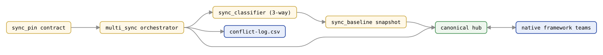

# `multi_sync` — AgentTeamsModule

Multi-framework **pinned sync** orchestrator (multi-framework-pinned-sync plan).

> *Source: `agentteams/multi_sync.py`*

Keeps every agentic interface in sync through the [canonical hub](canonical.md) under one locked model:
only the bootstrap pin's changes reach the hub and project to the other frameworks. A peer's
difference is logged for review and never absorbed, and a conflict is decided in favor of the pin.
(Operator ruling 2026-11-04. A peer's render differs just by being written for that framework, and
absorbing that overwrote the pin's own agent files.)

## Sync topology at a glance

Peer framework teams reconcile through the [canonical hub](canonical.md); `multi_sync` drives the
[three-way classifier](sync-classifier.md) over [baselines](sync-baseline.md), the
[pin](sync-pin.md) is authoritative on conflict, and every decided conflict is logged to
`conflict-log.csv`. Generated deterministically from `scripts/gen_api_cluster_figures.py`.

Builds entirely on shipped primitives — `interop.export_to_cai` / `import_from_cai`,
`canonical.materialize_canonical` / `load_canonical`, [`sync_classifier.classify_sync`](sync-classifier.md), and
[`sync_baseline`](sync-baseline.md) — plus the [pin contract](sync-pin.md) in `sync_pin`.

---

## Reconciliation policy

- **Pin first, authoritatively.** The pin framework's native-moved fields — including conflicts
  and capability fields — are absorbed into canonical (the pin is the trusted source of truth).
- **Peers next, log only.** A peer's `native-moved` field is logged as a proposal, and a capability
  change as withheld. A `both-moved-conflict` keeps canonical and is logged. Nothing is absorbed, and
  projection then replaces the peer's copy; each framework's `.agentteams-backups` keeps it (newest 10).
  Every framework is classified once a pass runs, including uncommitted edits. A peer's edit inside an
  instruction fence is reported in `SyncResult.notices` rather than the log. To spread a peer edit, make it
  in the pin, or restore it to the peer and adopt it with `--absorb-from` before the next sync.
- **Project + rebaseline.** Canonical is projected to every framework and every baseline is
  rewritten from the on-disk result, so the next run never re-absorbs this run's own output.
- **Change detection is commit-to-commit** (operator decision): a framework is "changed" when a
  path under its agents directory moved between the last synced commit and HEAD. A framework's
  own projected-but-uncommitted output therefore never re-triggers a sync.

---

## Public constants

- `CONFLICT_LOG_SUBPATH` (`".agentteams/sync-conflicts.log.csv"`): the durable, append-only,
  human-reviewable conflict log.

## Public types

- `ConflictRecord`: one documented conflict or withheld peer capability change
  (`framework`, `agent`, `field_name`, `classification`, `resolution`, `note`).
- `SyncResult`: outcome of a run (`changed_frameworks`, `projected_frameworks`, `conflicts`,
  `applied_fields`, `dry_run`, `note`, `notices`; property `did_work`). `notices` carries the
  interop notices from projection, such as an instruction file with no mergeable fences that
  was left untouched.

Projection backs up each framework's agents dir, instruction file and skills to
`.agentteams-backups/` first (pruned to the default most-recent N). It keeps unchanged Markdown
agents byte-for-byte and fence-merges existing instruction files (see `import_from_cai`'s
`preserve_existing`). Before projecting, `run_sync` refreshes the hub's instruction fences from
the pin's deployed instruction file through [`sync_hub_refresh`](sync-hub-refresh.md)
(`refresh_hub_binding`; reported in `SyncResult.notices`, preview-only under `dry_run`), so an old hub
doesn't project its own stale fence bodies. The pin wins, so stale values in the pin's file at the same
fence version still spread; that can't be detected. `--sync` and `--sync-init` refuse before writing when
the pin's instruction file is missing or unparseable while the hub has fences, or when another framework
deploys a newer fence than both the pin and the hub (`sync_hub_refresh.pin_instruction_problem`). The
fence-merge also never lowers an existing fence's version: a deployed fence with a higher `v=` is kept and
reported.

## Public functions

### `sync_init`

Bootstrap the pinned sync: export the pin framework to canonical, materialize the hub, project
to every framework in the set, and record all baselines plus the change-detection anchor.
Writes `.agentteams/pin.json`. Raises `ValueError` for an unregistered pin or a pin outside the
sync set.

### `run_sync`

Run one pass: detect changed frameworks from commit diffs, reconcile each (pin first) into
canonical per the policy above, project canonical to all frameworks, rewrite baselines, append
the conflict log, and advance the anchor. Returns early with no writes when nothing changed.
Raises `ValueError` if the project is not pinned.

### `framework_agents_dir`

Return a registered framework's agents directory under a project root.
