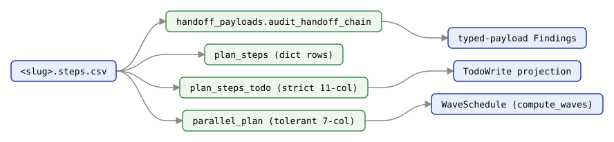

# `plan_steps` — AgentTeamsModule

Tolerant reader for plan `.steps.csv` artifacts.

Plans in `tmp/by-week/<ISO-week>/<slug>.steps.csv` describe sequenced handoffs between agents. Some cells (typically `notes`) contain quoted multi-line text. This module's `read_steps` wraps `csv.DictReader` with the conventions used across the project — quoted multi-line cells preserved, rows without a `step` field skipped, missing cells coerced to empty strings.

Introduced alongside [`handoff_payloads`](handoff_payloads.md) so the chain comparator can operate on dict rows.

> **Sibling readers.** Three modules define a `read_steps`/`PlanStep` pair over related-but-different schemas: this one returns plain **dict rows** keyed by the CSV header; [`plan_steps_todo`](plan-steps-todo.md) parses the Rule 9 runtime schema or the 11-column todo-projection schema into `PlanStep` dataclasses; and [`parallel_plan`](parallel-plan.md) uses a **tolerant 7-column** runtime reader. Pick by which schema your CSV follows.

## Readers at a glance

One `<slug>.steps.csv` feeds three distinct readers — this module's dict rows,
[`plan_steps_todo`](plan-steps-todo.md)'s TodoWrite projection, and [`parallel_plan`](parallel-plan.md)'s
wave schedule — plus [`handoff_payloads`](handoff_payloads.md)'s typed-payload chain check.
Generated deterministically from `scripts/gen_api_cluster_figures.py`.



> *Source: `agentteams/plan_steps.py`*

---

## Functions

### `read_steps(path)`

> *Source: `agentteams/plan_steps.py`*

Read a plan `.steps.csv`. Each returned dict is keyed by the CSV header row; missing values are normalized to empty strings (not `None`).

**Args:**

- `path` (`Path | str`) — Path to a plan `.steps.csv` artifact.

**Returns:** `list[dict[str, str]]` — One dict per data row. Rows whose `step` cell is empty are skipped (this allows trailing blank lines and comment-style header gaps without raising).

**Malformed rows:** if a row has more comma-separated values than the header (typically an unquoted comma or a stray quote inside a hand-edited cell shifting every subsequent column), `read_steps` emits a `UserWarning` naming the file and physical line number, and drops the unassigned overflow rather than leaking it into the returned dict under a `None` key. This is a warning, not an exception — well-formed rows elsewhere in the same file are read normally. Callers that must treat this as fatal can use `warnings.simplefilter("error")` around the call.

**Example:**

```python
from pathlib import Path
from agentteams.plan_steps import read_steps
from agentteams.handoff_payloads import audit_handoff_chain

steps = read_steps(Path("tmp/by-week/2026-W21/my-plan.steps.csv"))
findings = audit_handoff_chain(steps)
for finding in findings:
    print(f"{finding.severity} {finding.code}: {finding.message}")
```

---

### `set_step(path, step, *, status, note, append_note)`

Sets one step's status, its notes, or both, and returns the updated row. It rewrites that row only: every other
byte of the file is kept, including line endings, blank lines, and other rows that are themselves malformed.
(`update_step(path, step, **fields)` does the same for any column, without the status check; `write_steps` replaces
the whole table.) The result is checked before anything is written, and the write is a
rename. Use it, or the `--set` command below, instead of a one-off script that edits the CSV.

It refuses, and leaves the file unchanged, when:

- the status is not one of `pending`, `in_progress`, `done`, `blocked` (compared case-insensitively; the legacy
  `completed` is read by the tools but is not written);
- the step id names no row (`KeyError`) or more than one row (ids are compared with surrounding spaces ignored);
- the step's row has more cells than the header, which is what an unquoted comma produces;
- nothing is given to set, both `note` and `append_note` are given, or the appended note is empty;
- the header repeats a column, or lacks the column being set (`status`, or `notes` for a note).

`note` replaces the step's notes. `append_note` adds to them after `"; "`.

---

### `validate(path)`

Checks a steps CSV against the Rule 9 contract and returns `(errors, warnings)`.

- **Errors**, only when the file is unusable: no `step` column and no legacy `step_id` either.
- **Warnings**, under warn-first:
  - a missing required column (`step,agent,action,inputs,outputs,status,notes`);
  - a duplicate `step` id;
  - a `depends_on` id that names no row;
  - a status outside `pending|in_progress|done|blocked`, compared case-insensitively (`completed` is accepted,
    without a warning, as the legacy synonym of `done`);
  - a row with no inputs and no outputs;
  - a row wider than the header;
  - an empty file, or the legacy `step_id` schema.

CLI (`main(argv)`): `python -m agentteams.plan_steps --check STEPS.csv [...]` prints `ERROR`/`WARNING` lines and exits 1 only on an
error. Workflow 11 Part A runs it on the session's steps CSVs.

`python -m agentteams.plan_steps --set STEPS.csv STEP [--status S] [--note TEXT | --append-note TEXT]` updates one
step through `set_step`. It prints `OK <file>: step <id> status=<status>` and exits 0, or prints an `ERROR` line and
exits 1 when the update is refused. `--check` and `--set` cannot be combined. A step id that begins with `-`
followed by a letter cannot be given on the command line on every Python version; call `set_step` for those.

### `runnable(steps)`

The steps still to schedule, returned as `(remaining, waiting, warnings)`. `parallel_plan` uses this by default.

- A `done` row (or `completed`) is dropped and counts as a satisfied predecessor.
- A `blocked` or `in_progress` row is held: it is not scheduled (a running step is never dispatched twice), and
  neither is any step that depends on one, directly or transitively. Such a step is *waiting*
  (`waiting[step] = held step`; a held step maps to itself).
- A row with an unknown status is kept, scheduled as pending, and reported.

## See Also

- [`handoff_payloads`](handoff_payloads.md) — typed handoff substrate that consumes the rows returned here.
