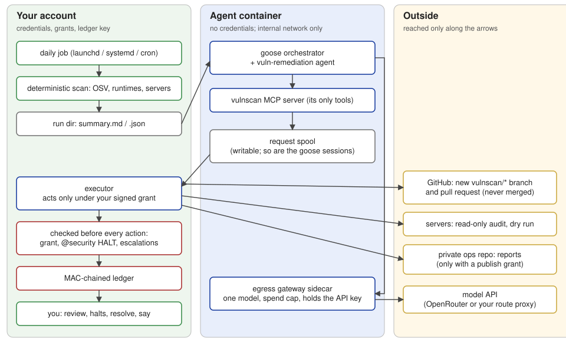

# `vulnscan` — AgentTeamsModule

Daily vulnerability scanning and **agent-driven remediation** of your repositories and servers,
with every action performed by an executor under grants you sign.

> *Source: `agentteams/vulnscan/` (run it as `python -m agentteams.vulnscan`)*

This page is the reference. To set it up step by step, follow the
**[automation walkthrough](../vulnscan-automation-walkthrough.md)**; for day-to-day use, see the
**[user guide](../vulnerability-remediation-guide.md)**.

**Contents:** [Architecture](#architecture) ·
[What leaves your machine](#what-leaves-your-machine) · [Files](#files-and-locations) ·
[Configuration](#configuration-vulnscanjson) · [Commands](#command-reference) ·
[Exit codes](#exit-codes) · [JSON output](#json-output) · [MCP tools](#the-agents-interface-mcp-tools) · [Grants](#grants) ·
[Escalations](#escalations) · [Ledger](#ledger-rows) · [Notifications](#notifications) ·
[Python API](#python-api) · [Known gaps](#limits-and-known-gaps)



---

## Architecture

Agent mode splits remediation across three trust zones. The agents decide; only the executor acts,
and only within what you signed.

| Component | Module | Runs where | Holds | Can do |
|---|---|---|---|---|
| Deterministic scan | `engine`, `osv`, `runtimes`, `daily` | your account | nothing secret | read lockfiles, query OSV.dev and release feeds, audit servers over ssh (read-only) |
| Agent team (goose orchestrator + `vuln-remediation`) | your generated team | Docker container on an internal-only network | a dummy model key | read today's scan; write requests into the spool |
| `vulnscan` MCP server | `mcp` | inside the agent container | nothing | the agents' tools: read the scan, `request`, `escalate`, `submit_report` |
| Egress gateway | `gateway` | sidecar container | the model API key(s) (read-only mounts) | relay the configured dialect routes (chat; Anthropic Messages and OpenAI Responses when enabled) for the allowed models only, deny by default; refuse requests carrying secrets and redact lesser identifying data (DLP); enforce the spend cap and a token cap on every run and debrief (`--max-tokens-total`, from `agent.max_tokens_total` or `agent.debrief_max_tokens`) |
| Executor | `executor` | your account | git, `gh` and ssh credentials; the signed grants | perform a request only under a grant, after the HALT and escalation checks |
| Ledger | `ledger` | your account | the MAC key, never mounted into a container | record every decision; the review trusts nothing else |
| Operator CLI | `operator_cli`, `review`, `grant`, `publish` | your terminal | your Ed25519 signing key (read only while signing) | review, resolve, leave notes, sign grants |

**Invariants the code enforces:**

- The agent container mounts no credentials. Its only writable mounts are the request spool and its
  own goose session directory (plus tmpfs `/tmp` and home). The run directory is mounted read-only at
  `/work/run`; `/work/run/gateway` and `/work/run/debrief` are masked by an empty read-only tmpfs
  (`agent_run.MASKED_RUN_DIRS`), so the agent never sees the gateway's or a debrief's files (the DLP
  host-name list, the acknowledgements and `spend.json` among them). The launcher creates both directories on
  the host before `docker run`, because Docker cannot create a mountpoint inside a read-only bind mount. Agent
  mode refuses to start until `agent-selftest` has passed for the current image.
- A request is executed only when a valid, unexpired, operator-signed grant covers the exact
  operation, target and remaining use count; no `@security` HALT is open on `vulnscan-remediation`
  in the decision log named **inside the grant**; and no open escalation blocks the target.
- The executor computes every change itself. `stage-fix` may only raise dependency pins and change
  lockfiles within the rules of [`validate_diff`](#validate_diffwt-base). Before any fetch it
  refuses a repository that git refuses to open (ledgered `refused`), or whose own git config
  defines a filter driver (ledgered `failed`) (`fix.git_config_problem`). The one exception is git-lfs's standard
  filter config, value for value (`fix.LFS_FILTER`: `filter.lfs.clean = git-lfs clean -- %f`, `smudge = git-lfs
  smudge -- %f`, `process = git-lfs filter-process`), when git-lfs is available (the tools image installs it) and no
  refused git-lfs setting is present (`fix.LFS_REFUSED_KEYS`: `lfs.extension.*`, any `lfs.customtransfer.*`, a key
  ending `standalonetransferagent`, `lfs.storage`; "the repository's git-lfs config names a program or a storage
  path"). The executor's git sets `GIT_LFS_SKIP_SMUDGE=1`, so a checkout writes LFS pointer files and downloads
  nothing, and `stage-fix` refuses a change to any path with a `filter` attribute ("has filter=..."), whose commit
  would hold the filter's output instead of the checked bytes. A conditional include (`includeIf.*`,
  `fix.CONDITIONAL_INCLUDE`; "the repository's git config has a conditional include (includeIf)") is refused too:
  its condition is evaluated where git runs, so `gitdir:**/worktrees/**` or `onbranch:vulnscan/**` could add a
  driver only in the executor's worktree. A plain `include.path` is allowed; what it adds is checked like the rest.
  `stage-fix` creates its worktree with `--no-checkout` and repeats the check inside it before checking files out.
  A config query git fails is a refusal ("git cannot read this repository's config"). An `include.path` target
  outside the repository (e.g. `~/.gitconfig`) is read as it is at each check. `open-pr` pushes a **new** `vulnscan/*` branch to `origin` and opens the pull request
  on that same repository (`--repo HOST/OWNER/REPO` from `origin`'s URL; an `origin` not of that form
  fails before anything is pushed), never merging and never force-pushing. It is idempotent
  ([`open_pr`](#open_prrepo-rationale)).
  Server operations are the read-only audit and the dry run.
- A ledger row is written before (`begun`) and after (`done`, `failed`) every granted action. A
  ledger that fails verification refuses everything.
- Notifications carry fixed text only (ids, counts, known words).

### One daily run

`daily.run_daily` takes the daily run lock (`<state>/daily.lock`) first. While another daily run
holds it, the second run writes nothing, prints why on stderr and exits 3. Then it checks Docker once
(`docker_readiness.ensure(cfg, start=True)`: it starts Docker only when `docker.autostart` is true, and re-runs a
self-test only when its record is for another image); the server audits, the staging, the remediation readiness
section and the agent phase use that record instead of probing again, and `summary.json` records it as
`remediation.docker`. Then it runs these steps:

1. **Scan** every `repo_roots` entry, this machine's runtimes and every `servers` host
   (`daily._collect`). Server audits run the **packaged** server-kit scripts with your
   `hosts.conf`, `apps.conf` and extra `ioc-*.txt` files from the server-kit directory.
2. **Summarise:** write `summary.md`, `summary.json` and the heartbeat (atomically); send `run-done`
   when the run exits non-zero or finds new findings (`daily._finish`). NEW marks compare with the
   newest readable earlier `summary.json`; an unreadable one is skipped with a note in `summary.md`.
   A write that fails (disk full) makes the run exit 3 (4 on compromise indicators), and `run-done`
   is still sent. `summary.md` ends with a **Remediation effectiveness** section
   (`effectiveness.section`, counts only, since the summary is published): findings fixed and new since
   the previous run, the remediation PRs the executor opened (open, the oldest one's age, open longer
   than 3 days, failing CI, no CI checks, merged in the last 7 days), fixes staged with no PR yet, PRs ready
   to merge (open, mergeable, every check passed),
   repositories held by the futile-retry guard, and, on a row of its own, findings already fixed upstream
   (`fixed_upstream`, never counted as fixed). PR state comes from read-only `gh pr view` calls on the
   PR URLs in the ledger (the newest 50); a failed lookup is counted as unknown. Then `stale-prs` is sent
   when any open remediation PR is older than 3 days or fails CI. These counts are taken before the
   agent phase, so the next run reflects what the agent did. The same lookups write the run's
   **merge digest**, `merge-digest.sh` (0700, machine-local, never published; `merge_digest`): one block
   per open remediation PR that GitHub reports mergeable with every check passed. Each block asks before
   `gh pr merge <n> --repo <host/owner/repo> --merge --match-head-commit <sha>`. You run it with your own
   credentials; it is not a grant use (the grant op `merge` stays reserved). It is built only from the
   validated repository, PR number and 40-hex head SHA, each `shlex`-quoted, so no PR title or branch text
   reaches it.
3. **Only when `agent.enabled`**, and only when step 2 wrote the summary and the heartbeat (a failed
   write skips the agent phase):
   1. **Agent run** (`agent_run.run_agent`): take the run lock (when another run or a debrief holds
      it: `not-run`, and nothing in the run directory is written); then refuse (`not-run`) on the
      first failing check (after moving an earlier run's record aside, see `run_records`), in this order: `team_dir` and `key_file` are set, docker is installed, a
      passing self-test exists for this image and these container flags, `team_dir` passes its
      checks, the run limits are valid. Then set aside requests left over from an
      earlier run (`executor.quarantine_pending`); fold your notes into the task (`notes-folded`
      row); start the gateway, then the agent container. Every 15 s the executor serves the agents'
      requests (`executor.serve_requests`): at most 200 per pass, escalations first, then the
      report, then granted operations. Before a granted op's first request of a pass, and after any
      refusal of one, a batch preflight (`executor.batch_block`) checks the tools container and that
      a valid grant with uses left allows the op; when either fails, the op's remaining requests in
      that pass are not attempted (one `refused` ledger row counts them). At the time cap the container is removed; the last requests
      are served; the run's own report is finalized with the run state. A run that would end
      `completed` without a report of its own ends `agent-error` (the reason quotes the
      transcript's last error line). A SIGTERM (launchd unload,
      logout) removes both containers, records `agent-error` and exits 143.
   2. Append the agent run's state to `summary.md`.
   3. **Publish** the report, review and summary when a publish grant is active
      (`daily.publish_run`).
   4. Send `agent-not-completed` unless the run completed, and `agent-down` when it is the second
      (or later) run in a row that did not complete (`effectiveness.agent_streak`).

### What leaves your machine

| Destination | What | Controls |
|---|---|---|
| OSV.dev, PyPI, nodejs.org, www.php.net, endoflife.date | package names and versions; runtime versions; with `unpinned_ranges` on, the names (no versions) of unpinned direct Python requirements, to OSV.dev only | HTTPS to those hosts only, no redirects |
| The npm registry (`stage-fix` in a repository with `package-lock.json`) | the lockfile's dependency tree, through `npm audit fix --package-lock-only` | npm runs in the [tools container](#subprocess-confinement-tools-container), whose egress proxy allows only `registry.npmjs.org:443`. npm runs on a scratch copy holding only `package.json` and the lockfile, with empty user and global npm config, the public registry, `--strict-ssl=true` and `--ignore-scripts`; the repository's `.npmrc` is never read. npm workspaces fail closed (npm errors, nothing is staged) |
| The model API (through the gateway) | everything the agents read and write: the scan summary and findings, repository paths, host names, fix plans, executor results, your notes | one route, one model; a DLP filter refuses requests carrying secrets or keys and redacts home paths, email addresses, private IP addresses and the host names and private package names the gateway is given ([DLP](#agentteamsvulnscangateway)). It bounds, never closes, exfiltration through the model endpoint: choose an `upstream` and model provider you trust with the rest |
| GitHub (`open-pr`) | the fix branch and a pull request body with the fix plan and the agent's rationale (sanitised, quoted) | only to `origin` of a repository a grant covers |
| Your servers | the server-kit scripts, streamed over ssh (`remote.sh` streams only `L1-audit.sh` to `L5-containers.sh`) | ssh runs in the [tools container](#subprocess-confinement-tools-container) with only the target's known_hosts lines and named identity files, and an egress proxy allowing only the first hop. exact `hosts.conf` names a grant covers; audit and dry run only. The audit (which the agent then reads) never reads process environments, unit files, journals or `.env` contents and shows each service by its executable path only, so service arguments and inline secrets never reach its output. Only a hand-run `L1-audit.sh --deep` reads process environments, and nothing in vulnscan passes it |
| Your private ops repo (publish grant) | the run's report, review and summary | agent text fenced; home paths, hostname and private IPs scrubbed; content scan; preflight |

**The spend cap** counts the `usage.cost` the upstream reports with each response, after the
response (on the Messages and Responses routes: else the operator's price table, else the reply is
unmetered). Upstream calls are serialised, so at most one call is in flight. On the chat route the
one that crosses a cap can overshoot it; Messages and Responses calls are reserved first (input
estimate plus output ceiling), so they cannot. Two backstops do not depend on reported
cost: a run token cap (`max_tokens_total`), and a refusal after `max_unmetered_calls` replies that
carry no usable usage (unless `allow_unmetered`). `spend.json` records the unmetered count and is
written atomically (a temporary file, then a rename). The gateway asks the upstream to include
usage on every call; OpenRouter does. The gateway refuses to start (exit 2) unless `--budget-usd`
is finite and ≥ 0, `--max-tokens-total` is ≥ 0 (0: no token cap), `--listen` is `HOST:PORT` and
`--upstream` is an http(s) URL; a non-numeric `Content-Length` gets HTTP 400.

---

## Files and locations

Everything is per user. Nothing is written into a repository except the executor's `vulnscan/*`
branches and, with a publish grant, the ops repository's `reports` branch. Teams generated by
agentteams protect `~/.config/agentteams` from their agents: a sandbox write root may not reach it,
and the emitted `Edit(...)` rules deny it to the editing tools. These protections cover the default
location only; if you move the config with `AGENTTEAMS_VULNSCAN_CONFIG_DIR`, `XDG_CONFIG_HOME` or
`AGENTTEAMS_SERVER_KIT_DIR`, protect that path yourself. Treat `hosts.conf` as code: its ssh target
field is passed to `ssh`, so an option such as `-oProxyCommand=…` runs a local command.

| What | Default path | Notes |
|---|---|---|
| Config | `~/.config/agentteams/vulnscan.json` | `$XDG_CONFIG_HOME` honoured; `AGENTTEAMS_VULNSCAN_CONFIG_DIR` |
| Project registry | `~/.config/agentteams/projects.json` | mode 600; written only by `vulnscan enroll` (never on CI, never by builds, `--update` or fleet runs). See [Project registry](#project-registry) |
| Server kit, `hosts.conf`, `apps.conf` | `~/.config/agentteams/server-kit/` | `AGENTTEAMS_SERVER_KIT_DIR` |
| Remediation grants | `~/.config/agentteams/vulnscan-grants/vg-*.json` | mode 600; each file must be a regular file you own, not group/world-writable, not a symlink. The directory must be a real directory (not a symlink) you own, not group/world-writable, or every grant is refused |
| Publish grants | `~/.config/agentteams/vulnscan-publish-grants/vp-*.json` | as for remediation grants |
| Operator notes | `~/.config/agentteams/vulnscan-notes/note-*.json` | directory must be yours and not group/world-writable |
| Operator verify keys (public) | `~/.config/agentteams/verify-keys/<key-id>.pub.pem` | the directory and the file must be yours, not group/world-writable and not symlinks |
| Operator signing key (private) | `~/.config/agentteams/keys/decision-signing-<key-id>.pem` | as written by `provision-operator-signing-key.sh`; named by `AGENTTEAMS_DECISION_ED25519_KEYFILE` |
| Ledger MAC key, high-water mark | `~/.config/agentteams/keys/vulnscan-ledger.key`, `vulnscan-ledger.hwm` | never mounted into a container |
| State | `~/.local/state/agentteams/vulnscan/` | `$XDG_STATE_HOME` honoured; `AGENTTEAMS_VULNSCAN_STATE_DIR` |
| Ledger | `<state>/ledger.jsonl` | append-only, MAC-chained |
| Server fix plans | `<state>/server-plans/<YYYY-MM-DD>/server-fixplan-<host>.md` | outside the run directory the agent container mounts ([server_fixplan](#agentteamsvulnscanserver_fixplan)) |
| Heartbeat | `<state>/heartbeat.json` | read by the stale-run warning; written atomically. Also records `agentteams_version` and `remediation_blocked` (the number of [readiness](#agentteamsvulnscanremediation_status) blockers) |
| Daily run lock | `<state>/daily.lock` | held for a whole daily run; a second run exits 3 |
| Run directory | `<state>/<YYYY-MM-DD>/` | `summary.md`, `summary.json` (a same-day re-run first copies them to `summary.<HHMMSS>.{json,md}`, the time the earlier one was written; only `summary.json` is read back), `infra-retry.count` (catch-up retries), `fixplan-*.md`, `agent/` (earlier agent runs of the day under `agent/runs/<run id>/`), `agent-report/`, `gateway/` |
| Request spool | `<state>/spool/requests/`, `results/`, `processed/` | the only path the agents write besides their sessions |
| Staged fixes | `<state>/worktrees/<repo>-<8 hex>-<YYYYmmddHHMMSS>-<6 hex>/` (repository name, a hash of its path, the UTC time, a random suffix) | executor-owned worktrees; removed once `open-pr` has a pull request (the branch is kept) |
| Run lock | `<state>/agent.lock` | held for a whole agent run or debrief |
| Self-test record | `<state>/agent-selftest.json` | tied to the image id |
| Tools self-test record | `<state>/tools-selftest.json` | tied to the tools image id and container flags (`subproc_confine.flags_sha256`) |

---

## Configuration: `vulnscan.json`

`init` writes the file; `daily.load_config` fills any missing key from the defaults below, then
checks each key's type and range. A file that is not a JSON object, or a key with a wrong value, is
refused with a message naming the file and the key (`config ... is unusable: ...: fail_on must be
one of ...`), and every command that reads the config exits 2.

Every `agent.*` key is checked at load too (`agent_run.validate_agent`), not only `agent.enabled`
(a bool):

- `team_dir`, `key_file`, `image`: strings, empty allowed (paths are checked against the filesystem
  only before a mount, by `team_dir_problem`);
- `model`, `framework`: non-empty strings; `framework` one of `goose`, `claude`, `copilot`, `codex`,
  `grok` whose runtime driver is in this release (`goose`, `claude`, `copilot` and `codex` now; `grok` is
  refused with `agent.framework grok: driver not available in this release`);
- model rules (plan revision 13, decision D2: each dialect is passed through to an upstream that speaks
  it, never translated): with `framework: claude`, or `copilot` with `copilot_provider_type: anthropic`,
  `model` and every `models` entry must be an Anthropic model id (`claude-...`, or OpenRouter's
  `anthropic/...`), and an `upstream_messages` of `api.anthropic.com` needs `prices` (or
  `allow_unmetered`); with `framework: codex`, an OpenAI model id (`gpt-...`, `o1`/`o3`/`o4`...,
  `codex-...`, or OpenRouter's `openai/...`), and an `upstream_responses` of `api.openai.com` needs `prices`
  (or `allow_unmetered`); goose and copilot (default `openai` provider type) keep any OpenRouter model over
  chat completions;
- `framework: codex` also needs `accept_residual_tools` to contain `apply_patch` (decision D4: Codex keeps
  one built-in tool no switch removes; its writes are rejected by the read-only sandbox, which the
  self-test proves); `framework: copilot` needs `recipe` (if set) to be `.github/agents/<name>.agent.md`;
- `upstream_messages`, `upstream_responses`: empty or an `http://` / `https://` URL with a host;
  `key_file_messages`, `key_file_responses`, `prices`: strings; `models`: a list of model ids;
  `anthropic_betas`: `null` or a list of beta names; `copilot_provider_type`: `openai` or `anthropic`;
  `accept_residual_tools`: a list of tool names; `max_output_tokens`: an integer 1–128 000; `max_turns`: an
  integer 1–1000; `reasoning`: `null`, or (chat route only) an object with exactly one of `effort`
  (`minimal`, `low`, `medium`, `high`), `max_tokens` (an integer below `max_output_tokens`) or
  `enabled: false`, plus an optional boolean `exclude`;
- `recipe`: a string (empty: the driver's agent definition);
- `upstream`: an `http://` or `https://` URL with a host;
- `command`: a list of strings (empty: the driver's command);
- as in `run_limits`: `budget_usd` a number > 0 and ≤ 1000, `max_minutes` > 0 and ≤ 1440 (no
  booleans, strings, `null`, NaN or infinity); `max_tokens_total` an integer 1–100 000 000;
  `max_unmetered_calls` an integer ≥ 1;
- `debrief_budget_usd`, `debrief_max_minutes`: as in [`debrief_limits`](#debrief_limitsa);
  `debrief_max_tokens`: as in [`debrief_max_tokens`](#debrief_max_tokensa);
- `allow_unmetered`: a bool.

| Key | Default | Meaning |
|---|---|---|
| `repo_roots` | `[]` | Directories whose git repositories are scanned, besides the enrolled projects of the [registry](#project-registry) |
| `exclude` | `[]` | Paths never scanned: a root (explicit or enrolled) inside one is skipped; findings of repositories in one inside a scanned root are dropped from the report (their manifests are still read) |
| `include_worktrees` | `false` | Also scan linked git worktrees |
| `servers` | `[]` | `hosts.conf` names audited each day |
| `fail_on` | `"high"` | Lowest severity that makes the run exit 1 |
| `unscored_as` | `"high"` | What an advisory with neither a CVSS vector nor a severity label counts as: `critical`, `high`, `moderate` or `low` ([Severity](#severity)). Such findings are marked UNSCORED and listed separately |
| `include_dev` | `false` | Dev-only dependencies count toward `fail_on` |
| `cooldown_days` | `0` | Ignored: every fix release the scanner adopts remediates a vulnerability the scan detected, which Rule S-10's remediation carve-out exempts from the release cooldown. A configured value prints a note; remove the key |
| `local_runtimes` | `true` | Check the runtimes in `runtimes.PRODUCTS` found on this machine |
| `fix_mode` | `"plan"` | `plan` writes a fix plan per git repository with fixable findings, `fixplan-<name>-<8 hex of its path>.md`, naming the repository as the `stage-fix` target (a `repo_roots` folder holding several repositories gets one plan each; a nested repository is left out of its parent's plan; a nested clone whose `origin` owner differs from the enclosing repository's, such as a local checkout of a third-party tool, gets a plan with no target that says to update or remove it locally, since a PR would go to the upstream project; see `daily.foreign_clone`); `apply-worktree` stages fixes in a worktree per repo (without agents), off `origin/HEAD` (nothing is staged without it), with no release-age cooldown (`executor.REMEDIATION_COOLDOWN_DAYS` is 0: Rule S-10's remediation carve-out). The result must pass [`validate_diff`](#validate_diffwt-base) or the worktree is removed; a same-day worktree is reused only when it is a worktree of that repository on its `vulnscan/<date>` branch with no other commits or changes |
| `allow_major` | `false` | Allow major-version upgrades in fix plans |
| `scan_workers` | `4` | How many scan roots, and then how many fix plans, are looked up at once (1–8; `1` = one after another; each scan already sends up to 8 OSV requests at once). The lookups are network-bound (OSV, the package registries); results are merged in root order, so the report and the fix plans do not depend on it. Each worker runs in a copy of the caller's context, so a confinement scope applies as it would serially. `apply-worktree` staging, servers and local runtimes stay serial |
| `notify` | `"desktop"` | `none`, `desktop`, or `command:<program and args>` (the program gets the fixed message as its last argument) |
| `schedule` | `{"hour": 7, "minute": 30}` | When `schedule install` runs the job |
| `stale_after_hours` | `26` | Age after which commands (`daily` and `schedule status` included) warn that no daily run completed, and after which `daily --catch-up` runs the missed scan |
| `governance_dir` | `""` | Used only by `halts`, to find a decision log when no grant names one. The executor uses the directory **signed into the grant** |
| `handoff_required` | `false` | `true` puts every repository under handoff delivery: `open-pr` waits for the repository orchestrator's `approve-staged` verdict ([handoff](#agentteamsvulnscanhandoff)). A project's brief can ask for it alone with `vulnerability_scanning.delivery: handoff` |
| `agent` | see below | Agent mode |
| `confine` | `{}` | The tools container for git, npm and the server kit in executor ops and `apply-worktree` staging ([Subprocess confinement](#subprocess-confinement-tools-container)); `{}` takes the defaults below |
| `catch_up` | `{"max_retries_per_day": 2}` | `daily --catch-up` also re-runs today's run when it exited 3 because of Docker (an `infra.*` code in `summary.json["infra_codes"]` or `remediation.docker`) and Docker is ready now, at most `max_retries_per_day` times per date (0–10; counted in the run directory's `infra-retry.count`) ([`catch_up_due`](#dailycatch_up_duecfg-dailycatch_upcfg)) |
| `docker` | `{"autostart": false, "start_timeout_s": 240, "auto_selftest": "on-change"}` | Docker readiness, checked once before each scan ([`docker_readiness`](#agentteamsvulnscandocker_readiness)); a partial block is merged over these defaults (table below) |

The `agent` block (merged over these defaults by `agent_run.agent_cfg`):

| Key | Default | Meaning |
|---|---|---|
| `enabled` | `false` | Run the agent team after the daily scan |
| `framework` | `"goose"` | Selects the runtime driver ([`agent_drivers`](#agentteamsvulnscanagent_drivers)): the CLI the image installs, its env, command, state dir, self-test checks and debrief. `goose`, `claude` (Claude Code), `copilot` (GitHub Copilot CLI, bring-your-own-key, offline) and `codex` (Codex CLI) have drivers in this release |
| `team_dir` | `""` | Root of the generated goose team's project (it contains `.goose/recipes/`). Required by agent runs, `agent-selftest` and `agent-chat`. Must be an existing directory you own, not group/world-writable; not home, an ancestor of home, or at, inside or above `~/.config/agentteams`, the vulnscan config or state directory, or a credential directory (so at, inside or above `~/.config/agentteams/keys` is always refused); and must not contain `key_file`, nor the operator signing key when `AGENTTEAMS_DECISION_ED25519_KEYFILE` is set (a key kept elsewhere is checked only then) |
| `recipe` | `""` | Agent definition the container runs, relative to `team_dir`. claude and codex: passed by its absolute path under the read-only team mount; copilot and goose: a checked copy in `<run>/agentdef` is passed instead ([`agent_recipe`](#agentteamsvulnscanagent_recipe)). Empty means the driver's (goose: `.goose/recipes/vuln-remediation.yaml`, whose prompt must carry the `task` parameter, copied to `/work/run/agentdef/recipe.yaml`, its top-level keys and `extensions` checked (R7); the generated orchestrator's opens with a role check, so a one-shot run of it stops after answering that; claude: `.claude/agents/vuln-remediation.md`; copilot: `.github/agents/vuln-remediation.agent.md`, copied to `/work/run/agentdef/.github/agents/vuln-remediation.agent.md` (`--agent=vuln-remediation --add-dir=/work/run/agentdef`); it must be a custom agent file `.github/agents/<name>.agent.md`; codex: `.codex/agents/vuln-remediation.toml`, given as `model_instructions_file`) |
| `model` | `"z-ai/glm-5.3"` | The one model the gateway allows (an OpenRouter model id) |
| `upstream` | `"http://host.docker.internal:8791"` | Where the gateway sends requests. Without a local route proxy, use `"https://openrouter.ai"` |
| `key_file` | `""` | File holding `OPENROUTER_API_KEY=...` (or the bare key). Mounted read-only into the gateway only |
| `budget_usd` | `2.0` | Spend cap per run (see [What leaves your machine](#what-leaves-your-machine)) |
| `max_tokens_total` | `10000000` | Prompt + completion token cap per run, independent of reported cost (integer 1–100 000 000) |
| `max_unmetered_calls` | `20` | The gateway refuses after this many successful replies without usable (non-zero) usage or cost (integer ≥ 1). Upstream errors (4xx/5xx replies, and calls that got no reply: DNS failure, connection refused, timeout) are counted separately (`upstream_errors` in `spend.json`) and do not count here |
| `allow_unmetered` | `false` | Accept replies without usage (then only the token cap, if usage has tokens, and the time cap bound a run) |
| `max_minutes` | `45` | Time cap per run; the container is removed at the cap |
| `image` | `""` | Image tag; default `agentteams-vulnscan-agent:<agentteams version>` for goose, `agentteams-vulnscan-agent-<framework>:<agentteams version>` for another framework |
| `command` | `[]` | Empty: the driver's command (goose: `goose run --recipe {recipe} --name {session} --with-extension "python -m agentteams.vulnscan.mcp" --params task={task}`). **Advanced:** a list overrides it, with `{recipe}`, `{session}`, `{task}` and `{run_id}` substituted; the override is part of `flags_sha256`, so it needs a fresh self-test. A goose override may not name `/work/team`: that would hand goose the team's recipe instead of the checked copy `{recipe}` names (R7). `claude`, `copilot` and `codex` refuse every override (their lockdown is the command) |
| `dlp_skip_ok` | `[]` | Secrets files the gateway's DLP check may skip, as `{"path": ..., "sha256": ...}` objects (`sha256`: 64 lower-case hex of the file's bytes, e.g. from `shasum -a 256`). The secrets directory is mounted whole into the gateway; a run ends `not-run` when the directory exists but cannot be read, or holds a `*.env` file the gateway cannot use (unreadable, not UTF-8, not a regular file, a symlink out of the directory) that no entry acknowledges. An entry covers that one file version only: editing the file makes it stop matching. `review` lists the entries; the paths appear only on the terminal |
| `debrief_budget_usd` | `0.5` | Spend cap for `agent-chat` |
| `debrief_max_minutes` | `20` | Time cap for `agent-chat` |
| `debrief_max_tokens` | `400000` | Prompt + completion token cap for `agent-chat` (integer 1–100 000 000) |

Keys for runtimes on another gateway dialect, and for copilot and codex
([`agent_upstreams`](#agentteamsvulnscanagent_upstreams); goose ignores them, and its gateway command is
unchanged):

| Key | Default | Meaning |
|---|---|---|
| `upstream_messages` | `""` (`https://openrouter.ai/api/v1`) | Anthropic Messages API base the gateway forwards `claude` to: OpenRouter's Anthropic-compatible route, or `https://api.anthropic.com/v1` |
| `key_file_messages` | `""` | That upstream's key file (mounted into the gateway only). Empty: `~/.config/agentteams-secrets/anthropic.env` (`ANTHROPIC_API_KEY=...`) for `api.anthropic.com`, else `key_file` (`OPENROUTER_API_KEY=...`) |
| `models` | `[]` | Further model ids the gateway allows besides `model`. Claude Code's helper models are pinned to `model`, so this is normally empty |
| `prices` | `""` | Price table file ([format](#agentteamsvulnscangateway)) for upstreams that report no `usage.cost`. **Required for `api.anthropic.com`** (else every reply is unmetered and the run stops after `max_unmetered_calls`); also check whether OpenRouter's Messages route reports `cost` in your acceptance run (`unmetered` in `spend.json`) |
| `anthropic_betas` | `null` | `anthropic-beta` values the gateway's Messages route allows; `null`: `claude-code-20250219`, `interleaved-thinking-2025-05-14`, `effort-2025-11-24`, `context-1m-2025-08-07` (header-only capabilities Claude Code still sends with experimental betas off). A refused value shows in `spend.json` `refusal_reasons` |
| `max_output_tokens` | `32000` | The gateway's output ceiling (`--max-output-tokens`) and the CLI's own output setting (Claude Code's `CLAUDE_CODE_MAX_OUTPUT_TOKENS`, Copilot's `COPILOT_PROVIDER_MAX_OUTPUT_TOKENS`), kept equal so every call fits; for codex, which sends no output ceiling, also the per-call reservation (`--responses-reserve-tokens`) |
| `max_turns` | `100` | Claude Code's `--max-turns` |
| `upstream_responses` | `""` (`https://openrouter.ai/api/v1`) | OpenAI Responses API base the gateway forwards `codex` to: OpenRouter's Responses route (verify it in your acceptance run: tool calls, and whether it reports `cost`), or `https://api.openai.com/v1` |
| `key_file_responses` | `""` | That upstream's key file (gateway only). Empty: `~/.config/agentteams-secrets/openai.env` (`OPENAI_API_KEY=...`) for `api.openai.com`, else `key_file` |
| `copilot_provider_type` | `"openai"` | copilot's BYOK provider type: `openai` (chat completions through the chat route, `upstream`/`key_file`, any OpenRouter model) or `anthropic` (Messages through the Messages route, `upstream_messages`, Claude models only) |
| `accept_residual_tools` | `[]` | Built-in tools you accept although no switch removes them (decision D4). codex requires `["apply_patch"]`; its writes are rejected by the read-only sandbox, which the self-test checks (`codex_residual_write_blocked`) |
| `reasoning` | `null` | Chat route only (goose; copilot with the `openai` provider type): an OpenRouter `reasoning` object, e.g. `{"effort": "low"}`, that the gateway writes into every request (`--chat-reasoning`), replacing the client's `reasoning` / `reasoning_effort` / `include_reasoning`. Set it when the model spends its whole output on reasoning and never reaches a tool call: the run ends `agent-error` with the reason "the model's reply reached its output-token limit". How a model maps `effort` or `max_tokens` is up to OpenRouter and the provider; `{"enabled": false}` turns reasoning off where the model allows it. The self-test fingerprint is unchanged by this setting |

The `confine` block (`subproc_confine.settings`; any other key, or a wrong type, is refused at load):

| Key | Default | Meaning |
|---|---|---|
| `subprocesses` | `true` (unset) | Run git, npm and the server kit in the tools container, failing closed. `false` is the operator's opt-out: they run on the host as before, with a warning on stderr and at the top of every `review` |
| `image` | `""` | Tools image tag; default `agentteams-vulnscan-tools:<agentteams version>` |
| `ssh_identity` | `""` | Private key a confined server-kit run uses; empty: the `IdentityFile` entries `ssh -G` reports for the target |

The `docker` block (`docker_readiness.settings`; any other key, or a wrong type, is refused at load):

| Key | Default | Meaning |
|---|---|---|
| `autostart` | `false` | `true` lets the daily run (and `ready --ensure`) start Docker when its daemon does not answer: `open -g -a Docker` on macOS (only in a GUI login session), `systemctl --user start docker-desktop` (else `docker`, rootless) on Linux; never sudo. Off by default, so a generated team never launches an app unless its operator opts in |
| `start_timeout_s` | `240` | How long to wait for a started daemon to answer (1–1800 seconds, polled every 5 s) |
| `auto_selftest` | `"on-change"` | `on-change` re-runs `tools-selftest` / `agent-selftest` when the recorded result is for another image (or, for the tools container, other container flags): once per image change, never again for an image whose self-test already failed. `off` only reports the stale record (`infra.selftest`) |

---

## Supported manifests

`manifests.discover(root)` lists, and `manifests.parse(path)` reads:

| Ecosystem | Files | Notes |
|---|---|---|
| PyPI | `requirements*.txt`, also with a prefix ending in `-`, `_` or `.` such as `ci-requirements.txt` (`REQ_NAME`) | `==` pins; the only requirements files a staged fix edits (`check_pin_edit`) |
| PyPI | `requirements*.lock`, `requirements*.in` (`REQ_SCAN_NAME`) | `==` pins, scanned only, never edited; a `.in` with loose specs is unscannable |
| PyPI | `poetry.lock`, `uv.lock`, `Pipfile.lock` | |
| PyPI | `pyproject.toml` next to requirements files (no lockfile) | PEP 621 `[project].dependencies` and `optional-dependencies` `==` pins (groups named like dev/test/lint/doc/type are dev). A pin a requirements file alongside already lists (PEP 503 name and version) is not counted twice; loose entries no requirements file pins make it unscannable for that part |
| PyPI | `pyproject.toml` alone (no lockfile, no requirements) | unscannable: "pyproject.toml without a lockfile" |
| npm | `package-lock.json`, `npm-shrinkwrap.json` (v1–v3), `yarn.lock` | `package.json` without a lockfile is unscannable (not listed next to a `pnpm-lock.yaml` or `bun.lock`) |
| npm | `pnpm-lock.yaml` (lockfile v6 and v9) | a restricted line reader of `packages:` (no YAML library); peer suffixes `(..)` dropped; non-registry entries (file, link, git, tarball) skipped. Scope: v6 `dev: true`; v9 `dev` only when reachable solely from `importers.*.devDependencies` through `snapshots:`, else (or when that cannot be told) `runtime`. Another lockfile version is unscannable. Fixes are plan-only (`pnpm update <name>@<ver>`) |
| npm | `bun.lock` (text, JSONC) | `packages[k][0]` = `"name@version"`; workspace/git/file entries skipped; every package `runtime`. `bun.lockb` (binary) stays unsupported and does not cover a `package.json`. Fixes are plan-only (`bun update <name>@<ver>`) |
| Go | `go.mod` | `require` lines (single-line and block, `// indirect` too), `replace` applied (a module replace substitutes name and version; a local-path replace drops the module and is named in a note); versions go to OSV without the `v`, pseudo-versions as they are. Every Go manifest is reported partial with "Go standard library / toolchain vulnerabilities not judged", plus "go < 1.17: indirect modules may be missing" (a `go` directive below 1.17, or none) and "go.work present: workspace replaces/uses not applied". `go.sum` is not read: beside a `go.mod` it is not listed; alone it is unsupported (`Go (go.sum without go.mod)`). Fixes are plan-only (`go get <mod>@v<ver>`) |
| RubyGems | `Gemfile.lock` | four-space `name (version[-platform])` entries under `GEM` / `specs:` whose remote is rubygems.org (a known platform suffix dropped); `GIT` / `PATH` skipped; gems of other sources counted in a note, never looked up. Every gem `runtime`. Fixes are plan-only (`bundle update --conservative <name>`) |
| Maven | `gradle.lockfile` | **Opt-in** (`scan --gradle-lockfiles`, `scan_path(gradle_lockfiles=True)`, `fix_path(gradle_lockfiles=True)`): otherwise unscannable, "gradle.lockfile not read (opt-in: …)", since no signal tells a private Maven repository from Maven Central. `group:artifact:version=configurations`, named `group:artifact`; `dev` when every configuration is a test one. Fixes are plan-only (the build script, then `./gradlew dependencies --write-locks`) |
| NuGet | `packages.lock.json` | `dependencies[tfm][name].resolved` over every target framework; `type: Project` skipped; every package `runtime`. Fixes are plan-only (`dotnet add package <name> --version <ver>`) |

Private sources a repository's own tooling declares are withheld like a brief's `private_packages`
(`withheld`, never sent to OSV, also by `fix`'s lockfile plans; `private_sources.PrivateSources`): Go modules
matching `GOPRIVATE`, `GONOPROXY` or `GONOSUMDB` (the environment, then `go env` run from `/` with
`GOTOOLCHAIN=local` and an empty `GOFLAGS`; Go's prefix-glob rule, `go_private_match`); every NuGet package of
a repository whose `nuget.config` (in it, or a parent within the scan root) names a package source other than
nuget.org, or cannot be read; and `pnpm-lock.yaml` / `bun.lock` names in an `.npmrc` scope (same places) whose
`@scope:registry=` is not registry.npmjs.org (a non-npmjs `registry=` withholds them all).
| Packagist | `composer.lock` | |
| crates.io | `Cargo.lock` (v1–v4; `CRATE_LOCKS`) | only `[[package]]` entries whose `source` is the crates.io index (an entry with a name or version outside
`CRATE_NAME` / `CRATE_VERSION` makes the whole lock unscannable: "a crates.io entry with an unusual name or version:
not read") (`CRATES_IO_SOURCES`: `registry+https://github.com/rust-lang/crates.io-index`, `sparse+https://index.crates.io/`); path, git and other-registry crates are skipped. Every crate is `runtime` (the lockfile records no dev/build split). A lock with none is unscannable: "no crates.io packages". Not in `LOCKFILES`, so it never hides a `package.json` / `pyproject.toml` beside it. Fixes are plan-only |

Manifests of ecosystems vulnscan does not read are discovered too (`manifests.unsupported_ecosystem(name)`)
and reported unscannable with the reason `unsupported ecosystem: <name>`:

| Ecosystem | Files |
|---|---|
| Go | `go.sum` when there is no `go.mod` (`Go (go.sum without go.mod)`) |
| Maven | `pom.xml` |
| Gradle | `build.gradle` / `build.gradle.kts` when there is no `gradle.lockfile` |
| NuGet | `*.csproj` when there is no `packages.lock.json` |
| conda, Lean | `environment.yml` / `environment.yaml`, `lake-manifest.json` |
| SwiftPM, CocoaPods, Pub, Hex | `Package.resolved`, `Podfile.lock`, `pubspec.lock`, `mix.lock` |
| Bun, Deno (npm packages) | `bun.lockb` (binary), `deno.lock` |
| CRAN, Hackage | `renv.lock`, `stack.yaml.lock` / `cabal.project.freeze` |
| Julia | `Manifest.toml`, only next to a `Project.toml` (the name alone is too generic) |
| RubyGems | `Gemfile` when there is no `Gemfile.lock` |
| Conan, vcpkg (C/C++) | `conan.lock` (`conanfile.txt` / `conanfile.py` when there is no `conan.lock`), `vcpkg.json` |
| container images | `Dockerfile`, `Dockerfile.*`, `Dockerfile-*`, `*.Dockerfile`, `Containerfile`, `compose.yml` / `compose.yaml`, `docker-compose*.yml` / `.yaml` |

None of them is in `LOCKFILES`, so none hides a `package.json` or `pyproject.toml` beside it.
`composer.json` and `Cargo.toml` without their lockfile are listed and unscannable ("composer.json without a
lockfile — run `composer update --lock`", "Cargo.toml without a lockfile — run `cargo generate-lockfile`"), like
`package.json`; a `Cargo.toml` with a `Cargo.lock` in a directory above it (a workspace member) is not listed.

A workspace whose only manifests are these is in the coverage state `unsupported ecosystem` (a coverage
gap: nothing in it is checked), never `nothing to scan`. A workspace that also has supported manifests
keeps its state, and the coverage section lists its unsupported files.

### Container images

**The image contents are not scanned**: the OS packages and libraries inside an image's layers are not
read or looked up. What `scan_path` checks is the support status and pinning of each **base image** a
container manifest names (`agentteams.vulnscan.images`). Each container manifest therefore stays listed
unscannable, with the reason `unsupported ecosystem: container images (layer contents not scanned; base
image support status checked)`, and coverage, which keys on file names, still puts an images-only
workspace in `unsupported ecosystem`.

References read: a Dockerfile's `FROM [--platform=..] <ref> [AS <name>]` (a `FROM` naming an earlier stage
and `scratch` are skipped; `${NAME}` takes the default of an `ARG NAME=default` written before the first
`FROM`, and the finding says "ARG default; `--build-arg` may override"), and a compose file's
`services.<name>.image` (a service with `build:` is skipped: its Dockerfile is scanned on its own). A
reference with an unresolved variable is listed as not judged, never guessed.

| Image | Judged as |
|---|---|
| `python`, `pypy` | `python` |
| `node`, `php`, `ruby`, `nginx`, `mysql`, `mariadb`, `redis` | the kind of the same name |
| `golang` | `go` |
| `postgres` | `postgresql` |
| `eclipse-temurin`; `openjdk` (also LOW: "deprecated image; use eclipse-temurin") | `java` |
| `amazoncorretto` | `java-corretto` |
| `mcr.microsoft.com/dotnet/{runtime,aspnet,sdk}` | `dotnet` |
| `ubuntu`, `debian`, `alpine`, `amazonlinux` | the OS release (`runtimes.evaluate_os`) |

An official image is the bare name, `library/<name>` or `docker.io/library/<name>`. The tag decides:

| Tag | Result |
|---|---|
| a release line (`3.12-slim`, `18-alpine`, `8.0`) | HIGH when the line is end-of-life; otherwise fine (a rebuild takes the line's newest patch) |
| a full patch (`3.11.4`) | also MODERATE "pinned patch tag behind <latest>" (HIGH when a newer release on the line is a security release) |
| fewer parts than the line (`python:3`, `redis:7`), or a keyword (`lts`, `stable`, `current`) | not judged: "floating … release line not determinable" (never fine) |
| `latest`, or none | LOW: "unpinned tag: rebuilds change silently" |
| a `@sha256:` digest | counted in the manifest's reason: "contents frozen at the pinned digest" (not a finding) |

The OS in a tag (`-bookworm`, `-jammy`, `-alpine3.18`, `-al2023`) is judged too, as `base OS: …`, for any
public image: `mcr.microsoft.com/playwright/python:v1.57.0-jammy` gets Ubuntu 22.04 judged while the
playwright line itself is listed as not judged. An image on a private registry (any registry not in
`images.PUBLIC_REGISTRIES`) or a bare name vulnscan does not know (a local build) is not judged and is
shown only as `(private registry image)` or `(local or unlisted image)`; a `latest` tag there is still LOW.
Only endoflife.date product slugs leave the machine, never an image name. Findings have `kind` `image`
(shown as "base image") and are never fixed automatically: the fix plan lists them under
`## base images: <file> — plan-only (no staged edit)`, and `executor.validate_diff` refuses a Dockerfile or
compose change.

### Unpinned Python requirements

A `requirements*` file with only range specifiers, or a `pyproject.toml` with no lock, has no exact versions
and is unscannable. With `unpinned_ranges` on, `engine.scan_path` also checks each of its **direct**
requirements' ranges against every advisory OSV holds for the name (`engine.analyze_ranges`,
[`specifiers`](#agentteamsvulnscanspecifiers)). It never guesses one version and never asks PyPI.

- **Switch.** `unpinned_ranges` (boolean, default `false`): `engine.scan_path(..., unpinned_ranges=True)` or
  `scan PATH --unpinned-ranges`. The daily run does not read it yet: the `vulnscan.json` key and its `daily`
  wiring follow once the config changes in flight there have merged. Turn it on after reviewing one run.
- **Egress.** When on, it sends unpinned direct requirement names to OSV (`/v1/querybatch`, the package name
  with no `version` key), the same host and the same names pinned scanning already sends; nothing goes to
  pypi.org. Withheld, as for pinned packages: names matching `private_packages`, and a whole file that names
  a package index (`withheld`, `"<repo>: <path in repo> (private index)"`): a requirements file with an
  `--index-url` / `-i` / `--extra-index-url` line, itself or in a file it includes with `-r` / `-c` (an
  include that leaves the repository counts as one), and a `pyproject.toml` with `[[tool.poetry.source]]`,
  `[[tool.uv.index]]`, `[tool.uv.sources]` with an `index`, or `[[tool.pdm.source]]`. `level: off` behaves
  as for pinned packages (scanned, listed under `brief_off`).
- **Judgement.** Each advisory's affected ranges (`osv.affected_intervals`) are intersected with the
  specifier set. Findings have kind `range` (shown as "requirement range"), an empty `version` and the
  specifier in `spec`:

  | Overlap | Severity | Detail |
  |---|---|---|
  | every allowed version is affected | the advisory's | "every version `<spec>` allows is affected" |
  | part of the range (`partial`) | the advisory's, capped at MODERATE after `unscored_as` | "`<spec>` allows vulnerable versions `<range>`; the installed version is unknown"; `fix` is the lower bound that clears it, when every overlapping range ends in a `fixed` event |
  | a `MAL-*` advisory | CRITICAL, `malicious` false (no install is confirmed, so no exit 4 or isolate banner) | "range admits known-malicious versions; check what is installed" |
  | none | no finding | |

  An environment marker is ignored (the requirement is judged for every environment; the detail says so).
  URL, VCS, `-e` and `===` requirements are counted as not checked. Files named like `dev` or `test`, and
  pyproject optional groups named like dev/test/lint/doc/type, give `dev` findings.
- **Exit code.** Range findings count toward `--fail-on` like package findings: a whole-range HIGH finding
  exits 1 (`fail_on: high`); a partial one is at most MODERATE and stays below the default.
- **Remediation.** Range findings are never routed to a fix (`daily`, `review` and `stage-fix` take
  `package` findings, and `stage-fix` edits only `==` pins). `summary.md` lists each known lower-bound raise
  under "Requirement ranges — plan-only (no staged edit)". The *Remediation effectiveness* fixed and new
  counts leave range findings out; they have a line of their own.
- **Coverage stays honest.** The manifest stays unscannable, with the reason "ranges checked against
  advisories: N direct requirement(s); the installed versions and transitive dependencies are not known, so
  pin with a lock for full coverage", followed by any notes: requirements not checked, advisories not judged
  (an unknown range event, `GIT`-only or malformed ranges), and `partial:` when a cap was reached
  (`engine.UNPINNED_QUERY_LIMIT` = 500 names, `engine.UNPINNED_DETAIL_LIMIT` = 2,000 advisory records per
  `scan_path`). An OSV failure goes to `feed_errors` (exit 3), never clean.

### Severity

A package finding's severity is the highest over its advisories (`osv.severity(record)`), each the higher of:

1. its CVSS vectors: every `CVSS_V3` / `CVSS_V4` entry of the OSV `severity` array (and of
   `affected[].severity`), scored by `agentteams.vulnscan.cvss` — v3.0/v3.1 with the specification's base
   equations and `Roundup`; v4.0 with the official FIRST algorithm (macro vectors, look-up table,
   severity-distance interpolation; threat and environmental metrics honoured as the FIRST calculator
   does) — and banded LOW (< 4.0), MODERATE (4.0–6.9), HIGH (7.0–8.9), CRITICAL (≥ 9.0);
2. its `database_specific.severity` label (GitHub's), when present.

An advisory with neither (common for PyPA `PYSEC-*` records), or one whose record could not be read, is
**unscored**: it counts as the config's `unscored_as` (default HIGH, so it fails `fail_on: high`), never
as MODERATE by default. `summary.md` marks such findings `UNSCORED (as HIGH)`, counts them in a banner and
lists them under *Unscored advisories*; `review` counts them; `status --project` shows them as `UNSCORED`.
A malicious (`MAL-*`) finding stays 4 and exits 4.

Every manifest kind honours the operator's `exclude`, the skipped directories (`SKIP_DIRS`) and each
brief's `exclude_paths` and `private_packages`. Unscannable entries are listed in the report; they do not
make a run partial.

## Command reference

All commands are `python -m agentteams.vulnscan <command>`. Every command except `schedule install`
and `schedule remove` first warns (on stderr) when the last daily run is stale or missing, partially
scanned, or found compromise indicators (`daily.stale_warning`).

`__main__` defines most commands. The rest come from modules that add their own (`register(sub)`) and run
them (`dispatch(args, load_cfg)`): `operator_cli` (`halts`, `resolve`, `say`, `publish-grant`, `publish`,
`agent-chat`), `project_cli` (`enroll`, `roots`, `status`), `tools_image` (`tools-image`, `tools-selftest`),
`handoff` (`handoff status`), `remediation_report` (`remediation-report`) and `docker_readiness` (`ready`).

| Command | Purpose |
|---|---|
| `scan PATH [--include-worktrees] [--gradle-lockfiles] [--unpinned-ranges]` | Scan manifests under a repo or a folder of repos (`--gradle-lockfiles`: also read `gradle.lockfile`, off by default). `--unpinned-ranges` also checks the ranges of Python requirements without exact pins and sends their names to OSV ([Unpinned Python requirements](#unpinned-python-requirements)) |
| `inventory LOG [--host H]` | Analyse a server-kit audit log (the host label defaults to the log file's name without its extension) |
| `runtimes` | The runtimes in `runtimes.PRODUCTS` found on this machine |
| `fix PATH [--apply] [--allow-major] [--allow-dirty] [--include-worktrees] [--no-npm]` | Plan, or make, dependency fixes in a working tree you control (`--cooldown-days` is ignored, since its fixes fall under Rule S-10's remediation carve-out; it prints a note). git runs hardened (no hooks, fsmonitor, system or global config); `--apply` refuses a tree whose own git config defines a filter driver or a conditional include (`includeIf`), or that git refuses to open (e.g. `safe.directory`: "git refuses to read this repository (...) — fix it by hand") |
| `scan`, `inventory`, `runtimes`: `--format md\|json`, `--out FILE`, `--fail-on critical\|high\|moderate\|low\|any\|none`, `--include-dev` | Report format (default `md`) and file (default stdout); the lowest severity that exits 1 (default `high`); dev-only dependencies count toward it |
| `init [--repo-root DIR]… [--server NAME]…` | Write a starter config (never overwrites) |
| `daily [--catch-up]` | One full run (scan; with agent mode, the agent run and publishing). `--catch-up` runs it only when the last completed run is older than `stale_after_hours` or there is none, after a `run-stale` / `run-missing` notification; otherwise it exits 0 without output (`daily.catch_up`) |
| `schedule install\|remove\|status [--apply] [--hour H] [--minute M]` | Manage the daily job (launchd on macOS, else a systemd user timer, else cron). Dry run without `--apply`. On macOS, `install` also installs the catch-up agent `io.agentteams.vulnscan.catchup` (`daily --catch-up` at login and every 6 hours), so a run missed while the Mac was powered off is caught up; systemd's `Persistent=true` does the same on Linux; cron does not catch up (add an `@reboot` line running `daily --catch-up` yourself) |
| `scan`, `inventory`, `runtimes`: `--unscored-as critical\|high\|moderate\|low` | What an unscored advisory counts as for `--fail-on` (default `high`; `daily` uses the config's `unscored_as`) |
| `server-kit [DEST]` | Export the server scripts (keeps an existing `hosts.conf` / `apps.conf`) |
| `grant sign\|list\|revoke` | Standing remediation grants ([Grants](#grants)); `sign --from-registry` proposes the enrolled `remediate` projects and asks per owner ([Grants from the registry](#grants-from-the-registry)) |
| `act OP TARGET [--rationale R]` | Run one grant-covered action yourself, through the executor (`OP`: `stage-fix`, `open-pr`, `close-superseded`, `server-audit` or `server-dryrun`) |
| `serve-requests` | Serve the spooled requests once. Refuses while a run holds the run lock; has no run, so it refuses `report` requests |
| `review [--since DATE] [--gh-replies]` / `review --ack [--note N]` | After-action review, with an overdue notice when actions have gone unacknowledged for more than 3 days ([`overdue`](#overduedays-rows)); `--ack` records that you reviewed it |
| `agent-image build --cli-version V --cli-sha256 S [--framework F] [--python-image IMG] [--source DIR]` | Build the agent image for one framework (default `agent.framework`; `goose`, `claude`, `copilot` or `codex` in this release) from an agentteams source checkout. `--goose-version` / `--goose-sha256` are aliases of `--cli-version` / `--cli-sha256`. `scripts/vulnscan-agent-image.sh` (`FRAMEWORK=`, default `goose`) fetches the pinned release and checks its digest (goose and codex: against GitHub's release metadata, codex also its sigstore bundle when `cosign` is installed; claude: from the GPG-verified release manifest) and the digest the driver records, and runs this. copilot has no release checksum: `--cli-sha256` is the driver's installed-tree hash, which the build checks after `npm ci --ignore-scripts` from the committed lockfile and `npm audit signatures` |
| `agent-selftest` | Prove the container's isolation for the current image ([checks](#selftestcfg)) |
| `agent-run` | One agent run on the latest scan |
| `tools-image build [--python-image IMG] [--node-version V --node-sha256-amd64 S --node-sha256-arm64 S]` | Build the tools image ([Subprocess confinement](#subprocess-confinement-tools-container)): git, OpenSSH, netcat, Node.js + npm (pinned in `tools_image.NODE_*`), the egress proxy and the probe. `scripts/vulnscan-tools-image.sh` checks the Node.js pin against the release's GPG-signed `SHASUMS256.txt`, resolves the python base image to a digest and runs this, then `tools-selftest` |
| `tools-selftest` | Prove the tools container's isolation for the current image and flags; confined operations refuse until it has passed. Exit 0 pass, 1 fail |
| `enroll [DIR]… [--discover DIR]… [--level off\|scan\|remediate]` | Enrol projects in the daily scan (operator only: needs a terminal, refuses on CI; exit 2). See [Project registry](#project-registry) |
| `roots` | Every candidate scan root with its source: `repo_roots`, `registry (scan)`, `registry (remediate)`, `excluded`, `opted out`, `unanswered` or `duplicate` (`SCAN` or `SKIP` per line) |
| `status [--project DIR] [--json]` | One project's status, read-only and without the network: identity, enrolment level, fix checkout, whether the daily run scans it, last scan time, its open package findings by severity in the latest run, the `stage-fix` / `open-pr` actions the ledger recorded for it (branch and PR URL, not checked online), and whether a valid grant covers its fix checkout |
| `halts` | Open escalations and decision-log HALTs, with how to clear each |
| `handoff status [--repo PATH ...] [--json]` | For each repository with a staged fix (or each `--repo`): its delivery (handoff or direct), the staged branch, the newest verdict of the repository's own orchestrator for that fix (`approved` means `open-pr` may push it), and the handoff packets no verdict answers yet. Exit 0, or 2 for an unusable config ([handoff](#agentteamsvulnscanhandoff)) |
| `remediation-report LEDGER SINCE [--log FILE] [--run NAME] [--attempt N] [--out FILE] [--agent-since TS] [--agent-until TS]` | One unattended remediation attempt's outcome from the executor's ledger rows at or after `SINCE` (ISO, UTC or with an offset): one JSON object (`done`, `infra`, `policy`, `error`, `skipped`, `infra_count`) on stdout, and `remediation.md` written to `--out`. `--agent-since`/`--agent-until` (the agent run's `started`/`finished`) add its executor rows, never past `SINCE`, in their own section; a bad or out-of-range time is a Needs-you note, never a usage error (listed under Needs you, never counted as infra). Run by `scripts/vulnscan-remediation/vulnscan-remediate-auto.sh` ([remediation_report](#agentteamsvulnscanremediation_report)) |
| `ready [--ensure] [--json]` | Docker readiness, layer by layer (`cli`, `daemon`, `tools_image`, `agent_image`, `tools_selftest`, `agent_selftest`), each with its state and, when it fails, a reason code (`infra.docker_daemon`, `infra.tools_image`, `infra.selftest`, `infra.no_gui_session`). Read-only without `--ensure`; `--ensure` makes the repairs the `docker` config allows (start Docker, re-run a stale self-test) under the daily run lock, and only checks while a daily run holds it. `--json` prints `{layer: {state, code, message}}`. Never builds an image ([`docker_readiness`](#agentteamsvulnscandocker_readiness)) |
| `resolve ID --evidence TEXT [--key-id ID]` | Resolve an escalation ([Escalations](#escalations)) |
| `say TEXT [--target T] [--days N]` · `say --from-gh REF [--repo O/R]` · `say --list` · `say --remove ID` | Operator notes for the next run |
| `publish-grant sign\|list\|revoke` | The grant that lets the executor push reports. `sign` checks `--node-id` and `--owner-id` first (exit 2): `refused: --node-id is empty — run the gh lookup first; it must be the ops repository's node id (gh repo view <owner/repo> --json id)`, `refused: --owner-id is empty — run the gh lookup first; it must be your numeric GitHub user id`, `is required` in place of `is empty` when the flag is omitted, and `refused: --owner-id must be your numeric GitHub user id (got '…')` |
| `publish [--run DATE]` | Publish a run's files now |
| `agent-chat [--run DATE]` | Resume a past run's agent session interactively (goose and claude; copilot and codex are refused: `no debrief for <framework>`) |

The signing commands (`grant sign`, `publish-grant sign`, `resolve` for serious kinds) also accept
`--allow-checkout-signing` and `--confirm-review-sha256` ([Signing](#signing)). `DATE` is always
`YYYY-MM-DD`.

`grant sign` takes `--op OP` (repeatable: `stage-fix`, `open-pr`, `close-superseded`, `server-audit`,
`server-dryrun`), `--repo-root DIR` and `--host NAME` (both repeatable), `--days N` (default 14),
`--max-uses N` (default 50), `--key-id ID` and `--governance-dir DIR`. `publish-grant sign` takes
`--ops-repo DIR`, `--remote-url URL` (default: the ops repository's `remote.origin.url`), `--node-id`,
`--owner-id`, `--governance-dir DIR`, `--days N` (default 30), `--max-uses N` (default 60) and `--key-id ID`.
Both `revoke` actions take `--grant-id`.

**The scheduled job** runs `python -P -m agentteams.vulnscan daily`. Its `PATH` is built by
`schedule.job_path`: the directories `schedule.JOB_TOOLS` resolve to at install time plus
`schedule.SYSTEM_PATH`, leaving out relative entries, a literal `~` and any directory inside a git work
tree under `$HOME`; `install` adds a note naming any tool left out. Besides `PATH` it gets only `HOME`,
`XDG_CONFIG_HOME`, `XDG_STATE_HOME`,
`AGENTTEAMS_VULNSCAN_CONFIG_DIR`, `AGENTTEAMS_VULNSCAN_STATE_DIR`, `AGENTTEAMS_SERVER_KIT_DIR` and
`AGENTTEAMS_SERVER_KIT_LOGS`, as set when you install it (`schedule.JOB_ENV_VARS`). No other
`AGENTTEAMS_*` variable is baked in: the plist, unit or crontab line is plain text, and such
variables can hold API keys. A baked value holding a control character is refused
(`schedule.job_environment` raises `ValueError`); `install` reports it as a plan error and writes
nothing. `--hour` must be 0–23 and `--minute` 0–59, or nothing is written. A
`%` is escaped in the crontab line and the systemd unit. Under systemd, `schedule remove` reports a
failed `systemctl disable` only when the units were installed.

### Checkout freshness

After scanning each root, `daily._freshness` (in `checkout_freshness`, re-exported by `daily`) checks every repository with package findings, read-only and
offline: no fetch, and the hardened git (`daily._git`: no hooks, no stored credentials; `git show` for file content)
on the local remote-tracking refs as of the last fetch. `summary.md` gets a `## Checkout freshness` section after
the per-repository sections: each repository's checked-out branch, the commits `HEAD` lacks from `origin/HEAD` (`no
origin/HEAD` when it is not set), the age of `FETCH_HEAD`, and how many findings are already fixed upstream. A
package finding is labelled `fixed_upstream` when the checkout is behind and every file it was found in still
exists at `origin/HEAD` but no longer pins that `name==version` (a file removed upstream proves nothing); its Notes
cell ends with `fixed upstream (checkout behind)`. Repositories nested in another inside the scan root, and
third-party clones (`daily.foreign_clone`), are skipped; a git query that fails leaves the repository unlabelled.
What is scanned, the fix plans, grants and handoffs are unchanged: the working tree is still what is scanned.

### Exit codes

| Command | 0 | 1 | 2 | 3 | Other |
|---|---|---|---|---|---|
| `scan`, `inventory`, `runtimes`, `daily` | clean | findings at or above `--fail-on` (`daily`: the config's `fail_on`) | usage or setup error: a missing `scan` path or `inventory` log; `daily`: no config | partially unscanned (`daily`: also another daily run holds the lock, or the summary or heartbeat could not be written) | 4: malicious package or compromise indicator · `daily`: 143, SIGTERM during the agent phase (both containers removed) |
| `fix` | nothing held back | something held back or refused | usage error, a missing path | a feed failed (partially unscanned) | 4: a malicious pin |
| `schedule` | done or dry run (`status`: always) | errors (a time out of range, a failed command) | the config is unusable (`install`, `remove`) | — | — |
| `grant sign` | signed and installed | not signed (declined, preflight) | refused (bounds, the cap of 2 valid grants, a `--from-registry` refusal; does not verify) | — | — |
| `grant revoke`, `publish-grant revoke` | revoked | no such grant | — | — | — |
| `act` | done | refused | no config | failed | — |
| `serve-requests` | served | — | run lock held, or no config | — | — |
| `agent-image build` | built | build failed (also: Docker not reachable, checked before `pip wheel`) | no config | — | — |
| `agent-selftest` | passed | failed, refused (also: Docker not reachable or the image not built), or a `docker` command failed part-way (`agent-selftest failed: …`) | no config | — | — |
| `agent-run` | completed | — | no scan, or no config | not run, error, gateway-refused, cap-reached or timed out | 143: SIGTERM (both containers removed, `agent-error` recorded) |
| `halts` | nothing blocks | something blocks, or the ledger fails verification | an unusable config | — | — |
| `resolve` | resolved | not resolved (declined, not signed) | refused | — | — |
| `say` | done | no such note | refused | — | — |
| `publish-grant sign` | signed and installed | not signed | refused (also: `--node-id` / `--owner-id` empty, missing or not numeric) | — | — |
| `publish` | published | no publish grant | no such run, or no config | failed or refused | — |
| `enroll` | written | nothing to enrol, or aborted | refused (CI, no terminal, an unreadable or malformed registry) | — | — |
| `roots` | listed | — | an unreadable registry, or an unusable config | — | — |
| `status` | printed | — | no such directory, or an unusable config | — | — |
| `tools-image build`, `tools-selftest` | built / passed | failed | a setup error (an unusable config) | — | — |
| `handoff status` | printed | — | an unusable config | — | — |
| `remediation-report` | reported (an unreadable ledger is reported, as `error`) | — | a bad `SINCE`, or `--out` not writable | — | — |
| `ready` | ready (no layer failed) | — | an unusable config | degraded (a layer failed; the first line names its reason code) | — |
| `agent-chat` | the session's exit code | | refused | | 75: run lock held · 124: time cap · 143: SIGTERM (both containers removed) |

"No config" includes a config that cannot be used (invalid JSON, not an object, a key with a wrong
value): every command that reads the config then exits 2 and prints the reason. Without a config
`halts` still runs (HALTs are read from the grants' governance directories only, without the
config's `governance_dir`) and exits 0 or 1 as above; with an unusable one it exits 2. Argument errors exit 2, including a `--since`
(`review`) or `--run` (`publish`, `agent-chat`) that is not a `YYYY-MM-DD` date.

`init`, `server-kit`, `review` and every `list` otherwise exit 0.

### JSON output

`scan`, `inventory` and `runtimes` with `--format json`, and each run's `summary.json` and
`repos-*.json`, print `report.Report.to_dict()`: one object.

| Field | Type | Meaning |
|---|---|---|
| `schema_version` | integer | `1` (`REPORT_SCHEMA_VERSION`; the string `"1"` before this release). It increases on an incompatible change: check it before reading the rest. `Report.from_dict` ignores unknown top-level keys |
| `target` | string | the scanned path, host label, `this-machine` for local runtimes (`engine.LOCAL_TARGET`), or `"daily"` for the daily aggregate |
| `findings` | array of Finding objects | below |
| `unscannable` | array of `{"path": string, "reason": string}` | manifests without exact versions |
| `feed_errors` | array of strings | feeds or hosts that failed; non-empty means partially unscanned (exit 3) |
| `checked` | integer | items checked (distinct package versions plus runtimes) |
| `opted_out` | array of strings | repositories the operator enrolled at `off` (not scanned) |
| `brief_off` | array of strings | repositories whose brief says `vulnerability_scanning.level: off` but that the operator enrolled or listed in `repo_roots`: scanned anyway, reported as a mismatch |
| `excluded` | array of strings | `"repo: path in repo"`: manifests skipped by a brief's `exclude_paths` |
| `withheld` | array of strings | `"repo: name (ecosystem)"`: private packages (a brief's `private_packages`), not checked and never sent. The daily `summary.json` (which the agent's MCP server reads) writes `"repo: (private)"` instead, one per package; only the machine-local `repos-*.json` keeps the names |
| `generated_at` | string | UTC ISO-8601 time, whole seconds |
| `unscored_as` | string | what an unscored advisory counted as in this report: `critical`, `high`, `moderate` or `low` (default `high`) |

In the daily aggregate the `opted_out`, `brief_off`, `excluded` and `withheld` lists name each repository under
its root, as findings do (`<root>/<repo>`). A path inside the operator's `exclude` never appears in them.

A Finding (`report.Finding`):

| Field | Type | Meaning |
|---|---|---|
| `kind` | string | `package`, `range` ([an unpinned requirement](#unpinned-python-requirements)), `runtime`, `image` (a base image; see [Container images](#container-images)), `host` or `ioc` |
| `target` | string | repository (relative to the scan root), host name, or `this-machine` for local runtimes (`engine.LOCAL_TARGET`) |
| `name` | string | package or runtime name; `host` / `compromise indicator` for host checks |
| `version` | string | installed version (`""` when not applicable) |
| `ecosystem` | string | OSV ecosystem (`PyPI`, `npm`, …); `""` for runtimes and host checks |
| `scope` | string | `runtime` or `dev` |
| `severity` | integer 0–4 | 1 low, 2 moderate, 3 high, 4 critical (`osv.SEVERITY_NAME`; 0 `UNSCORED` only for an old report). The effective rank: see [Severity](#severity). A malicious package or `ioc` is 4 |
| `rated` | integer 0–4 | highest rank the finding's advisories publish (CVSS or label); 0 when none does |
| `unscored` | integer | advisories with neither a CVSS vector nor a severity label (each counts as `unscored_as`) |
| `fix` | string | smallest version that fixes every advisory with a fix; `""` when none is known |
| `unfixed` | integer | advisories with no fixed version that may be shown (includes `fix_hidden`) |
| `malformed` | integer | advisories whose OSV record had malformed parts, which were skipped (0 in a report written before rc.4) |
| `fix_hidden` | integer | advisories whose fix version has an unusual format (outside `[A-Za-z0-9.+~:_-]{1,64}`): not shown and not offered; also counted in `unfixed` |
| `fixed_upstream` | boolean | daily runs only: the checkout is behind `origin/HEAD`, and every file the finding was found in still exists there but no longer pins this `name==version` (read-only, as of the last fetch; see [Checkout freshness](#checkout-freshness)). The finding stays in the list and is not counted as fixed |
| `ids` | array of strings | advisory ids (GHSA, PYSEC, CVE, `MAL-*`, …) |
| `locations` | array of strings | manifest paths or install locations |
| `malicious` | boolean | an OSV `MAL-*` record matches (exit 4) |
| `distro` | boolean | a Python package in an OS-managed location (ignored by `--fail-on`) |
| `count_dev` | boolean or null | dev scope only: the project's `include_dev`, which overrides the run's `--include-dev` for this finding; null follows the run |
| `detail` | string | host-check or runtime message, or the malicious-package note |
| `spec` | string | `range` only: the requirement's specifier set (`""`: any version); `version` is then `""` |
| `partial` | boolean | `range` only: part of the allowed range is affected (severity capped at MODERATE) |

---

## Project registry

Which repositories exist on this machine is a machine fact, kept in `~/.config/agentteams/projects.json`
(mode 600) and written only by the operator command `enroll`. A project's *level* is project intent,
kept in its brief's `vulnerability_scanning` block; `enroll` copies it into the registry.

**The registry only narrows what is scanned and proposed. It never authorizes a change: signed grants
do.** `enroll`'s terminal check keeps it off CI and out of pipes; it is not authentication. `load`
refuses a registry file that is a symlink, not owned by you, or group/world-writable (as for grant
files), and the identity reader refuses a `.git` file, `commondir` or `config` that is not a regular
file of at most 1 MiB (`registry.checked_identity` says why; the executor then refuses repo operations).

**Operator choices win.** A brief may only narrow what leaves the machine, never what is checked: a
repository the operator enrols at `scan` or `remediate`, or lists in `repo_roots`, is scanned even when
its brief says `level: off` (reported as `brief says off; scanned by operator enrolment`). Only an
enrolment at `off`, confirmed by the operator in `enroll`, skips it. The brief's `exclude_paths` and
`private_packages` always apply.

**Identity.** A repository is identified by its `origin` URL, read from the repository's config file as
text (no repository command is run): `git@host:owner/name.git`, `ssh://git@host:22/owner/name` and
`https://user@host/owner/name/` all become `host/owner/name` (lowercase; no scheme, user, port, `.git`
or trailing `/`). A linked worktree's config is found through its `.git` file and `commondir`. Without
an origin the identity is `local:<common dir>`; an origin that is a local path gives `file:<path>`; a
directory that is not a checkout gives `dir:<path>`. Clones and worktrees of one origin collapse to one
entry.

**Fix checkout.** Each entry names the one checkout the daily run scans and a grant may cover: by
default a main checkout (a `.git` directory) without a `-wt-`, `.wt-`, `worktrees` or `*.worktrees`
path segment, shortest path first. `enroll` lets you choose another (`[c]hoose fix checkouts`).

**`enroll`.** Projects come from the `DIR` arguments and from fleet discovery under each `--discover DIR`
(every framework; linked worktrees are kept as further checkouts). They are grouped by owner
(`host/owner`). For each owner it lists every identity with its brief level and checkouts, and asks once:

- `e`: enrol all at their brief levels (no level in the brief: `unanswered`);
- `s`: set a level for the unanswered ones (`--level`, or asked). Each brief is changed through
  `project_policy.set_level`, which shows the diff; answer `y`, `n`, or `a` to apply the rest of this
  owner's diffs;
- `c`: choose fix checkouts, then ask again;
- `k`: skip. An enrolled project keeps its entry unchanged; a new one is recorded as `unanswered`, so the
  coverage section shows it.

A project whose brief has an invalid or unreadable `vulnerability_scanning` block is not unanswered: it
is skipped with the problem shown (`skipped <identity>: fix its brief first (…)`), its brief is never
rewritten, and a new one is not enrolled.

The registry is written once, at the end. Re-running updates entries and keeps each first `enrolled` date.

**Entry fields:** `identity`, `fix_checkout`, `checkouts`, `level` (`off`, `scan`, `remediate`,
`unanswered`), `owner`, `enrolled` (ISO time), `brief` (the brief's path, or null). A malformed file is
refused with a message naming it: `enroll` exits 2, and `daily` scans only the explicit roots and
reports the run as partially unscanned.

**Effective roots.** `daily` scans each `repo_roots` entry, then the fix checkout of every entry at
`scan` or `remediate`. An entry inside a scanned explicit root, or with the same fix checkout as an
earlier entry, is a duplicate and is not scanned again. A root inside an `exclude` path is skipped.
`roots` prints the result. Inside a scanned root, manifests under an `exclude` path are never read or
sent to OSV, and repositories enrolled at `off` are skipped (`engine.scan_path(..., exclude=, opted_out=)`).

**Coverage.** The daily `summary.md` and `review` have a `## Coverage` section: totals per state, then
names per state grouped by owner (the published review has totals only). Each entry's fix checkout is in
exactly one state, in this order of precedence: `missing on disk`, `not a git repository`, `excluded`,
`nothing to scan` (the checkout holds no dependency manifest that `manifests.discover` lists, unsupported
ones included; `coverage.nothing_to_scan(path, cfg)`, which applies the same exclusions as `unsupported_manifests`; not a coverage gap, and Rule S-VM does not report
it), `unsupported ecosystem` (every manifest it holds is of an ecosystem vulnscan does not read, see
[Supported manifests](#supported-manifests); `coverage.unsupported_only(path)`; a coverage gap that Rule
S-VM reports), then by level: `fixable` (remediate, and a valid grant covers `stage-fix` on it), `not covered by the
grant yet` (remediate, no such grant), `scan-only`, `opted out` (`off`), `unanswered`. Every further
checkout is a `duplicate checkout` (or `missing on disk`). The unsupported manifests of every workspace
that has some are listed under *Not scanned (unsupported ecosystem)* (`coverage.unsupported_manifests(path, cfg)`,
which leaves out manifests at or inside the config's `exclude` paths and those matching the workspace brief's
`exclude_paths`, as the scan does; the published review has the counts only). A `### Project briefs` part then lists each
`brief says off; scanned by operator enrolment` mismatch and, per repository, how many manifests its
brief excluded and how many private packages it withheld (counts only, never package names; the
published review has totals only).

`status --project DIR [--json]` reports the same vocabulary as `coverage_state` (plus `not enrolled` for
a project the registry does not know and no `repo_roots` entry scans; one an explicit root scans is
`fixable` or `scan-only` by the grant; one with no dependency manifest is `nothing to scan` either way, one with
only unsupported manifests `unsupported ecosystem`), `unsupported_manifests` (`"<path> (<ecosystem>)"`, printed
as `not scanned` lines), `last_scan_partial` / `last_scan_unscanned` (the last run's feed
errors), `brief_level`, `launcher` (the project's `sandbox/confine-run.sh` by
[`launcher_lineage.launcher_state`](launcher-lineage.md): `current`, `older`, `modified`, `missing`, or `unknown` when the
shipped lineage cannot be read), and a `mismatch:` problem for a brief that says `off` on a scanned project.

Python API. `agentteams.vulnscan.registry`: `identity(repo) -> str`, `checked_identity(repo) -> (str, str)`,
`origin_identity(url) -> str | None`,
`owner_of(identity) -> str`, `short_name(identity) -> str`, `load(path=None) -> list[Entry]`,
`save(entries, path=None) -> Path` (raises `PermissionError` on CI), `find(entries, path) -> Entry | None`,
`discover(root) -> dict[str, list[Path]]`, `pick_fix_checkout(paths) -> Path`, `registry_path()`,
`is_ci()`, `LEVELS`, `SCANNED_LEVELS`. `agentteams.vulnscan.coverage`: `effective_roots(cfg, entries)
-> list[Root]`, `operator_skips(cfg, entries)`, `states(cfg, entries, grants, unsupported=None)`,
`markdown(rows, *, names, unsupported=None)`, `scanned_manifests(path, cfg=None)` (the discovered manifests minus the
config's `exclude` paths and the brief's `exclude_paths`), `nothing_to_scan(path, cfg=None)`, `unsupported_manifests(path, cfg=None)`,
`unsupported_only(path, cfg=None)`,
`brief_lines(entries, report, *, names)`, `section(cfg, *, names, report=None)`,
`project_state(cfg, entry, path, grants)`, `within(path, root)` (contained after `~` expansion and symlink
resolution), `exclusions(cfg)`, `excluded_inside(cfg, root)` (the `exclude` paths strictly inside a scanned
root, whose findings are dropped).

`agentteams.vulnscan.project_cli` runs the three commands above (`COMMANDS = ("enroll", "roots", "status")`):
`register(sub)` adds them to the main parser, and `dispatch(args, load_cfg)` runs one (with no config file,
`roots` uses the defaults and `status` runs without one; an unusable config exits 2).
`cmd_enroll(args, *, ask=input, interactive=…)` returns 0 when written, 1 when there is nothing to enrol or you
abort, and 2 when refused (CI, no terminal, an unreadable registry). `cmd_roots(cfg)` prints each candidate
root with its source. `project_status(project, cfg)` collects the object `status --json` prints without
touching the network, and `cmd_status(args, cfg)` prints it (exit 2 when the directory does not exist).

---

## The agents' interface: MCP tools

The `vulnscan` MCP server (`python -m agentteams.vulnscan.mcp`, stdio) runs inside the agent
container. Everything it returns that came from advisories or repositories is prefixed as **data**
(C-4).

| Tool | Arguments | Effect |
|---|---|---|
| `get_summary` | — | Today's `summary.md` |
| `list_findings` | `min_severity` (`critical`…`any`), `target` (an alias or a path) | Findings as JSON, malicious first, then by severity; at most 500 rows, with `total` (rows that matched) and `truncated`. A row's `target` is the repository's alias |
| `get_fix_plans` | — | The deterministic fix plans, one per git repository, each headed by the repository alias to give `stage-fix` as `target`. A plan for a repository the registry enrols below `remediate` is headed `scan only — do not request stage-fix (enrolled at <level>)` and names no target; so is every plan when the host could not read the registry. The host writes `plan-levels.json` into the run directory before the agent starts (`executor_guard.write_plan_levels`); the executor enforces the level either way. Repositories in `staged-fixes.json` (written before the agent starts by `executor_serve.write_staged_index`: a fix is staged with no PR yet) are listed first, by alias, under *Already staged: request open-pr for these, not stage-fix* |
| `request` | `op` (`stage-fix`, `open-pr`, `close-superseded`, `server-audit`, `server-dryrun`), `target`, `rationale` | Queues a request; runs only if a grant covers it. A repo op's `target` is a known alias (mapped to the host path) or an absolute path; an unknown alias is refused. A `stage-fix` for a repository in `staged-fixes.json` is refused (request `open-pr`) |
| `escalate` | `target`, `kind` (`malicious`, `ioc`, `injection`, `integrity`, `other`), `evidence` | Queues an escalation; needs no grant. A known alias is mapped to the host path |
| `submit_report` | `markdown` (≤ 200 000 UTF-8 bytes) | Queues the run report; needs no grant |
| `request_status` | `id` | The executor's result, or `pending` with a `note` not to poll (the executor serves requests on its own schedule). After `MAX_PENDING_POLLS` (3) pending answers for one id in a run, further polls of it are refused with the same note |
| `list_requests` | — | The 20 most recent results, newest first |

**Repository aliases** (`agentteams.vulnscan.repo_alias`). The gateway's DLP redacts home paths in
everything the model reads, so the tools never show a repository path: each repository appears as
`<name>-<8 hex>` (the fix plan's file-name key, `daily.plan_slug`, and the executor's state key), in plan
headings, plan text, the summary, finding rows and the executor results `request_status` and
`list_requests` return. `request` maps an alias named in this run's fix plans, findings or staged fixes back to the
host path before writing the request and refuses any other relative target. `escalate` maps a known
alias the same way but passes any other target through: a stop condition is never refused, and a target
the executor cannot place widens the escalation to every target. Two paths that share an alias are both
left unmapped. The mapping is a convenience: the spool file still carries the absolute path and the
executor re-validates it. The DLP is unchanged.

Python API: `alias(path, *, empty="root")` gives `<name>-<8 hex>` (the sanitised name and a sha256 of the
full path); `known(run_dir, *, extra=())` gives `{alias: path}` for every repository this run's fix plans or
findings name, plus `extra` (two paths sharing an alias are both dropped); `resolve(target, aliases)` maps an
alias back to its path; `hide_paths(text, aliases)` and `hide_in(value, aliases)` replace known paths with
aliases in text and in parsed JSON (keys included).

**Spool request file** (`<state>/spool/requests/<id>.json`, what the MCP server writes and the
executor validates):

| Field | Rule |
|---|---|
| `id` | 32 lowercase hex characters; equals the file name; never reused (replay is refused) |
| `op` | an `OPS` value, or `report` / `escalate` |
| `target` | absolute repo path (`stage-fix`, `open-pr`, `close-superseded`), exact `hosts.conf` name (server ops), any target (`escalate`), `"run"` (`report`) |
| `rationale` | string, kept in the ledger |
| `created` | ISO timestamp |
| `payload` | only for `report` (`{"markdown"}`) and `escalate` (`{"kind", "evidence"}`) |

No other key is accepted. A request is at most 64 KiB (256 KiB for `report`). Symlinks and
non-regular files are refused and moved to `processed/rejected-*`.

---

## Grants

Two kinds of operator-signed grant exist, each with its own Ed25519 purpose tag, so a signature
for one can never verify as the other.

| | Remediation grant (`grant`) | Publish grant (`publish-grant`) |
|---|---|---|
| Purpose tag | `agentteams-vulnscan-remediation-grant-v1` | `agentteams-vulnscan-publish-grant-v1` |
| Covers | `ops` on repositories under `repo_roots` and exact `hosts` | pushing one run's report, review and summary to one repository |
| Signed fields | `grant_id`, `issued`, `expires`, `ops`, `repo_roots`, `hosts`, `max_uses`, `key_id`, `governance_dir` | `grant_id`, `issued`, `expires`, `ops_repo`, `remote_url`, `node_id`, `owner_id`, `governance_dir`, `max_uses`, `key_id` |
| Lifetime | at most 30 days | at most 30 days |
| Uses | at most 500 | at most 400 |
| Valid at once | at most 2 (more: all refused) | at most 1 (more: all refused) |
| Gate action (HALT) | `vulnscan-remediation` | `vulnscan-publish` |

**Operations.** v1 grants may name `stage-fix`, `open-pr`, `close-superseded`, `server-audit` and
`server-dryrun`. `merge` and `server-apply` are reserved: the CLI lists them, and `grant.build` refuses them.
An existing grant does not cover `close-superseded` until the operator signs one that names it.

**Bounds `grant.build` enforces:**

- at least one operation, and only v1 operations;
- `days` 1–30 and `max_uses` 1–500;
- `repo_roots` are resolved to absolute paths and may not be `/` or your home directory itself;
  `stage-fix`, `open-pr` and `close-superseded` need at least one;
- `hosts` must be plain names, never `all`; server operations need at least one. Whether a name is
  in `hosts.conf` is checked when the operation runs;
- `governance_dir` must contain `references/security-decisions.log.csv`.

**Scope.** A repository is covered when its path is inside one of the `repo_roots`, so a root covers
every repository below it. Name roots explicitly, or let `grant sign --from-registry` propose them
([Grants from the registry](#grants-from-the-registry)). Before any git runs in a requested path,
the executor checks, from the filesystem and the signed grants alone, that it is an existing
directory inside an active grant's `repo_roots` (`executor_guard.refuse_outside_grants`); a path no
grant covers is refused without running a subprocess. Whatever a grant says, the executor
(`executor_guard`) then refuses repo operations on:

- **a protected repository**: the agentteams installation it runs from, `agent.team_dir`, the
  `governance_dir` of every grant file (remediation and publish, valid or not), and any publish grant's
  ops repository. A target is the same repository when it shares the git common directory (worktrees)
  **or** has the same origin (`host/owner/name`): a separate clone of a protected repository is refused
  too ("`<target>` is a clone of `<origin>`"). The target's origins are both the config file's `origin`
  URL (`registry.identity`) and the push URL git itself would use (`git remote get-url --push origin`,
  run hardened: hooks and fsmonitor off, no global or system config), so `remote.origin.pushurl` and
  `url.*.pushInsteadOf` cannot point a push at a protected repository. An identity that cannot be read
  is refused. Repositories without a host origin are compared by common directory only. If agentteams
  runs from a virtual environment inside a repository, that repository is refused too. Other
  third-party clones are not excluded; leave them out of your roots;
- **a repository enrolled below `remediate`**: when the project registry has an entry for the target
  (by identity, or by a registered checkout path containing it) at `scan`, `off` or `unanswered`,
  `stage-fix` and `open-pr` are refused ("enrolled at `<level>`: scanning only"). A registered checkout
  whose origin is no longer the enrolled one is refused ("origin changed since enrolment; re-run
  enroll"), as is an unregistered repository nested inside a registered checkout. A repository the
  registry does not know (explicit `repo_roots`) keeps the grant as its only scope. An unreadable
  registry refuses every repo operation. The registry only narrows: it never authorizes anything;
- **what the project's brief does not ask for** (narrowing only): a `vulnerability_scanning.level` set
  to anything but `remediate` refuses both operations; `delivery: plan` refuses `open-pr` ("project asks
  for plans only"). `delivery: handoff` (or the operator's `"handoff_required": true`) refuses `open-pr`
  until the newest verdict of the project's own orchestrator for the staged fix is `approve-staged`
  ([handoff](#agentteamsvulnscanhandoff)). `base_branch`, when set, is the PR base: `stage-fix` bases the fix on
  `origin/<base_branch>` after fetching and refuses when origin has no such branch, and `open-pr`
  checks it again with `ls-remote` before pushing (without `base_branch`, origin's default branch).

A repository check that does not answer within 30 s refuses the request, and so does an unreadable
`*.json` file in either grants directory ("cannot tell which repositories are protected").

**PR bodies** pass the same scrubber as published reports (`publish.rewrite_paths`): home paths become
`~`, this machine's host name `<this-host>`, RFC 1918 addresses `<private-ip>`. The fix plan and the
agent's quoted rationale are both inside the body.

### Grants from the registry

`grant sign --from-registry` proposes the repo roots instead of you typing them:

1. **Proposal.** The fix checkout of every registry entry at level `remediate`, each once. Entries at
   `scan`, `off` or `unanswered` are never proposed. An entry whose enrolled identity, or the identity its
   fix checkout has now, is the origin of a protected repository (above, plus the `--governance-dir`
   being signed) is left out and listed as "not proposed (protected)". `--repo-root` values are added
   as given. Each root is grouped under the owner of its **current** origin (where a PR would go); when
   that is not the enrolled identity, its owner reads `<owner> (ORIGIN CHANGED: enrolled as …)` (the
   executor refuses it until it is re-enrolled).
2. **Change review.** Against the previous grant: the most recently issued grant file in
   `vulnscan-grants/` whose signature verifies with your key, expired or not (an unsigned or forged file
   is ignored, so it cannot make additions look unchanged; with none, every root is an addition). The
   additions and removals are listed grouped by owner (`host/owner`); unchanged roots are only counted.
3. **Per-owner confirmation.** Each owner's registry additions need `y` at `Add these N repositories of
   <owner> to the grant? [y/N]`; any other answer drops them. `--repo-root` additions are shown, not
   asked. The command refuses on CI (`CI` set) and without a terminal (exit 2), and when the registry or
   a grant file cannot be read.
4. **Signing, unchanged.** The resulting full list goes through `grant.build` (≤ 30 days, the
   aggregate cap of 2 valid grants) and the usual signing flow: the display shows every root and the
   review digest covers every root, unchanged ones included. `--confirm-review-sha256` works as before.

The registry only proposes. Nothing it holds reaches a grant without your answer here and your
signature.

**Directories and keys** (`grant.dir_problem`, `verify_key`). Whoever can write these can plant or
swap a grant or a key, so each is judged by its own final component (`lstat`, `O_NOFOLLOW`):

- a grants directory (`vulnscan-grants/`, `vulnscan-publish-grants/`) or the verify-keys directory
  that is a symlink, is not a directory, or is not owned by you or is group/world-writable is
  refused. A refused grants directory refuses every grant of that kind; a refused verify-keys
  directory fails every verification;
- each grant file must be a regular file you own, not group/world-writable;
- the verify-key file must be a regular file (not a symlink) you own, not group/world-writable,
  and UTF-8 text.

Group- or world-*readable* is fine.

### Signing

Every signature goes through one flow (`grant.operator_sign`):

1. **Preflight, key unread.** `AGENTTEAMS_DECISION_ED25519_KEYFILE` must name your private key
   file; the signing code's integrity is checked; the install-location check
   (`signer_location.verify_install_location`) refuses an `agentteams` an agent could edit: the
   package, a venv's `sys.prefix` or the interpreter inside the current directory, a git work tree
   or an agent-writable `allowWrite` root. The base interpreter (`sys.executable`, and `sys.prefix`
   outside a venv) counts as inside a work tree only when git does not ignore its path there, so
   Homebrew's Python (in the git-ignored `Cellar/` of Homebrew's own work tree) and a `pipx` install
   on it pass. Only the work tree's own ignore rules count: the lookup drops inherited `GIT_*`
   variables and global/system git config (`core.excludesFile`). A project `.claude/settings.json`
   that exists but cannot be read or parsed (or whose `allowWrite` is not a list) refuses signing:
   the agent-writable roots it grants are unknown. A missing file or no sandbox block means none. The package and a venv's prefix are judged strictly: a `pip install` into Homebrew's
   Python without a venv is still refused.
   `--allow-checkout-signing` overrides that check, which means signing with code an agent may have
   edited.
2. **Display.** The banner and every signed field, then the review digest.
3. **Confirm** with `y` at the `Sign this payload? [y/N]` prompt, or, without a terminal, by re-running
   with `--confirm-review-sha256` set to the digest the first run printed.
4. **Sign** with a single read of the key.

`grant sign` and `publish-grant sign` then verify the record against
`~/.config/agentteams/verify-keys/<key-id>.pub.pem` and install it. They do **not** install the
public key; put it there yourself (see the
[walkthrough](../vulnscan-automation-walkthrough.md#step-5-provision-your-operator-key)).

**What the digest covers.** `operator_signing.review_choices`: the record without the fields each
run mints (`grant_id`, `issued`, `expires`), plus the exact lifetime (`expires - issued`), with
the vulnscan config directory as the digest base. So a digest printed by a run without a terminal
confirms the next run (`--confirm-review-sha256`), from any working directory, and any change to
what you chose is refused. The display marks the minted fields. A digest is a standing approval of
those choices, not a one-time token: the same digest confirms them again later. Core
`--sign-mcp-direct-grant` digests the same way, with the target project as its base. (Before 2026-10-22 the digest covered the minted fields and the working directory,
so the flag could never match.)

---

## Escalations

An agent calls `escalate` when it hits a stop condition. The executor records it in the ledger
and, until you resolve it, refuses every grant use in its scope.

| Kind | Raised for | Scope the executor sets | Resolve with |
|---|---|---|---|
| `malicious` | an OSV `MAL-*` package | every target (`*`) | your Ed25519 signature |
| `ioc` | a compromise indicator on a host | every target | your Ed25519 signature |
| `integrity` | a ledger or report integrity failure | every target | your Ed25519 signature |
| `injection` | data that tries to direct the agent | the canonical target | your Ed25519 signature |
| `other` | anything you must decide first | the canonical target | `y` at a terminal (MAC'd ledger row) |
| `escalation-flood` | (executor) more than 10 escalations in one run, or more than 200 spool requests at once | every target | your Ed25519 signature |

The canonical target is the **main** repository's top-level path (a subdirectory or a linked
worktree maps to it) or an exact `hosts.conf` name. Only a path inside an active grant's `repo_roots` is
canonicalised (`executor_guard.canonical_if_granted`; git never runs elsewhere). A target that does not
canonicalise blocks everything. A repeat of an open escalation (same kind and scope) records nothing new.

**Escalations and HALTs are separate.** An escalation is the executor's block, raised by an agent and
cleared with `resolve`. A HALT is a `@security` verdict in the team's decision log; Rule S-VM tells
`@security` to HALT on a malicious package or a compromise indicator, so both may be open for the
same incident. Resolving an escalation never retracts a HALT. A HALT is cleared only by an
Ed25519-signed `HALT-RETRACTED` decision row (`agentteams --sign-decision`); `halts` prints the
spec to sign.

---

## Ledger rows

`<state>/ledger.jsonl`, one JSON object per line. Every row has `seq`, `ts`, `kind`, `prev` (the
previous row's MAC) and `mac` (HMAC-SHA256 under the ledger key).

| `kind` | Written when | Fields |
|---|---|---|
| `begun` | a grant use is reserved, before acting | `grant_id`, `op`, `target`, `request_id` |
| `done` (granted op) | an action completes | `grant_id`, `op`, `target`, `request_id`, `detail`, `rationale` |
| `done` (`report`, `escalate`) | an internal op is recorded | `op`, `target`, `request_id`, `detail` |
| `failed` | an action fails | `grant_id`, `op`, `target`, `request_id`, `detail` |
| `refused` | a request is refused (no grant, HALT, escalation, malformed, replayed, stale, overflow) | `op`, `target`, `request_id`, `detail`; a tools-container refusal (detail `tools container unavailable: ...`, or `not attempted: tools container unavailable: ...` for a batch) adds `reason_code` (`infra.docker_daemon`, `infra.tools_image` or `infra.selftest`; [`docker_readiness`](#agentteamsvulnscandocker_readiness)) |
| `refused` (`op: publish`) | a publish is refused before a use is reserved | `op`, `grant_id`, `target`, `run_id`, `detail` |
| `escalation` | an escalation opens | `esc_id`, `esc_kind`, `scope`, `evidence`, `request_id`, `run_id` |
| `resolved` | an escalation is resolved | `esc_id`, `esc_kind`, `scope`, `evidence`, `method` (`operator-mac` or `operator-ed25519`); signed ones add `issued`, `key_id`, `signature` |
| `notes-folded` | notes go into a run's task | `run_id`, `notes` (ids and sha256s only), `problems` |
| `publish-begun` | a publish use is reserved | `grant_id`, `op`, `target`, `run_id`, `path`, `files` |
| `publish-done` | a publish is pushed | `grant_id`, `op`, `target`, `run_id`, `commit`, `path`, `fenced_injection_hits` |
| `publish-failed` | a publish fails after its use was reserved | `grant_id`, `op`, `target`, `run_id`, `local_commit`, `detail` |
| `ack` | you acknowledge a review | `detail` |

---

## Notifications

`notify.send` renders one of these fixed messages. A field must be an id, a count or a known state
or kind word; otherwise nothing is sent.

| Key | Message |
|---|---|
| `escalation` | Escalation {id} ({kind}) opened — remediation is blocked for its scope. Run: vulnscan halts |
| `halt-refusal` | A @security HALT blocked remediation this run. Run: vulnscan halts |
| `run-done` | Daily run {state}: {findings} findings ({new} new). Run: vulnscan review |
| `agent-not-completed` | Agent run {state}. Run: vulnscan review |
| `publish-failed` | Publishing the run report FAILED (kept locally). Run: vulnscan review |
| `publish-done` | Run report published to the ops repository. |
| `run-stale` | No daily run has completed for {hours}h: running the missed scan now. Check: vulnscan schedule status |
| `run-missing` | No daily run has completed yet: running it now. Check: vulnscan schedule status |
| `repo-held` | A repository is held: nothing is fixable without a major upgrade and its fix plan has not changed. Upgrade it by hand. Run: vulnscan review |
| `stale-prs` | {count} remediation PR(s) waiting: {old} older than {days} days, {failing} failing CI. Run: vulnscan review |
| `agent-down` | The remediation agent has not completed for {count} runs in a row. Run: vulnscan review |
| `remediation-blocked` | Remediation is blocked ({count} reason(s)): see Remediation readiness in the summary. Run: vulnscan halts |
| `grant-expiring` | Remediation grant {id} expires in {days} day(s): renew it with your key. Run: vulnscan grant list |

`run-stale` and `run-missing` are sent by `daily --catch-up` (the macOS catch-up agent) before it runs the
missed scan. `repo-held` is sent once per held fix plan (`retry_guard.mark_held`); `stale-prs` at most
once per daily run; `agent-down` on every run that extends a streak of two or more. `remediation-blocked` and
`grant-expiring` are sent by each daily run, before `run-done`, from its
[remediation readiness](#agentteamsvulnscanremediation_status) check.

---

## Subprocess confinement (tools container)

The executor and the daily run's `apply-worktree` staging run tooling against repositories you do not
control. Since W1 of the baseAgent security-hardening plan they run it in a throwaway container of the
**tools image** instead of on your account (`subproc_confine`, decision D1):

| What | Where it runs | Network (egress allowlist) |
|---|---|---|
| Every git command of a granted op (`stage-fix`, `open-pr`, and the protected-repository and target checks before them) and of `apply-worktree` staging | tools container | none; `fetch`, `push`, `ls-remote`: origin's host only (`host:443`, or the https URL's port); a local-path origin is mounted instead |
| `npm audit fix` (stage-fix and staging) | tools container | `registry.npmjs.org:443` only |
| Server kit: `server-audit`, `server-dryrun`, the daily `servers` audits | tools container | the hosts.conf target's first hop (the bastion when it jumps) only |
| `gh pr list` / `gh pr create` (open-pr), `gh pr view` / `gh pr close` (close-superseded) | host | GitHub API, with your token; runs no repository content |
| Fix planning (`fix_mode: plan`, `fix` without `--apply`), scanning, manifest parsing | host | pure Python parsing (plus the OSV/PyPI feeds) |
| `vulnscan fix --apply`, `publish` (your own ops repository), operator commands, an escalation's target canonicalisation (only inside a grant's `repo_roots`) | host | unchanged (outside the unattended scope, D2) |

Every confined container gets `--read-only`, `--cap-drop ALL`, `no-new-privileges`, your uid:gid (never
root; files it writes in a worktree stay yours), pids and memory limits, empty tmpfs `/tmp` and `$HOME`
(`/toolhome`), and only the mounts the command needs, at their real paths:

- **writable:** the repository's git dirs (not for read-only queries such as `rev-parse`, `diff`,
  `ls-files`, `config --get`), a linked worktree under a scratch root (`<state>/worktrees`, daily's
  `<repo>.worktrees`), the scratch root a `worktree add|remove` names (any other path is refused), npm's
  scratch copy, the server kit's log directory;
- **read-only:** the repository read, the executor's git identity file, the packaged server kit and its
  config directory, the other registered worktrees' `.git` files (so git never treats them as
  prunable; `gc.auto=0` and `maintenance.auto=false` too);
- **never:** your home directory or an ancestor of it, and `~/.ssh`, `~/.gnupg`, `~/.aws`, `~/.docker`,
  `~/.kube`, `~/.config/gh`, `~/.config/agentteams/keys`, `~/.netrc`, `~/.git-credentials`, `~/.npmrc`,
  `~/.pypirc`, `~/Library/Keychains` (`subproc_confine.SECRET_DIRS`). A server-kit run alone gets a
  generated ssh config, the target's (and bastion's) known_hosts lines and the identity files its ssh
  config names, read-only.

**Egress.** A command that needs the network joins the internal Docker network
`agentteams-vulnscan-tools-net` (no route out). Its only way out is a CONNECT proxy started for that
operation (on the default bridge too) that allows exactly the listed `host:port` and answers anything
else, IP literals included, with 403. git (libcurl), npm and ssh (`ProxyCommand nc -X connect`) all go
through it; DNS for other names is not available inside.

**Credentials for push.** A credentialed git fetch, `ls-remote` or push gets your GitHub token from
`gh auth token --hostname HOST` on the host and hands it to the container on **stdin**. A wrapper in the
image (`vulnscan-with-token`) keeps it in one process's environment, and a credential helper
(`git-credential-vulnscan`) gives it only to that host over https. It never appears in an argv, the
container's configuration, a file or a log. An ssh origin (`git@HOST:…`, `ssh://git@HOST/…`) is
rewritten to `https://HOST/…`, so no ssh key reaches git; an ssh origin with a port is refused. The
existing hardening is unchanged and still applies inside: `_GIT_HARDENING`, the pinned
upload-pack/receive-pack, the origin URL check, `--ignore-scripts`, the fixed npm registry.

**Fail closed.** With confinement on (the default) and Docker, the tools image, or a passing
`tools-selftest` for **this** image id and these container flags (`<state>/tools-selftest.json`,
`subproc_confine.flags_sha256`) missing, a granted op is refused with
`tools container unavailable: …` (ledger `refused`), `apply-worktree` stages nothing for that
repository and says why, and a `servers` host is reported unscanned (exit 3). A Docker failure
mid-operation (exit 125-127, a refused mount, a proxy that does not start) fails the op. Nothing is ever
retried on the host. `confine.subprocesses: false` is your explicit opt-out.

**Server kit.** `ssh -G` resolves the target on the host (configuration only). Refused, with the reason:
a `ProxyCommand`, a multi-hop `ProxyJump`, a host with no known_hosts line, no identity file. A key that
needs ssh-agent or a passphrase cannot work (`BatchMode`; the agent socket is never forwarded).

**Residual risks** (documented, not closed): one shared tools network, so two confined operations at
the same moment could reach each other's proxy (each still allows only its own listed hosts); the
allowed origin host is whatever origin names (the repository is under a signed grant, and the token is
given only to a host `gh` is logged in to); a compromised git or npm can still write inside the
mounts it was given (the worktree, the repository's git dirs, the npm scratch copy), which
`validate_diff` and the lockfile checks then judge on the host; during a credentialed fetch or push a
compromised git process could read the token and use it at origin's host (only that host is
reachable, for that one command; `api.github.com` is not); a repository whose top is the home
directory itself cannot be mounted and is refused; Docker itself is trusted (on macOS it runs in a
VM, which adds a boundary). See the module docstring of `subproc_confine` for the details.

## Python API

The CLI is the supported interface. These functions are what it calls; use them to script around
vulnscan or to test an integration.

### `agentteams.vulnscan.engine`

#### `engine.scan_path(root, *, include_worktrees, exclude=(), opted_out=(), gradle_lockfiles=False, unpinned_ranges=False)`

Scan every manifest under `root` (a repository or a folder of repositories). Returns a
[`Report`](#json-output) whose targets are repositories relative to `root`. A feed failure lands
in `feed_errors`; it never raises for one. The operator's choices apply first: a manifest inside an
`exclude` path is never read or queried, and a repository in `opted_out` (enrolled at `off`) is
skipped (`opted_out`). Each repository's brief then narrows what is sent, never what is checked
([`project_policy`](#agentteamsvulnscanproject_policy)): `level: off` does **not** skip it (it is
scanned and listed in `brief_off`), manifests under `exclude_paths` are skipped (`excluded`), packages
matching `private_packages` are never sent to OSV (`withheld`), and `include_dev` sets `count_dev` on
its dev-only findings. `unpinned_ranges=True` also checks the ranges of Python manifests without exact pins
([Unpinned Python requirements](#unpinned-python-requirements)).

#### `engine.analyze_ranges(items, report, *, dev_policy=None, query_limit=UNPINNED_QUERY_LIMIT, detail_limit=UNPINNED_DETAIL_LIMIT)`

Check `engine.RangeItem(target, location, req)` requirements against OSV by name and append `range`
findings to `report`. Returns `{location: [coverage notes]}` (caps reached, advisories not judged, a failed
query). A failed query goes to `report.feed_errors`.

#### `engine.analyze(deps, report, *, distro_check, dev_policy=None)`

Look up `(target, Dep)` pairs in OSV and append findings to `report` in place. Feed failures go to
`report.feed_errors`. `distro_check=True` marks Python packages in OS-managed locations `distro`.
`dev_policy` maps a target to its project's `include_dev`, recorded as `Finding.count_dev`.

#### `engine.scan_inventory(text, target)`

Analyse a server-kit audit log. Returns a `Report` for host `target`. Lines are tab-separated; a line with
another prefix or field count is ignored:

| Prefix | Fields |
|---|---|
| `INV` | ecosystem, name, version, location |
| `RUNTIME` | kind (a `runtimes.PRODUCTS` key), version, path, manager |
| `OSREL` | os-release `ID`, `VERSION_ID`, `PRETTY_NAME` (`L1-audit.sh` parses the file, never sources it) |
| `ESM` | esm-infra, esm-apps: `enabled`, `disabled` or `unknown` (Ubuntu only, read from `/var/lib/ubuntu-advantage/status.json`; the kit never runs `pro`) |
| `HOSTCHECK` | severity, message |
| `IOC` | message |

A `RUNTIME` manager says where a package-manager install came from. `pkg:<package>` (or
`pkg:<package>:universe` for Ubuntu universe/multiverse) means the installed version comes from an
allowlisted distribution archive: `*archive.ubuntu.com`, `security.ubuntu.com`, `esm.ubuntu.com`,
`*ports.ubuntu.com`, `deb.debian.org`, `security.debian.org`, the Amazon Linux repositories
(`amazonlinux*.amazonaws.com`, `al2023-repos-*.amazonaws.com`, `cdn.amazonlinux.com`), `cdn.redhat.com`,
`*.rockylinux.org` and `*.almalinux.org`. Any other origin is `repo:<host>:<package>`, and an unreadable one
(including an installed version only `/var/lib/dpkg/status` knows, such as a local `.deb`) is
`repo:unknown:<package>`. On apt hosts the origin is the `***` block of `apt-cache policy`; on dnf hosts it is
`dnf -C repoquery --installed --qf '%{from_repo}'` (or `yumdb`), resolved to a host through
`/etc/yum.repos.d`. Only `pkg:` is left to distro updates; `repo:` is judged upstream.

`OSREL` is judged by `runtimes.evaluate_os`. The finding is `kind="host"`, `name="os-release"` (`OS_RELEASE`),
`fix` the newest supported release:

| OS release | Severity | Detail |
|---|---|---|
| supported | none (counted in `checked`) | |
| end-of-life | HIGH | `eol: OS release <pretty> is end-of-life: distro security updates have stopped` |
| Ubuntu past standard support (its ESM has not ended), esm-infra not `enabled` or no `ESM` line | HIGH | `standard-support-ended: … standard support ended; ESM/Pro required for security updates (esm-infra <state>)` |
| as above, esm-infra `enabled` | LOW | `… on ESM (main only); universe packages need esm-apps` (`on ESM (esm-infra and esm-apps enabled)` when both are) |
| as above, esm-infra `enabled`, a `pkg:<name>:universe` runtime present, esm-apps not `enabled` | MODERATE | the LOW detail plus the universe packages |
| Ubuntu past standard support, whether its ESM still runs unknown (no extended-support data), any `ESM` line | HIGH | `standard-support-ended: … standard support ended; ESM state unknown (extended-support data unavailable)` |
| `ID` not in `runtimes.OS_PRODUCTS` | unscannable | `OS <ID> not judged by this vulnscan version` |
| no `VERSION_ID`, or a release line endoflife.date does not list | unscannable | |
| feed failure | feed error | |

An audit without an `OSREL` line (a kit staged before it) has no OS release result.

#### `engine.local_runtimes(target=LOCAL_TARGET)`

A `Report` for every `runtimes.PRODUCTS` probe whose binary is on this machine's `PATH`, labelled `target`.
Each probe runs once per product and binary, for at most `PROBE_TIMEOUT` (20) seconds, and reads its version
from stdout, stderr or both. A binary that is not found is skipped; one whose version cannot be read, or that
is not the product (LibreSSL's `openssl`: "not OpenSSL (…): not judged by this vulnscan version"), is
unscannable. `mysqld` is judged as MariaDB when its output says so and as MySQL otherwise; `dotnet
--list-runtimes` gives one item per runtime version; `docker` reads the server version only and never starts a
daemon. The `runtimes` command and `daily` (with `local_runtimes: true`) call it.

In `scan_inventory` and `local_runtimes`, a `RUNTIME` kind that is not a `runtimes.PRODUCTS` key is reported
under `unscannable` as "runtime kind <kind> not judged by this vulnscan version", never dropped.

### `agentteams.vulnscan.runtimes`

Judges installed runtimes and OS releases against live release data (endoflife.date, nodejs.org,
www.php.net). `PRODUCTS` maps each runtime kind to a frozen `Product(eol, cycle, security_feed, probes, label,
cycle_fn, norm)`: the endoflife.date slug, the version parts that name a release line (or a `cycle_fn`
override), the security-release feed, and the local `Probe(argv, stream, regex, each, require, only_if,
reject)` list.

| Kind | endoflife.date slug | Release line | Security feed | Probe |
|---|---|---|---|---|
| `node` | `nodejs` | major (`24`) | nodejs.org | `node -v` |
| `php` | `php` | two parts (`8.3`) | www.php.net | `php -v` |
| `python` | `python` | two parts | — | `python3 --version` |
| `ruby` | `ruby` | two parts | — | `ruby -v` |
| `go` | `go` | two parts (`1.22`) | — | `go version` |
| `java` | `eclipse-temurin` | major; `1.8.0_x` is `8` | — | `java -version` (stderr) |
| `java-corretto` | `amazon-corretto` | as `java` | — | none (chosen by image name) |
| `dotnet` | `dotnet` | two parts (`8.0`) | — | `dotnet --list-runtimes` |
| `nginx` | `nginx` | two parts | — | `nginx -v` (stderr) |
| `openssl` | `openssl` | two parts (`3.0`); before 3, three (`1.1.1`) | — | `openssl version` |
| `postgresql` | `postgresql` | major from 10 (`16`); `9.6` before | — | `postgres --version`, `psql --version` |
| `mysql` | `mysql` | two parts | — | `mysqld --version` (not MariaDB) |
| `mariadb` | `mariadb` | two parts (`10.11`) | — | `mariadbd --version`, `mysqld --version` (MariaDB) |
| `redis` | `redis` | two parts | — | `redis-server --version` |
| `docker` | `docker-engine` | two parts | — | `docker version --format '{{.Server.Version}}'` |

Java on a host is judged on Eclipse Temurin's support dates and its findings say so. `EOL_PRODUCT` is the
derived `{kind: slug}` dict. `OS_PRODUCTS` maps an os-release `ID` or image name to its slug (`ubuntu`,
`debian`, `alpine`, `amzn` and `amazonlinux` → `amazon-linux`, `rhel`, `rocky` → `rocky-linux`, `almalinux`,
`fedora`, `centos`), and `OS_CODENAMES` maps Debian and Ubuntu codenames (`bookworm` → `12`, `jammy` →
`22.04`, …) to versions.

#### `runtimes.cycle_of(kind, version)`

The endoflife.date release-line name of `version` for a `PRODUCTS` or `OS_PRODUCTS` key (`KeyError` for
neither): `"24"`, `"8.3"`, `"8"` for `1.8.0_412`, `"1.1.1"`, `"22.04"`.

#### `runtimes.evaluate_os(os_id, version_id, today=None)`

A `RuntimeFinding` for an OS release, judged on its release line alone (`behind-patch` does not apply):
`eol` (HIGH: "<OS> <line> is end-of-life — distro security updates have stopped", `upgrade_to` the newest
supported release), `ok`, or `unchecked` (an OS not in `OS_PRODUCTS`, a release line endoflife.date does not
list, or a feed failure). `version_id` may be a codename in `OS_CODENAMES`.

#### `runtimes.os_extended_support(os_id, version_id, today=None)`

Whether an OS release's extended support (Ubuntu ESM: endoflife.date `eoesFrom`, or `extendedSupport` in its v0
API) is still running: `True`, `False` once it has ended or the release has none, `None` when the OS, release line
or data is unknown or the feed fails. `scan_inventory` uses it to tell an Ubuntu release past standard support
from one whose ESM has ended too.

#### `runtimes.evaluate(kind, version, path="", manager="", today=None)`

A frozen `RuntimeFinding(kind, version, path, manager, severity, verdict, detail, upgrade_to="")`. `verdict` is
`eol` (the release line gets no more security fixes; HIGH), `security-release-missing` (a newer release on the
same line is a security release; HIGH), `behind-patch` (newer, non-security patches; MODERATE), `ok`,
`distro` (`manager` is `pkg:<name>`: a runtime packaged by the distribution's own archive is left to OS
security updates, since distributions backport fixes without changing the version; a `repo:<origin>:<name>`
package from a third-party or unknown origin is judged like an upstream install) or `unchecked` (a feed could not be reached, the
release line is unknown to endoflife.date, or `kind` is not in `PRODUCTS`; never reported as fine). Only a
product with a security feed can be `security-release-missing`, and only such a product's `behind-patch` is
raised to HIGH when its security data is unavailable. The others are judged on end of life and latest patch
only, and their detail says "no upstream security-release feed; judged on end-of-life and latest patch
only".

### `agentteams.vulnscan.images`

Base-image support checks for container manifests ([Container images](#container-images)). `ImageRef(registry,
repository, tag, digest, line, source, arg_default)` is one reference; `public`, `official` and `display()` decide
whether it is judged and how a report names it. `IMAGE_PRODUCTS`, `MCR_PRODUCTS` and `OS_IMAGES` map images to
`runtimes.PRODUCTS` / `OS_PRODUCTS` keys; `MAX_BYTES` (1 MiB) and `MAX_REFS` (256) bound one manifest.

#### `images.refs(path)`

`(references, notes)` for one Dockerfile, Containerfile or compose file; each note says what was not judged
and why (an unresolved variable, an unusual reference, a file too large, binary or not UTF-8). Never raises.

#### `images.parse_ref(text, line, source, arg_default=False)` / `images.tag_os(tag)` / `images.is_container_manifest(name)`

Split a reference (None outside the reference syntax); the OS a tag names (`("debian", "bookworm")`,
`("alpine", "3.19")`, or None); whether a file name is a container manifest.

#### `images.judge(ref, rel, target, today=None)`

A `Judgement(findings, notes, feed_errors, checked)` for one reference, by the rules above. An unreachable
endoflife.date is a feed error (the run is partial); a release line it does not list is a note.

#### `images.scan_manifest(path, rel, target, report, today=None)`

Judge every reference of one manifest into `report`: the manifest's reason (`CONTAINER_REASON`, with the digest
count), a note per reference not judged, findings (a reference repeated on several lines is judged once and
located at each) and feed errors. `engine.scan_path` calls it for every container manifest.

#### `images.plan(path, rel, today=None)`

`(findings, feed errors)` for the fix plan; `fix.fix_path` turns each finding into a plan-only `PinChange`.

### `agentteams.vulnscan.project_policy`

A project's own scanning intent: the brief's `vulnerability_scanning` block
(`project-description.schema.json`). The module reads and writes that block and nothing machine-local.

| Name | Behaviour |
|---|---|
| `POLICY_KEY`, `LEVELS` | `"vulnerability_scanning"`; `("off", "scan", "remediate")` |
| `ProjectPolicy` | Frozen: `level` (None = unanswered), `exclude_paths`, `private_packages`, `include_dev`, `delivery` (`"pr"`, `"plan"` or `"handoff"`), `base_branch`, `brief_path`, `problem` (why an invalid block was ignored; never echoes its values) |
| `find_brief(repo)` | The brief, resolved like fleet updates (`fleet._resolve_descriptor`): the rich brief first, then the thin stub |
| `read_policy(repo)` | Never raises. A missing brief, a missing block, an unreadable brief (deep nesting included) or an invalid block (unknown key, bad enum, a value failing the privacy guard) gives `level=None` |
| `is_private(name, patterns, ecosystem="")` | fnmatch, case-insensitive; for `PyPI` the name and every pattern are first normalised per PEP 503 (runs of `-`, `_`, `.` become one `-`) |
| `is_excluded(rel, patterns)` | The repository-relative path, or any directory above it, matches |
| `set_level(repo, level, *, confirm, say=None)` | Creates or updates the block. Only the block's text changes; the rest keeps its key order and indentation. `confirm(diff)` sees the unified diff, and the brief is written only when it returns True. A brief is never created, never written through a symlink, and never written when it resolves outside the project. `say` receives the reason when nothing is written. Returns whether it wrote |
| `plan_level(repo, level)` | `(brief, old text, new text, problem)` without writing |
| `unanswered_line(project, policy)`, `report_unanswered(description)` | The one-line "unanswered" notice that `--update` and fleet runs print |
| `repo_dir(path, root)` | The git repository holding `path`: its nearest ancestor with a `.git`, not above `root` (else `root`). The engine and `fix` key each manifest's policy by it |

The privacy guard is the regex `NO_LEAK`, shared by `EXCLUDE_PATH_PATTERN`, `PRIVATE_PACKAGE_PATTERN`
and `BASE_BRANCH_PATTERN`. The schema carries the same strings, and a test keeps them identical. It
refuses newlines, a leading `/`, `..`, `~`, `:`, `//`, backslashes, IPv4 addresses, `localhost`, and
dotted names ending in `.com`, `.net`, `.org`, `.local`, `.lan`, `.internal`, `.corp`, `.intranet` or
`.localdomain`. `NOT_CATCH_ALL` (in both list patterns) refuses an `exclude_paths` or `private_packages`
entry without a letter or digit outside a `[...]` set: `*`, `**`, `*/**`, `?*`, `.*` or `@*/*` would
exclude or withhold everything.

`delivery` and `base_branch` are applied by the executor ([Scope](#grants)): `delivery: plan` refuses
`open-pr`, `delivery: handoff` makes `open-pr` wait for the project orchestrator's `approve-staged` verdict
([handoff](#agentteamsvulnscanhandoff)), and `base_branch` is the PR base (it must exist on origin).

### `agentteams.vulnscan.manifests`

Finds dependency manifests and reads exact versions from them; the formats are listed under
[Supported manifests](#supported-manifests). It also holds the two edit checks the executor's
[`validate_diff`](#validate_diffwt-base) applies to a staged fix.

#### `Dep` / `Manifest`

`Dep` is frozen: `ecosystem` (the OSV name, e.g. `PyPI`, `npm`, `Packagist`), `name`, `version`, `scope`
(`"runtime"` or `"dev"`), `source` (the manifest path or install location). `Manifest` is the parse result
for one file: `path`, `deps`, `unscannable` (the reason, when no exact version could be read), `unpinned`
(requirement lines without an `==` pin) and `covered` (a `pyproject.toml` whose pins the requirements
files beside it already carry, so it has nothing of its own to report).

#### `manifests.discover(root, *, include_worktrees=False)`

Sorted manifest paths under `root`. Vendored and generated trees (`SKIP_DIRS`: `node_modules`, virtualenvs,
`dist`, `build`, a repository's `tmp`, Lean's `.lake` package cache, …) and `*.egg-info` are skipped, and so are linked git worktrees unless
`include_worktrees` is set. `package.json` and `pyproject.toml` are listed only when their directory has no
lockfile (a `pyproject.toml` next to requirements files is listed too, for its PEP 621 pins). Manifests of
ecosystems the scanner does not read are listed so they can be reported as unscannable; `go.mod`,
`go.sum`, `build.gradle*`, `Gemfile`, `conanfile.*` and `*.csproj` only when their directory has no lockfile (or
`go.mod`) of the same ecosystem, `Manifest.toml` only next to a `Project.toml`. `composer.json` and `Cargo.toml` are listed only
without their lockfile (for `Cargo.toml`, none in its directory or above it under `root`).

#### `manifests.parse(path)`

Read one manifest into a `Manifest`. It never raises for bad input: an unreadable or malformed file comes
back with `unscannable = "could not parse: …"`, an unsupported ecosystem with
`"unsupported ecosystem: <name>"` (`UNSUPPORTED_REASON`, which [coverage](#project-registry) keys
on), a `package.json` without a lockfile with a hint to run `npm install --package-lock-only`, and a file
that yields nothing with `"no exact \`==\` pins"` or `"no dependencies listed"`.

#### `unsupported_ecosystem(name)` / `is_linked_worktree(directory)`

The ecosystem of a file name the scanner discovers but does not read (`Go`, `Maven`, `container images`, …),
or `""`. `is_linked_worktree` is True when `directory/.git` is a file pointing into another repository's
`worktrees/` (not a main checkout or a submodule).

#### `check_pin_edit(rel, old, new)`

Raise `ValueError` unless a requirements edit only raises `==` versions in place: the line count and every
byte outside a changed pin's version span stay the same (name, extras, marker, options, comment, line
ending), and each new version is a final release above the old one (`versions` ordering). A file holding
`--hash` options is never edited. Only `requirements*.txt` (`REQ_NAME`) is ever edited; the `.lock` and `.in`
variants (`REQ_SCAN_NAME`) are read only.

#### `check_lock_edit(rel, old, new)` / `lock_entries(rel, text)`

`check_lock_edit` raises `ValueError` when an npm lockfile edit changes the root package's `dependencies`,
`devDependencies`, `optionalDependencies`, `peerDependencies`, `scripts` or `workspaces`, or when any entry
would fetch from outside `REGISTRY_HOSTS` (`registry.npmjs.org`, `registry.yarnpkg.com`) over `https://`.
An entry with no `resolved` URL passes only with a plain registry version. The one exception is a workspace
link or `file:` entry kept unchanged from the base and inside the repository. `lock_entries` parses the
lockfile type-safely and returns `(root entry, [(name, entry), …])` from `packages` and, recursively,
`dependencies`; it raises `ValueError` for malformed JSON or a level that is not an object.

### `agentteams.vulnscan.versions`

Lenient, ecosystem-neutral version ordering that never raises, good enough to compare PEP 440, semver and
Composer versions for advisory ranges and upgrade targets.

| Name | Behaviour |
|---|---|
| `version_key(version)` | A sortable key: numeric release segments padded with zeros; an epoch (`1!2.0`) first; a leading `v` and anything after `+` ignored; pre-releases before the final release (`dev < a/alpha < b/beta < rc/c/pre/preview`); `.postN` after it. Tokens are typed, so a number is never compared with a word |
| `is_final(version)` | True for a plain numeric release (`1.2.3`, `v1.2`), with no pre-release, dev, post or local tag |
| `major(version)` | The leading numeric component, or `None` when there is none |

### `agentteams.vulnscan.report`

#### `Report`

Dataclass: `target`, `findings`, `unscannable` (`(path, reason)` tuples), `feed_errors`, `checked`,
`opted_out`, `excluded` (`"<repo>: <path>"`), `withheld` (`"<repo>: <name> (<ecosystem>)"`), `brief_off`,
`unscored_as`, `generated_at`. `exit_code(fail_on, include_dev)` gives the shared exit code;
`apply_unscored(level)` counts every unscored advisory as `level` (raises `ValueError` for another
value); `unscored_findings()` lists the findings whose severity comes from it; `policy_counts()` gives
`{repo: (excluded manifests, withheld packages)}`; `to_dict(*, private_names=True)` / `from_dict(data)` convert
to and from the [JSON shape](#json-output) (`private_names=False` shows each withheld name as `(private)`); `markdown(new_keys)` renders
`summary.md`; `merge(other)` folds another report in.

#### `Finding`

Dataclass with the fields listed under [JSON output](#json-output). `key()` is the identity used for
NEW marks: `target|kind|ecosystem|name|version|ids or detail`. `malformed` and `fix_hidden` default to 0;
the engine passes them explicitly for each package finding, from `osv.quirks` after `osv.minimal_fix`
(`Finding` reads nothing at construction). `Report.from_dict` sets both to 0 when an older report lacks
them. A finding's notes show both counts, and `summary.md` adds a line at the top with the run's total of
malformed records.

#### `report.new_finding_keys(current, previous)`

The `Finding.key()` values present in `current` but not in `previous` (every key when `previous` is
`None`).

### `agentteams.vulnscan.osv`

#### `osv.vulnerable_ids(items)`

`{(ecosystem, name, version): [advisory ids]}` for the affected items only, through OSV
`querybatch`. Raises `FeedError` (`agentteams.vulnscan._http`) on a malformed or incomplete reply
or endless pagination: nothing is concluded about the items.

#### `osv.package_ids(items)`

`{(ecosystem, name): [advisory ids]}` for every package OSV holds advisories for, whatever the version: the
`querybatch` query names the package and **omits** the `version` key. Raises `FeedError` as
`vulnerable_ids` does.

#### `osv.affected_intervals(record, ecosystem, name)`

The versions an advisory affects for one package, as `specifiers.Interval` values: `introduced` opens an
interval (`"0"`: unbounded), `fixed` closes it before that version (marked `fixed`), `last_affected` closes it
at that version, `limit` before it, an unclosed `introduced` is open-ended, and each `versions[]` entry is a
single version. `None` (not judged) for a malformed record, an unknown event or range type, an entry with only
`GIT` ranges, or no interval for the package; a `GIT` range beside a release range is skipped.

#### `osv.details(vuln_id)`

The full OSV record (cached per process). Raises `FeedError`.

#### `osv.severity(record)` / `osv.cvss_rank(record)`

The advisory's rank 0–4: the higher of its CVSS rank (`cvss_rank`: the highest band of its `CVSS_V3` /
`CVSS_V4` vectors) and its `database_specific.severity` label; 0 when it has neither (unscored). Malformed
fields (a scalar or object `severity`, a non-object `database_specific`, a non-list `affected`) count as absent:
the advisory is unscored, never a crash.

#### `osv.fix_for(record, ecosystem, name, version)`

The `fixed` version of the affected range that contains `version`, or `None` when that range has no
fix. `GIT` ranges are ignored. The record is untrusted: a part of the wrong type (`affected`, a package,
`ranges`, a range, `events`, an event, a non-string version) is skipped, never a crash, and a fix is never
paired with a range start that could not be read. A fix version outside `osv.FIX_VERSION`
(`[A-Za-z0-9.+~:_-]{1,64}`) is never returned.

#### `osv.quirks(ids, ecosystem, name, version)`

`(malformed, fix_hidden)`: how many of `ids` `osv.minimal_fix` found malformed, or with a fix version of
unusual format, for that package version in this process; `(0, 0)` for advisories it has not seen.
`engine` calls it for each package finding and passes the two counts to `Finding` as `malformed=` and
`fix_hidden=` (R8).

### `agentteams.vulnscan.specifiers`

Minimal PEP 440 specifier sets as version intervals, on `versions.version_key`, for
[unpinned requirements](#unpinned-python-requirements). No network.

| Name | Behaviour |
|---|---|
| `parse_specifier(text)` | A `SpecifierSet` (`text`, allowed `intervals`, `prereleases`; `contains(version)`) from `>=`, `<=`, `<`, `>`, `!=`, `~=`, `==`, `==x.*` / `!=x.*`, comma-combined, optionally parenthesised. Pre-releases are excluded unless a clause names one. Raises `ValueError` for anything else, `===` included |
| `parse_requirement(line, scope="runtime")` | A `Requirement` (`name`, `spec`, `scope`, `marker`), `"unchecked"` (URL, VCS, `-e`, `name @ url`, `===`), `"unreadable"`, or `None` (blank or an option line) |
| `judge(spec, affected)` | A `Judgement`: `verdict` `whole` / `partial` / `none`, the affected `overlap`, and for `partial` the `raise_to` lower bound (the highest `fixed` version among the overlapping ranges, when every one ends in a fix) |
| `read_requirements(path, repo)` / `read_pyproject(path, skip=())` | A `RangeFile` (`reqs`, `unchecked`, `unreadable`, `private_index`); `private_index` files keep `reqs` empty |
| `Interval`, `intersect(a, b)`, `merge(intervals)` | Version intervals (`None` bounds are unbounded; `fixed` marks an advisory's fix as the upper end) |

### `agentteams.vulnscan.cvss`

`score(vector) -> float | None` (v3.0, v3.1 or v4.0; None for another version or a malformed vector),
`score_v3(vector)`, `score_v4(vector)`, `roundup_v31(value)`, `band(value) -> "LOW" | "MODERATE" | "HIGH" |
"CRITICAL"` (a 0.0 score is LOW: a published advisory is never unscored). No dependency; v4.0 is a port
of the FIRST reference calculator (BSD-2-Clause).

### `agentteams.vulnscan.fix`

#### `fix.fix_path(root, *, apply, allow_major, cooldown_days, include_worktrees, allow_dirty, npm, manifests, gradle_lockfiles=False)`

Plan (with `apply=True`, make) dependency fixes under `root`. Defaults: `apply=False`,
`allow_major=False`, `cooldown_days=0` (no release-age gate, under Rule S-10's remediation carve-out; the CLI and the daily job always pass 0), `include_worktrees=False`, `allow_dirty=False`, `npm=True`,
`manifests=None` (every manifest `discover` finds; `daily` passes one repository's). A dry run lists each
container manifest's base-image findings (`images.plan`) in `image_plan`, plan-only; `apply` skips them. A dry run lists
each npm lockfile's vulnerable packages through `plan_npm_lock` whether or not `npm` is set; `apply`
never does (there npm alone decides). Returns a `FixResult`. Symlinked manifests are refused, never followed.
Each repository's brief applies here as in `scan_path`. A manifest in an `off` repository or under
`exclude_paths` is recorded in `refused` and never read. Private packages are never looked up
(`plan_requirements` and `plan_npm_lock` take `private=`). An npm lockfile that holds a private package is
refused, because `npm audit` would send it to the registry. A `Cargo.lock` is planned by `plan_cargo_lock` in
a dry run and with `apply` alike, and never written.

#### `fix.plan_cargo_lock(path, *, label="", private=())`

Plan-only rows for one `Cargo.lock`, from OSV: `plan-only` with `new` the minimal fixed version and the note
`cargo update -p <name>@<installed> --precise <new>` (the `@<installed>` keeps it unambiguous when the lock holds
two versions; written only when the name and versions are plain crate-name / version characters, else "fix by
hand"), `no-clean-release`, or `malicious`. Private crates (`project_policy.is_private`, `-` and `_` alike) are
never sent to OSV. `markdown()` renders them under `## crates.io: <lock> — plan-only (no staged edit)`; the agent is
told never to request `stage-fix` for them, and `executor.validate_diff` refuses a `Cargo.lock` change anyway.

#### `fix.plan_lockfile(path, *, label="", private=(), hidden=None)` / `fix.lockfile_note(name)`

Plan-only rows for one `lockfiles.FORMATS` file (`go.mod`, `pnpm-lock.yaml`, `bun.lock`, `Gemfile.lock`,
`gradle.lockfile`, `packages.lock.json`), from OSV, as `plan_cargo_lock` makes them: `plan-only` with `new` the
minimal fixed version and the format's command in the note, `no-clean-release`, or `malicious`. A command is written
only when the name, the installed and the fixed version all match the format's patterns, else "fix by hand".
Private packages are never sent to OSV. `markdown()` renders them under
`## <label>: <lock> — plan-only (no staged edit)` (labels `Go`, `npm (pnpm)`, `npm (Bun)`, `RubyGems`,
`Maven (Gradle)`, `NuGet`), headed by `lockfile_note(name)`; `executor.validate_diff` refuses a change to any of
these files, and `executor_guard.refuse_plan_only` refuses a `stage-fix` where they are all a repository has.

#### `fix.plan_npm_lock(path, *, cooldown_days, label, private=())`

`(rows, note)` for one `package-lock.json` / `npm-shrinkwrap.json`, from OSV; npm is not run. One
`PinChange` per vulnerable package version, with `new` the smallest version the advisories call fixed.
`stage-fix` runs `npm audit fix` on the lockfile as a whole, and npm picks the versions, so `new` is a
floor, not a promise (the plan shows it as `≥`). npm runs without `--before` (`executor.REMEDIATION_COOLDOWN_DAYS` is 0):
the fix releases, and the dependencies they pull in, fall under Rule S-10's remediation carve-out. Actions follow `plan_requirements`, with npm's limits:
`malicious`; `no-clean-release` (no advisory names a fix); `major-held` when the fix leaves the
installed version's caret range (`1.x` → `2.x`, `0.3.x` → `0.4.x`), whatever `allow_major` says,
because npm without `--force` never takes it; `workspace-held` when the lockfile's root package or
the `package.json` beside it declares `workspaces` (`stage-fix` fails closed there);
`npm-unavailable` when npm is not on `PATH`. Dev-only packages are planned like the rest (npm fixes
them too) and say `dev only` in the note. Raises `FeedError`.

#### `FixResult`

Dataclass: `changes` (`PinChange` list), `npm_plan` (`PinChange` list from `plan_npm_lock`), `cargo_plan`
(`PinChange` list from `plan_cargo_lock`, counted by `exit_code()` like held rows), `lock_plan` (likewise, from
`plan_lockfile`), `image_plan` (`PinChange`
list of base-image findings, dry run only, rendered under `## base images: <file> — plan-only (no staged edit)`
and counted like `cargo_plan`),
`npm_notes` (lockfile → note), `npm` (`(directory, summary)` tuples), `composer`, `refused`
(`(path, reason)` tuples), `feed_errors`, `applied`, `target` (the repository a daily plan is for)
`target_problem` (why `stage-fix` cannot take it) and `resolved` (how many advisory occurrences the
applied changes removed; `None` when not measured). `exit_code()`: 4 a malicious version,
3 a feed failed, 1 anything held back or refused, else 0. `markdown()` renders the fix plan under `# Fix plan (APPLIED)` or
`# Fix plan (dry run)`; with `target` set the heading is followed by
``Repository (the `stage-fix` target): `<path>` ``, or, when `target_problem` is set, by
``Directory `<path>`: `stage-fix` cannot take it (<problem>).``

#### `PinChange`

Dataclass for one requirements edit or npm plan row: `path`, `name`, `old`, `new`, `action` (`fix`,
`major-held`, `no-clean-release`, `cooldown-held`, `hash-held`, `malicious`; npm rows also
`workspace-held`, `npm-unavailable`; Cargo, `plan_lockfile` and base-image rows `plan-only`), `ids`, `note`.

### `agentteams.vulnscan.lockfiles`

The stdlib readers `manifests.parse` calls for those six formats: `read_go_mod`, `read_pnpm_lock`,
`read_bun_lock`, `read_gemfile_lock`, `read_gradle_lockfile`, `read_nuget_lock`, each `(path) -> LockRead`
(`deps`: `(ecosystem, name, version, scope)` rows; `notes`: what a partial read leaves out). A reader raises only
`Unreadable` (a `ValueError`), whose message `parse` reports as the unscannable reason: a file over `MAX_BYTES`
(64 MiB), not UTF-8, malformed, of another lockfile version, or holding a name or version outside the format's
pattern (C-4: the text never reaches a fix-plan command). `FORMATS` maps each file name to its `Format`
(ecosystem, plan label, name/version patterns, reader, command, follow-up). `GO_STDLIB_NOTE`, `GO_OLD_NOTE`,
`GO_WORK_NOTE`, `GO_FULL_LIST` hold the Go notes and threshold. `manifests.PLAN_ONLY_LOCKS` is `CRATE_LOCKS` plus
these; `manifests.NPM_SIDE_LOCKS` (`pnpm-lock.yaml`, `bun.lock`) cover a `package.json` beside them.

### `agentteams.vulnscan.private_sources`

What a repository's own tooling marks private, so `engine.scan_path` and `fix.fix_path` withhold it
(`withheld`) without a brief. `PrivateSources(root, go_patterns=None)` decides per dependency
(`is_private(repo, manifest, ecosystem, name)`), reading each repository's configuration once:
`go_private_patterns(environ=None)` (the environment's `GOPRIVATE`/`GONOPROXY`/`GONOSUMDB`, then `go env` from `/`
with `GOTOOLCHAIN=local`, an empty `GOFLAGS`, `GO_ENV_TIMEOUT` seconds; read on the first Go module only) and
`go_private_match(globs, module)` (Go's prefix-glob rule; a malformed pattern matches); `repo_sources(repo, root)`
over the repository and its parents within `root`: `nuget_names_private_source(path)` (a `nuget.config` source
outside `NUGET_PUBLIC`, or a file unreadable, over `MAX_BYTES`, malformed or with a DTD) and `npmrc_private(path)`
(a non-`NPM_PUBLIC` `registry=` or `@scope:registry=`; applied to `NPMRC_LOCKS`). `GRADLE_OPT_IN` is the
unscannable/refused reason of a `gradle.lockfile` read without the opt-in.

### `agentteams.vulnscan.ledger`

#### `ledger.read(*, verify)`

Every row in order. With `verify=True` (the default) checks each MAC, the chain and the high-water
mark, and raises `ValueError` on any break, a missing ledger that once had rows, or an incomplete
final row. Row kinds: those in [Ledger rows](#ledger-rows) (`begun`, `done`, `failed`, `refused`,
`escalation`, `resolved`, `notes-folded`, `publish-begun`, `publish-done`, `publish-failed`, `ack`).

#### `ledger.append(kind, **fields)` / `ledger.locked()`

`append` writes one MAC-chained row (`seq`, `ts`, `kind`, the fields, `prev`, `mac`), fsyncs it, then advances
the high-water mark, and returns the row. It reads and verifies the ledger first and raises `ValueError`
rather than append to a chain that fails `read`. Call it inside `with ledger.locked():`, the ledger's
exclusive (blocking) lock.

#### `ledger.consumed_request_ids(rows=None)`

Every `request_id` any row names: the executor's replay protection (a spooled id already in the ledger
is refused).

#### `ledger.uses(grant_id, rows)`

How many uses are charged to a grant: its `begun` rows. `rows` reuses rows already read.

### `agentteams.vulnscan.schedule`

#### `schedule.install(hour, minute, *, apply)`

Install the daily job (launchd, else a systemd user timer, else cron). Returns a `Plan` (`files`,
`commands`, `notes`, `errors`); without `apply=True` nothing is written or run. A bad time or a
control character in a baked variable is a plan error, and nothing is written.

On macOS it writes two launchd agents: `LABEL` (`io.agentteams.vulnscan`, the calendar time) and
`CATCH_UP_LABEL` (`io.agentteams.vulnscan.catchup`: `daily --catch-up` with `RunAtLoad` and a
`StartInterval` of `CATCH_UP_INTERVAL`, 6 hours). When the first one fails to load, the second is not
installed. `launchd_plist(hour, minute, *, catch_up=False)` returns either definition.

#### `schedule.remove(*, apply)`

Remove the daily job (on macOS, both agents). Returns a `Plan`.

#### `schedule.status(cfg=None)`

Text: the mechanism, whether the job is installed (on macOS also the catch-up job), the config and state
paths, and the heartbeat. The CLI prints the staleness warning before it. Given the config (the CLI passes it),
a schedule drift is added as a `WARNING:` line.

#### `schedule.installed_time()` / `schedule.drift(cfg)`

`installed_time()` reads the installed job's `(hour, minute)`: the launchd plist's `StartCalendarInterval`, the
systemd timer's `OnCalendar`, or the tagged crontab line (None when no job is installed or it cannot be read).
`drift(cfg)` returns a one-line warning when that differs from `vulnscan.json`'s `schedule`, else `""`: the
config's time only takes effect through `schedule install --apply`, and the run happens at the installed time. The
daily summary's remediation readiness section repeats it.

#### `daily.catch_up_due(cfg)` / `daily.catch_up(cfg)`

`catch_up_due` gives `(due, hours since the last completed run)`: due when the heartbeat is missing,
unreadable (hours `None`) or older than `stale_after_hours`, or when `daily.infra_retry_due(cfg)` (in `infra_retry`) names today's run
directory: the last run exited 3, its `summary.json` names Docker as a cause (an `infra.*` code in `infra_codes`, the
run's Docker reason codes, or in `remediation.docker`; feed error text is never matched), fewer than `catch_up.max_retries_per_day` retries have run for
that date, and `docker_readiness.ensure(cfg, start=False)` is ready now. `catch_up` first checks the daily run lock
(`daily.run_in_progress()`): while another daily run holds it, it prints one line on stderr and returns `None`
without notifying. When the last run is stale it sends `run-missing` or `run-stale` and runs `run_daily`; when an
infrastructure retry is due it counts the retry in `infra-retry.count`, prints one line on stderr and runs
`run_daily` without a notification; otherwise it returns `None` and does nothing. Before a re-run writes its
summary, `daily._finish` copies the earlier `summary.json` and `summary.md` to `summary.<HHMMSS>.{json,md}`.

#### `schedule.job_environment()`

The variables baked into the job: `HOME` and those of `JOB_ENV_VARS` set now, with `PATH`
always replaced by `job_path()[0]`. Raises `ValueError` for a value holding a control character.

#### `schedule.job_path(path)`

`(PATH, skipped)`: the `PATH` baked into the job, built from `path` (default: this process's
`PATH`). It holds the first safe directory each of `JOB_TOOLS` (`git`, `gh`, `docker`, `ssh`, `npm`,
`node`, `openssl`) resolves to, then `SYSTEM_PATH` (`/usr/bin`, `/bin`, `/usr/sbin`, `/sbin`). A
directory that is relative, holds a literal `~`, or lies inside a git work tree under `$HOME` is left
out; `skipped` lists `"tool (dir)"` for each tool found only in a left-out directory.

### `agentteams.vulnscan.gateway`

#### `gateway.main(argv)`

The egress gateway, `python -m agentteams.vulnscan.gateway`. `agent_run.gateway_argv` sets every
flag; you never run it by hand.

| Flag | Default | Meaning |
|---|---|---|
| `--listen HOST:PORT` or `unix:PATH` | `0.0.0.0:8080` | where it listens: TCP on the container network (runs and debriefs), or a Unix-domain socket for host-side use (below) |
| `--peer-uid N` | the gateway's uid | with `unix:PATH`, the only uid admitted; refused with TCP |
| `--model M` | none | an allowed model (exact match); `--model` and/or `--models` is required |
| `--models A,B` | none | further allowed models, e.g. a CLI's helper model |
| `--dialects LIST` | `chat` | routes served: `chat`, `messages`, `responses` (comma-separated, distinct) |
| `--key-file PATH` | none | the chat upstream's key file (`OPENROUTER_API_KEY=...` or the bare key); also the default key file of the other upstreams. Required for every dialect without its own key file |
| `--key-file-messages PATH` | `--key-file` | the Messages upstream's key file: `ANTHROPIC_API_KEY=`, else `OPENROUTER_API_KEY=`, else a bare key |
| `--key-file-responses PATH` | `--key-file` | the Responses upstream's key file: `OPENAI_API_KEY=`, else `XAI_API_KEY=`, else `OPENROUTER_API_KEY=`, else a bare key |
| `--upstream URL` (alias `--upstream-chat`) | `https://openrouter.ai` | chat upstream; requests go to `<URL>/api/v1/chat/completions` |
| `--upstream-messages URL` | none | Messages API base, e.g. `https://api.anthropic.com/v1` or `https://openrouter.ai/api/v1`; requests go to `<URL>/messages`. Required with `messages`, refused without it |
| `--upstream-responses URL` | none | Responses API base, e.g. `https://api.openai.com/v1` or `https://openrouter.ai/api/v1`; requests go to `<URL>/responses`. Required with `responses`, refused without it |
| `--messages-auth MODE` | `auto` | `x-api-key` or `bearer`; `auto` is `bearer` for an `openrouter.ai` upstream, else `x-api-key` |
| `--anthropic-betas A,B` | none | `anthropic-beta` values allowed on the Messages route |
| `--prices PATH` | none | price table (below) |
| `--max-output-tokens N` | `64000` | ceiling for `max_tokens` (Messages, chat), `max_completion_tokens` (chat) and `max_output_tokens` (Responses); ≥ 1 |
| `--chat-reserve-tokens N` | `8192` | output tokens reserved for a chat call that names no `max_tokens`; ≥ 1 |
| `--chat-reasoning JSON` | none | a `reasoning` object written into every chat request, replacing the client's `reasoning` / `reasoning_effort` / `include_reasoning` (`agent.reasoning`); checked at startup like `agent.reasoning` |
| `--responses-reserve-tokens N` | `0` | output tokens reserved for a Responses call that names no `max_output_tokens`, and set as that call's `max_output_tokens` upstream (Codex sends none; runs of `framework: codex` pass `agent.max_output_tokens`); 0 refuses such a call; at most `--max-output-tokens` |
| `--drain-timeout S` | `120` | seconds to keep reading a reply after the client hung up; finite, ≥ 0 |
| `--budget-usd X` | `2.0` | spend cap; finite and ≥ 0 |
| `--spend-file PATH` | none | where `spend.json` is written |
| `--max-tokens-total N` | `0` | prompt + completion token cap across all routes; 0 means none (runs and debriefs always pass a positive cap) |
| `--max-unmetered-calls N` | `20` | refuse after this many unmetered replies; ≥ 1 |
| `--allow-unmetered` | off | never refuse for unmetered replies (they are still counted) |
| `--dlp-secrets-file PATH` | none | env file whose secret values are blocked by exact match (repeatable) |
| `--dlp-secrets-dir DIR` | `~/.config/agentteams-secrets` | its `*.env` files are loaded the same way when the directory exists (absent in the gateway container); `''` turns it off |
| `--dlp-secrets-mount DIR` | none | a mounted secrets directory: every `*.env` (and `.env`) file in it is loaded; a directory it cannot list, or a file it cannot read as UTF-8 text, makes it exit 2 (repeatable) |
| `--dlp-skip-ok-file PATH` | none | in-gateway paths of acknowledged files (`agent.dlp_skip_ok`), one per line: one of them it cannot read is skipped, not counted |
| `--dlp-hostname NAME` | none | a host name to redact, besides the gateway's own (repeatable) |
| `--dlp-hostnames-file PATH` | none | host names to redact, one per line (`#` comments); how runs pass the host's names without putting them in argv ([host context](#agentteamsvulnscangateway)) |
| `--dlp-private-names A,B` / `--dlp-private-names-file PATH` | none | private package names to redact: case-insensitive fnmatch patterns (the file: one per line, `#` comments) |
| `--dlp-responses` | off | also scan each upstream reply for the block classes; a hit is counted in `dlp_response_flags`, the reply is relayed unchanged |

A bad flag value exits 2; so does a key file that cannot be read or holds no key, a price table
that cannot be read or is malformed, an unreadable `--dlp-private-names-file` or `--dlp-hostnames-file`, and a `unix:` path
whose directory is not usable. On a DLP-context refusal (a secrets directory or file, or a names file, it cannot read) the gateway
also writes one line of counts to `dlp-refused` next to `--spend-file` (`gateway_dlp.REFUSED_NAME`).

**Routes.** Each route is passed through, untranslated, to an upstream that speaks its dialect
(`gateway_dialects`). Every other path is 403; so is a route whose dialect is not in `--dialects`.
Paths match exactly: the one query string accepted is `?beta=true` on the Messages routes (Claude Code
posts to `/v1/messages?beta=true`); it is not forwarded.

| Route | Dialect | Upstream auth |
|---|---|---|
| `POST /api/v1/chat/completions` | OpenRouter chat | `Authorization: Bearer` |
| `POST /v1/messages`, `POST /api/v1/messages` | Anthropic Messages | `x-api-key` and `anthropic-version`, or `Bearer` (`--messages-auth`) |
| `POST /v1/responses`, `POST /api/v1/responses` | OpenAI Responses | `Authorization: Bearer` |
| `POST /v1/messages/count_tokens` (and `/api/v1/…`) | — | not served: 404 with a message saying so (clients fall back to their own estimate) |
| `GET /healthz` | — | 200 |

The agent container's dummy key is never forwarded. Of the client's headers only `Accept` is
forwarded, plus on Messages `anthropic-version` (only `2023-06-01`) and `anthropic-beta` (only values in
`--anthropic-betas`); any other value of those two is refused. Errors on the Messages route use
Anthropic's shape (`{"type": "error", "error": {...}}`); every error body has `error.message`.

**Chat route rewrites.** The model must be allowed; OpenRouter `plugins`, `web_search_options` and
`transforms` are stripped and `usage: {include: true}` is forced. These rewrites are OpenRouter-only
and never applied to the other routes. One deliberate exception is not an OpenRouter feature: goose's
`session_id` (a session-grouping label sent by goose 1.54 and later, duplicating the allowed `user`) is
also stripped, so it never reaches the upstream. Refusing it stopped every goose run before its first
model call. Any other unknown key is still refused.

**Deny by default (every route).** A request is refused with HTTP 400 and counted as `refused`; nothing
(beyond the chat rewrites above) is stripped. Each refusal's reason is kept in `spend.json`
(`refusal_reasons`, the last 20 distinct, 200 characters each: key, tool or beta names, never content).

| | Chat (after the rewrites) | Messages | Responses |
|---|---|---|---|
| Body keys allowed | `model`, `messages`, `tools`, `tool_choice`, `parallel_tool_calls`, `stream`, `stream_options`, `max_tokens`, `max_completion_tokens`, `temperature`, `top_p`, `top_k`, `min_p`, `top_a`, `stop`, `seed`, `frequency_penalty`, `presence_penalty`, `repetition_penalty`, `response_format`, `reasoning`, `reasoning_effort`, `include_reasoning`, `usage`, `provider`, `user`, `verbosity`, `logprobs`, `top_logprobs` | `model`, `messages`, `system`, `max_tokens`, `metadata`, `stop_sequences`, `stream`, `temperature`, `top_p`, `top_k`, `tools`, `tool_choice`, `thinking`, `output_config` (only `effort`, `format`) | `model`, `input`, `instructions`, `max_output_tokens`, `tools`, `tool_choice`, `parallel_tool_calls`, `temperature`, `top_p`, `stream`, `store` (false only), `background` (false only), `reasoning`, `text`, `metadata`, `truncation`, `include` (only `reasoning.encrypted_content`), `prompt_cache_key`, `client_metadata` (a flat object of at most 32 strings of at most 4096 characters: Codex's thread, turn and installation ids) |
| Refused by name | `models`, `route` (OpenRouter fallbacks would bypass the model allowlist), `n` | `mcp_servers`, `container` | `background: true`, `store: true` (an absent `store` is forced to false), `previous_response_id`, `conversation`, `prompt` |
| Tool types allowed | `function` | custom tools (no `type`, or `custom`) | `function`, `custom`, `namespace` (holding `function` / `custom` tools only: Codex groups MCP tools in one), `tool_search` with `execution: client` only (Codex searching its own deferred MCP tools). Tool lists carried in `input` items (Codex's `additional_tools`) are checked the same way |
| Server tools refused | `web_search*`, `openrouter:*`, `file_search`, `code_interpreter`, `mcp`, `computer*`, `image_generation` (and every other type) | `web_search*`, `web_fetch*`, `code_execution*` (and every other typed tool, such as `bash_*`) | `mcp`, `web_search*`, `file_search`, `code_interpreter`, `computer_use*`, `image_generation` (and every other type, such as `local_shell`) |
| `tool_choice` | `auto`, `none`, `required`, or an object of type `function` | an object of type `auto`, `any`, `tool` or `none` | `auto`, `none`, `required`, or an object of type `function` or `custom` |
| Output ceiling | `max_tokens` / `max_completion_tokens` optional, 1 … `--max-output-tokens` | `max_tokens` required, 1 … `--max-output-tokens` | `max_output_tokens` 1 … `--max-output-tokens`; required unless `--responses-reserve-tokens` is set |
| Content the upstream would fetch | `file_url`, `file_id`, an `image_url` that is not a `data:` URL, a `source` of type `url` or `file` | a `source` of type `url` or `file` | `file_url`, `file_id`, an `image_url` that is not a `data:` URL |

The model must equal one of `--model` / `--models` on every route.

**Metering.** Usage is parsed from every successful reply, JSON or SSE stream:

| Dialect | Usage read from | Prompt tokens | Completion tokens |
|---|---|---|---|
| chat | the last `usage` object | `prompt_tokens` | `completion_tokens` |
| Messages | `message_start.message.usage`, then each `message_delta.usage` (or the message's `usage`) | `input_tokens` + `cache_read_input_tokens` + `cache_creation_input_tokens` | `output_tokens` (the last, cumulative value) |
| Responses | `response.usage` of `response.completed` (or `.incomplete`, `.failed`), or of the non-streamed response | `input_tokens` (`input_tokens_details.cached_tokens` priced as cache reads) | `output_tokens` |

Spend is the reply's `usage.cost` when the upstream reports one; else the price table's price for the
model; else unknown. On Messages and Responses, a reply with unknown spend (or nothing non-zero) is
**unmetered**; on chat the original rule holds (unmetered only when neither cost nor tokens are
non-zero). Tokens always count toward `--max-tokens-total`, on every route.

**Reservation.** Before any call is relayed, the gateway reserves its worst case:
tokens = request bytes / 3 (an input over-estimate) + the output ceiling (chat without `max_tokens`:
`--chat-reserve-tokens`, an estimate rather than a bound, since the upstream is not told the ceiling, and the
caps are re-checked after metering; Responses without `max_output_tokens`: `--responses-reserve-tokens`, which
the gateway also writes into the forwarded body as its `max_output_tokens`, so the upstream cannot exceed it);
USD = those tokens at the
model's price-table price (input at the dearer of the input and cache-write prices; 0 without an
entry). A call whose reservation would cross the budget or the token cap is refused with HTTP 402
(`reservation refused: ...`) and counted as `refused`. The reservation is released once the call is
metered.

**Client hang-up.** When the client disconnects mid-reply, the gateway keeps reading the upstream reply
to its end, for at most `--drain-timeout` seconds, and meters it. A drain the timeout cuts short
usually has no usage and counts as unmetered (fail closed).

**Price table** (`--prices`), USD per million tokens:

```json
{
  "anthropic/model-a": {"input_per_mtok": 3.0, "output_per_mtok": 15.0,
                        "cache_read_per_mtok": 0.3, "cache_write_per_mtok": 3.75}
}
```

`input_per_mtok` and `output_per_mtok` are required; `cache_read_per_mtok` defaults to the input
price and `cache_write_per_mtok` to twice it. Any other field, or a value that is not a finite number
≥ 0, makes the gateway exit 2.

**DLP (decision D3: block secrets, redact and flag the rest).** Every request that passes the policy
above is scanned before it is relayed, on every route (`gateway_dlp`). It is always on. It bounds
exfiltration through the model endpoint (T6); it does not close it: an agent can still encode or split
a secret, or leak through what it writes.

| Action | Classes | Effect |
|---|---|---|
| **Block** | `known-secret` (exact match: each upstream key, every secret-looking value in the key files, `--dlp-secrets-file` and the secrets directory); `private-key` (PEM, OpenSSH, PuTTY); `aws-access-key`, `aws-secret-key`; `github-token` (`ghp_`, `gho_`, `ghu_`, `ghs_`, `ghr_`, `github_pat_`), `gitlab-token`; `anthropic-key`, `openrouter-key`, `openai-key`; `slack-token`, `slack-webhook`; `google-api-key`, `stripe-key`, `npm-token`, `pypi-token`; `jwt` (signed); `bearer-token`; `url-credentials` (`scheme://user:password@`); `secret-assignment` (a password/secret/token/api-key/credential name assigned a random-looking value of 12+ characters, or 32+ hex digits); `high-entropy-assignment` (`UPPER_SNAKE=` and a 32+ character high-entropy value that is not hex or a digest) | HTTP 400, counted as `refused` and in `dlp_blocks`; reason `<dialect>: dlp: <class>`. The matched text is never echoed, logged or written |
| **Redact and flag** | `private-package` → `[REDACTED:private-package]`; `home-path` (`/Users/<name>`, `/home/<name>`, `C:\Users\<name>`) → `~`, which the executor expands back, so a target the agent names still resolves; `email` → `[REDACTED:email]` (not `git@` remotes); `hostname` → `[REDACTED:hostname]`; `private-ip` (RFC 1918 and link-local IPv4, ULA and link-local IPv6) → `[REDACTED:private-ip]` | the call continues; counted per class in `dlp_redactions` |

**Host context (roadmap B2).** The gateway runs in a container, where on its own it would know only the
container's hostname and no secrets files or private package names. Before every gateway start (a run,
`agent-selftest`, a debrief) the launcher calls `gateway_context.prepare(<gateway dir>)`, which gathers
the host's context at that moment and hands it over as read-only file mounts:

| Context | Gathered from (host side, each start) | Reaches the gateway as |
|---|---|---|
| host names | `socket.gethostname()` (full and short); on macOS `scutil --get ComputerName` and `LocalHostName` (plus `<LocalHostName>.local`), best effort; the host part of every server-kit `hosts.conf` ssh target (destination and `-J` hops) and, for ssh-config aliases, the `hostname` / `proxyjump` that `ssh -G` resolves (reads config, contacts nothing; best effort) | `<gateway dir>/dlp/hostnames` mounted at `/run/dlp/hostnames:ro`; `--dlp-hostnames-file` |
| private package names | the union of `private_packages` over every registry entry's brief (fix checkout), whatever its level | `<gateway dir>/dlp/private-names` (same mount); `--dlp-private-names-file` |
| secrets | every `*.env` (and `.env`) file of `~/.config/agentteams-secrets`, any name | the directory mounted read-only at `/run/secrets/dlp/<n>` (`--mount`, CSV-quoted); `--dlp-secrets-mount` per directory, `--dlp-skip-ok-file` |

The upstream key file(s) the gateway already mounts are blocked as well. Only the gateway sees any of
this; the agent container mounts none of it. The files are written fresh at every start (directory
0700, files 0600; a planted symlink is removed, never followed; a symlinked `dlp` directory is refused)
and are machine-local: never in argv (so not in `docker inspect` or `ps`), never in a repository. A
`hosts.conf` *name* (first column), and any gathered name equal to one, is never redacted: the agent
names servers by those names for `server-audit` / `server-dryrun`. A name that reveals a host anyway (it
has a dot, so a fully qualified name or an address, or it equals this machine's name;
`gateway_context.revealing_names`) is warned about on stderr at every gateway start and counted in
`<gateway dir>/dlp/notes` (`hosts_conf_unredacted=N`), which `review` lists under *Anomalies* (a count,
never the names): rename such entries to short aliases. An unreadable registry only drops
the private names (a warning on stderr); an unreadable context file (host names, private names **or a
secrets file**) makes the gateway exit 2 (`gateway.DlpContextError` for a secrets file) with a hint, so the
run does not start without it.

Before the gateway starts, `prepare` checks each configured secrets directory (`gateway_context.check_secrets`).
If a directory exists but cannot be read, the run ends `not-run` (`gateway_context.DlpRefused`). So does a
`*.env` file in it that is unreadable, not a regular file or a symlink out of the directory, unless
`agent.dlp_skip_ok` acknowledges that file by path and sha256 (`validate_skip_ok`; the acknowledged in-gateway
paths go to `<gateway dir>/dlp/skip-ok`). A missing directory is fine. The paths go to stderr only; the run
record holds counts, and `dlp/notes` gains `secrets_dirs_missing`, `secrets_files`, `secrets_skip_ok`,
`secrets_skip_ok_unmatched` and `secrets_problems`. When the gateway itself refuses (exit 2), `_start_gateway`
reads `dlp-refused` (`raise_if_refused`), and the run also ends `not-run`. The debrief's gateway applies the
same check with the same `agent.dlp_skip_ok`; a refusal there ends the debrief with exit 2 and
`debrief not started: …` before its container starts. `prepare(spend_dir, *, kit_dir, secrets_dir, entries,
skip_ok)` takes one secrets directory or several, and returns a `Context(directory, secrets_dirs)`;
`bind_spec(source, target)` builds the CSV-quoted read-only `--mount` value.

**Gateway DLP context on Linux.** The gateway's user follows the Docker mode
([`docker_mode`](#agentteamsvulnscandocker_mode)). Docker Desktop maps the ownership of bind-mounted files,
so uid 10001 reads the operator's 0700 directory and 0600 files. A Linux Docker Engine bind mount keeps the
operator's uid and modes, so there the gateway runs as the operator (rootful: their `uid:gid`; rootless:
uid 0, mapped to them) and reads the same files. If a file is still unreadable the gateway refuses to start
(exit 2) rather than run with an incomplete filter; `prepare` prints a note on Linux at every start. The
files are never made world-readable (every local account could then read the secrets).

`flags_sha256` hashes the gateway argv built with
`gateway_context.placeholder()` (fixed paths, one placeholder secrets directory): it covers the presence and
paths of these mounts and flags, never the machine's names, packages or secrets files, so the
self-test is not invalidated by them. Adding the context changed the fingerprint once: run
`agent-selftest` again after upgrading.

Every string and object key in the body is scanned for the block classes, except base64 media `data`
and `data:…;base64,` URIs. Redaction applies only to message text: chat `messages[].content` (strings
and parts, tool results included); Messages `system` and `messages[].content` blocks (`text`,
`tool_result`, text `document` sources); Responses `instructions` and `input` (messages,
`function_call_output`). Ids, names, tool-call `arguments`, `tool_use` inputs and thinking or reasoning
blocks (which are signed) are never changed, so the tool-call structure stays intact, and the body is
re-serialised as JSON. Guards against false positives: known formats need their prefix at a token
boundary and a random-looking body; sha256 and git digests, `sha256:`/`sha512-`/`h1:` pins, UUIDs,
CVE and GHSA ids, package versions and placeholders (`${{ secrets.X }}`, `process.env.X`,
`<your-key>`) are not blocked. The regexes are linear (bounded repeats, no nested quantifiers), a
string seen before is not scanned again (a repeated text is counted once), and a scan is bounded by
the 16 MiB body cap. Every run, self-test and debrief passes the host's names and the briefs' private package
names to the gateway through the files described under Host context (`gateway_context.prepare`).

**Unix-domain listener (host-side use).** `--listen unix:PATH` binds a socket created mode 0600 in a
directory that must be a real directory owned by the gateway's uid and not writable by group or
others (a stale socket is replaced; anything else at the path is refused). Each connection's peer
uid is read from the kernel (`SO_PEERCRED` on Linux, `LOCAL_PEERCRED` on macOS); a connection from
another uid than `--peer-uid`, or whose uid cannot be read, is closed before a byte is read and
counted as `refused`. Runs and debriefs keep TCP on the internal container network.

**`spend.json`** adds `reserved_usd` and `reserved_tokens` (0 between calls), `drained` (replies read
on after a client hang-up), `drain_cut` (drains cut short by the timeout), `refusal_reasons`, and
the DLP counts `dlp_blocks`, `dlp_redactions` and `dlp_response_flags` (each `{class: count}`; class
names only). The agent run copies `spend.json` into `status.json`, and `vulnscan review` lists DLP
blocks and reply flags of the latest run under **Anomalies**, with the redaction counts beside them.

#### `gateway_dlp` and `gateway_peer`

`gateway_dlp.Filter(*, secrets, hostnames, private_names, redact)`: `apply(dialect, body)` (scans in
place, raises `DlpBlocked`, a `PolicyError` whose `cls` names the class, and returns the redactions per
class), `scan_block(text)`, `scan_response(payload)`; `secret_values(text)`, `load_secret_files(paths)`,
`secrets_dir_files(directory)`, `read_private_names(path)`, `env_candidates(directory)` (a directory's
`*.env` and `.env` entries that are not directories, dangling symlinks included, so they are counted),
`load_secret_mounts(directories, skip_ok)` (returns the values and the counts of directories and files it
could not read and of acknowledged files skipped) and `REFUSED_NAME` (`dlp-refused`). `gateway_peer.peer_uid(conn)`,
`peer_allowed(conn, allowed_uid)`, `socket_path_problem(path)` and `UnixGatewayServer(path, handler, *,
allowed_uid, on_deny)`.

#### `gateway_dialects`

The per-dialect policy and parsers behind the gateway: `ROUTES`, the allowlists above,
`check_request(dialect, raw, *, models, max_output_tokens, chat_reserve_tokens, dlp, responses_reserve_tokens, chat_reasoning)` (raises `PolicyError`
for a refusal; `dlp` is the DLP hook, and `Checked.redactions` its counts),
`upstream_headers(dialect, client, up, anthropic_betas)`, `usage_for(dialect, payload)`
(returns `(Usage, found)`), `load_prices(path)`, `priced(prices, model, usage)` and
`reservation(prices, checked)`.

**Live probe.** `scripts/vulnscan-gateway-probe.sh [--model M] [--anthropic-model M]
[--openai-model M] [--key-file FILE]` (operator-run, outside the sandbox; 8 small paid calls) sends one
tool-calling request to OpenRouter's `/api/v1/messages` and `/api/v1/responses` with the non-native
model and with a native model, streamed and not, and prints per call whether a tool call and usage came
back. The key comes from `~/.config/agentteams-secrets/openrouter.env` and is never printed.

### `agentteams.vulnscan.executor`

#### `act(op, target, cfg, *, rationale, request_id, payload, run_dir, run_id)`

Authorize and perform one action, ledgering it: the single entry point for every operation.
Internal operations (`report`, `escalate`) need no grant. Returns
`{"status": "done" | "failed" | "refused", ...}`; a refusal is a result, not an exception. A ledger
that fails verification refuses everything without appending; a request id already in the ledger is
refused as a replay.

#### `serve_requests(cfg, *, run_dir, run_id, deadline)`

Process the pending spool requests once: escalations first, then reports, then granted operations.
Reads at most `MAX_REQUESTS_PER_PASS` (200); more are moved aside unread and open an
`escalation-flood`. Starts no new request after `deadline` (a `time.monotonic()` value). Each result
is also written to `<spool>/results/<id>.json`. Without `run_dir`, `report` requests are refused.
Lives in `executor_serve` (re-exported here), as do `quarantine_pending` and `batch_block`.

Before the first request of each granted op in a pass, and again after any refusal of one,
`batch_block(cfg, op)` returns why that op cannot run at all: the tools container is unavailable
(confinement on, and no image or no passing `tools-selftest`), or no valid grant with uses left allows
the op. While it does, the op's remaining requests are not attempted: each result is `refused` with
`not attempted: <reason>`, the file is moved to `processed/blocked-<id>.json`, and one `refused` ledger
row (target `<n> requests`) records the count. A `stage-fix` refused by the futile-retry guard sends
`repo-held` once per held plan.

#### `authorize(op, target, request_id, cfg)`

Call inside `ledger.locked()`. A repo operation reaches it only after `executor_guard.refuse_outside_grants`
has passed (no grant covering the requested path: refused before any git runs) and its repository top has been
resolved. Refuses a target an open escalation blocks, a repo operation on a
publish grant's ops repository, a protected repository (common directory or origin) or a repository
enrolled below `remediate` (`executor_guard`), a `stage-fix` the futile-retry guard holds
(`retry_guard.futile_reason`: the repository's last `stage-fix` outcome was "nothing fixable without a
major jump", or "already fixed on the default branch" when a scan of the default branch finds nothing
vulnerable (the scanned local checkout is behind), and its newest dry-run fix plan is byte-identical to the plan of that day; a changed plan,
a later success or a missing plan lifts the hold), a target no grant covers, exhausted uses, a missing
decision log or an open HALT; otherwise appends the `begun` row and returns the grant. Raises `ExecError`.

#### `open_pr(repo, rationale)`

Push the staged `vulnscan/*` branch as a new ref and open the pull request; called by `act` for
`open-pr`. Idempotent:

- When the remote branch exists and has an open pull request from the same repository, that pull
  request is returned (`existing: true`), but only if its branch holds the staged tree; otherwise it
  refuses (`not claiming it`). Pull requests from forks with the same branch name are ignored.
- When the remote branch exists with no open pull request, one is created without pushing, but only
  if the remote ref is exactly the staged commit (a push that succeeded before `gh pr create`
  failed); otherwise it refuses (`not overwriting`).
- When the remote branch does not exist, the same change may already be open under an earlier date: the
  branch name is `vulnscan/<YYYYMMDD>-<digest>`, and a fix re-staged on a later day keeps its digest. An open
  pull request from the same repository on `vulnscan/<any date>-<same digest>` (the first 3 such) is returned
  (`existing: true`, `same_change_as: <its branch>`) and nothing is pushed, but only if every commit on it is the
  executor's git identity and its whole change (`git diff` from its merge base with the staged base) equals the
  staged change byte for byte. The digest only selects candidates: it is public and 40 bits long. Reviews and
  comments do not prevent a claim. The lookup is best effort: if gh or git fails or times out, the pull request
  is opened as before.
- When the remote branch does not exist and every staged path already has its staged content on origin's base
  branch (the change was merged meanwhile, e.g. through an earlier day's pull request), nothing is pushed or
  opened: the staged state is retired and the result says `already_in_base: true` (`pr` is empty).
- Otherwise, when a person closed an executor pull request carrying this change without merging it, nothing is
  pushed or opened: re-opening it would undo their decision. Candidates are the repository's own closed, unmerged
  pull requests on `vulnscan/<any date>-<same digest>` (found by the digest in their title, the first 3). One counts
  only if every commit is the executor's and its change, read from `refs/pull/<n>/head`, equals the staged change
  byte for byte; one that `close-superseded` closed does not count. The staged state is retired and the result
  says `closed_unmerged: <its URL>` (`pr` is empty, `detail: "not re-opened"`). Best effort: if gh or git fails,
  the pull request is opened as before (`executor_supersede.closed_pr_for_change`).
- Once the pull request exists, the executor's worktree and staged state are removed; the local
  branch is kept. A second call then raises `no staged fix`.
- The body (fix plan plus the agent's quoted rationale) passes `publish.rewrite_paths` before it is
  written: home paths, this host's name and private IPv4 addresses are scrubbed.

Re-staging the same change on the same day releases the earlier local branch only when the executor
created it and every worktree holding it is executor-owned; otherwise `stage-fix` refuses. When
`stage-fix` fails it removes its worktree and, if this attempt created the branch, deletes that
branch while it still points at the base commit and is checked out nowhere outside the executor's
worktrees, so a retry starts clean. `stage-fix` stages only the validated paths, as literal
pathspecs: tracked files with `git add -u` (so a tracked pin file under a gitignored directory is
staged without `-f`) and new, non-ignored files with a plain `git add`. It refuses if anything else
ends up staged. Raises `ExecError`.

#### `close-superseded REPO` (`executor_supersede.close_superseded`)

Closes the repository's older remediation PRs once its newest one is open (`open-pr` never updates a PR in
place, since it never force-pushes). The replacement is the PR of the repository's newest successful
`open-pr` in the ledger; GitHub must report it open with a `vulnscan/*` head in the same repository, with
every commit by the executor's git identity, or nothing is closed (open-pr can record a PR it claimed as the
newest). Reviews and comments on the replacement do not matter. Candidates are only earlier `open-pr` PRs of the same repository (the newest 20). A
candidate is closed only when it is open, its head is a same-repository `vulnscan/*` branch, and it has no
reviews, no comments and no commit by anyone but the executor's git identity; otherwise it is kept, with
the reason, in the result's `kept`. `gh pr close` posts a fixed comment naming the replacement (scrubbed by
`publish.rewrite_paths`); the branch stays and nothing is merged. A grant must name the op; `authorize` and
`executor_guard` apply as for `open-pr`. Returns `{"repo", "replacement", "closed", "kept"}`.

#### `validate_diff(wt, base)`

Check a staged change against `base` before `stage-fix` commits it, and before `daily` keeps an
`apply-worktree` result. Returns the changed paths; raises `ExecError` on anything else:

- only requirements files and npm lockfiles may change or appear, as regular, non-executable files;
  renames, deletions, mode changes and symlinks are refused;
- a requirements pin may change only its version, upward, to a final release; every other byte of
  the file stays (`manifests.check_pin_edit`). A file with `--hash` options is never edited (`fix`
  holds it back as `hash-held`);
- every lockfile entry must resolve over `https://` to the registry allowlist, or have no
  `resolved` and a plain version: an entry with a URL or path in `version` and no `resolved` (a v1
  lockfile form) is refused. A workspace `link` or `file:` entry passes only when it is inside the repository and
  unchanged from `base`. A change to the root package's dependencies, `scripts` or `workspaces` is
  refused (`manifests.check_lock_edit`).

#### `canonical_target(target)`

The main repository's top-level path for a path inside a git repository (linked worktrees map to
their repository), an exact `hosts.conf` name unchanged, or `None`.

#### `quarantine_pending(reason)`

Move every pending request to `processed/stale-*` unprocessed, with one `refused` ledger row.
Returns how many were moved. Called at the start of each agent run.

#### `new_run_id(run_dir)`

`"<run date>-<6 hex>"`.

### `agentteams.vulnscan.executor_guard`

The executor's refusals that only narrow a grant, called by `authorize` for `stage-fix` and `open-pr`.

| Function | Does |
|---|---|
| `refuse_outside_grants(op, target)` | Refuses, before anything runs git in it, a target that is not absolute, that no active grant's `repo_roots` covers (symlinks resolved), or that is not an existing directory; reads only the filesystem and the signed grants. Returns the resolved path, which the executor uses from then on (what runs is what was checked) |
| `canonical_if_granted(target)` | The escalation canonicaliser: a `hosts.conf` name, or `canonical_target` of a path inside an active grant's `repo_roots`; any other target is `None` without a subprocess, so its escalation blocks every target |
| `refuse_ops_repo(target)` | Refuses a publish grant's ops repository (by path) |
| `refuse_protected_repos(target, cfg)` | Refuses a target in the same repository as a protected path, by git common dir (`repo_identity`) or by origin (any of `target_origins`); a git check that takes over 30 s refuses |
| `target_origins(target)` | The target's origin identities: the config text's `origin` URL and the push URL git itself would use (hardened `remote get-url --push origin`); refuses an unreadable identity |
| `refuse_scan_only(target)` | Refuses a target whose registry entry (by identity, or by a registered checkout containing it) is not at `remediate`, whose origin changed since enrolment, or that is an unregistered repository nested in a registered checkout; an unreadable registry or identity refuses |
| `refuse_by_brief(op, target)` | Refuses when the brief's level is set and is not `remediate`, and `open-pr` when `delivery` is `plan` |
| `refuse_plan_only(op, target, editable)` | Refuses `stage-fix` on a repository whose every scanned manifest (brief `exclude_paths` applied) is plan-only — a `manifests.PLAN_ONLY_LOCKS` file: `Cargo.lock`, `go.mod`, `pnpm-lock.yaml`, `bun.lock`, `Gemfile.lock`, `gradle.lockfile`, `packages.lock.json` — and none matches `editable` (`executor.ALLOWED_CHANGED`): stage-fix could only fail there, so it is refused before a grant use is spent |
| `refuse_repo_op(op, target, editable)` | What `authorize` calls for a repository op: `refuse_scan_only`, `refuse_by_brief`, `refuse_plan_only`, in that order |
| `brief_base_ref(repo)` | `origin/<base_branch>` when the brief sets one (refuses when origin lacks it), else `None` |
| `require_remote_branch(wt, branch)` | Refuses `open-pr` unless origin has `branch` now (`ls-remote`) |
| `protected_repo_paths(cfg)` | The agentteams checkout, `agent.team_dir`, every grant file's `governance_dir`, every publish ops repo |
| `protected_identities(cfg, extra=())` | `{origin identity: path}` of those (and `extra`); used by `grant sign --from-registry` |
| `origin_of(path)` | `host/owner/name` of the checkout containing `path` (nearest `.git` upwards; git is not run), or `None` for a repository without a host origin |
| `repo_identity(path)` | The git common dir of the repository containing `path`, or `None` |
| `write_plan_levels(run_dir)` | Writes `plan-levels.json` (`{"scan_only": {target: level}, "registry_problem": str}`) for the MCP server; called before the agent container starts |

All raise `executor.ExecError` when they refuse.

### `agentteams.vulnscan.grant`

#### `grant.build(*, ops, repo_roots, hosts, days, max_uses, key_id, governance_dir, now)`

An unsigned grant, after every bound above. Raises `GrantError`.

#### `grant.sign(record, *, confirm_sha256, allow_checkout)`

Sign through [the shared flow](#signing). Returns the signed record, or `None`.

#### `grant.verify(record, *, now)`

Shape, bounds, expiry and signature. Raises `GrantError`.

#### `grant.install(record)`

Write a signed grant (mode 600). Returns its path.

#### `grant.revoke(grant_id)`

Delete a grant (narrowing needs no signature). Returns whether one was removed.

#### `grant.load_active(*, now)`

`(valid grants, problems)`. A grant file that is not a regular file (a symlink included), is
not owned by you, or is group/world-writable is rejected and listed in `problems`. More than two valid
grants refuses all of them.

#### `grant.cap_problem(*, now=None)`

Why signing one more grant would go over the cap of two valid grants (over it, `load_active` refuses
them all), naming the valid grants and how to revoke one; `""` when it would not. `grant sign` checks it
first, so a third grant never silently disables the two in force.

#### `grant.file_problem(path)` / `grant.unverified_values(directory, key)` / `grant.grants_dir()`

`file_problem` says why one grant file may not be trusted (not a regular file, a symlink, not yours,
group/world-writable), or `None`. `unverified_values` reads one string field from every `*.json` file in a
grants directory **without verifying it**; it is only ever used to narrow (an unsigned or expired file may
add a value, never widen what the executor does). `grants_dir()` is `<config>/vulnscan-grants`
(`publish.grants_dir()`: `<config>/vulnscan-publish-grants`).

#### `covers(record, op, target)`

Whether the grant's scope includes `op` on `target` (use counts are the ledger's).

#### `verify_key(key_id)`

The public key PEM from `~/.config/agentteams/verify-keys/<key-id>.pub.pem`, refused when the
directory fails [`dir_problem`](#dir_problemdirectory), or the file is a symlink, not a regular file,
not yours, or group- or world-writable. Raises `GrantError`.

#### `dir_problem(directory)`

Why a grants or verify-keys directory may not be trusted (`is a symlink — refused`, `is not a
directory — refused`, `is not owned by you or is group/world-writable — refused`), or `None`.

#### `roots_from_registry(cfg, explicit, governance_dir, *, ask, say, tty)`

The repo roots for `grant sign --from-registry`: refuses (returns `None`, after saying why) on CI,
without a terminal, or when the registry or a grant file cannot be read; otherwise
`registry_proposal`, then `review_registry_roots` against `previous_grant()`. The terminal check keeps
the per-owner answers interactive; it is not authentication. The registry only proposes: the signed
grant is what authorizes.

#### `registry_proposal(entries, protected)`

`({root: owner}, [left-out descriptions])`: the fix checkouts of `remediate` entries, each once,
without those whose identity is in `protected` (`executor_guard.protected_identities`). `owner` is the
owner of the root's current origin, suffixed `(ORIGIN CHANGED: enrolled as <identity>, owner <owner>)`
when it is not the enrolled identity.

#### `review_registry_roots(proposed, explicit, previous, *, ask, say)`

Prints additions and removals grouped by owner and the unchanged count, asks `y/N` per owner for the
registry additions, and returns the sorted list to sign (unchanged, accepted, explicit).

#### `previous_grant()`

The most recently issued grant file whose signature verifies as of its own issue time (expired
allowed), or `None`. Unsigned, forged or unreadable files are ignored.

#### `operator_sign(record, *, digest_kind, banner, fields, values, confirm_sha256, allow_checkout)`

The shared signing flow described under [Signing](#signing). Returns the signed record, or `None`
after printing why nothing was signed.

### `agentteams.vulnscan.publish`

#### `publish.build(*, ops_repo, remote_url, node_id, owner_id, governance_dir, days, max_uses, key_id, now)`

An unsigned publish grant, after every bound. Raises `PublishError` (a `GrantError`).

#### `publish.sign(record, *, confirm_sha256, allow_checkout)`

Sign through [the shared flow](#signing). Returns the signed record, or `None`.

#### `publish.verify(record, *, now)`

Shape, bounds, expiry and signature. Raises `PublishError`.

#### `publish.install(record)`

Write a signed publish grant (mode 600). Returns its path.

#### `publish.revoke(grant_id)`

Delete a publish grant. Returns whether one was removed.

#### `publish.load_active(*, now)`

`(valid publish grants, problems)`. Each file gets the same per-file checks as
[`grant.load_active`](#grantload_active-now). More than one valid grant refuses all of them.

#### `preflight(grant_record)`

Problems that stop a publish (empty means it may proceed): the checkout's `remote.origin.url` is
the pinned one with no `pushurl` or `insteadOf` redirection; the repository has the pinned node id
and is private; its owner and the authenticated `gh` user have the pinned owner id; Actions and
Pages are off; the `reports` branch has no `.github/workflows/`; no collaborator other than the owner
(`affiliation=all`), no pending invitation, and no deploy key (read-only keys also expose reports).
Any API error refuses. GitHub Apps and tokens with access are not visible to it.

#### `publish(grant_record, run_dir, run_id, files)`

Check the files first (scrub, caps of 10 files and 1 MB, content scan), refusing **before** a use is
reserved; then ledger `publish-begun`, preflight, commit `reports/<date>/<run_id>/<name>` in an
executor-owned worktree, preflight again, push without force. Returns `status` `done`, `failed`
(the local commit is kept under `refs/vulnscan-publish/<run_id>`) or `refused`.

#### `rewrite_paths(text)`

Scrub local identity: home paths become `~`, this machine's hostname `<this-host>`, RFC 1918
addresses `<private-ip>`.

#### `fenced_lines(text)`

Line numbers inside closed ```` ```text ```` fences (what `report_store.fence` writes), by CommonMark's
rules: an opener of 3 or more backticks plus `text`, up to 3 spaces of indent; closed by a run of at
least as many backticks with only trailing whitespace; an unclosed fence fences nothing; other
fences (`~~~`, other info strings) are tracked but never exempt. A file with an HTML-block start
(`<` after up to 3 spaces) outside a fence, or with a line break CommonMark does not recognise
(`\v`, `\f`, `\x1c`–`\x1e`, NEL, U+2028, U+2029), gets no exemption at all. The content scan allows
injection-pattern hits inside these fences (an escalation's evidence quotes what it reports) and
counts them; secrets and personal data block anywhere. Container blocks (lists, block quotes) are
not modelled; they only make the check stricter than GitHub's rendering.

#### `all_ops_repos()`

The ops repository of every publish-grant file, valid or not. Used only to refuse remediation there.

### `agentteams.vulnscan.escalations`

#### `record(kind, target, evidence, *, request_id, run_id, canonical)`

Record an agent escalation; call inside `ledger.locked()`. Returns the new or the already-open
`Escalation`. Raises `EscalationError`.

#### `record_flood(detail, *, run_id, request_id)`

Open (or return the open) `escalation-flood`. Returns `(escalation, newly_opened)`.

#### `sanitize_evidence(text, limit=EVIDENCE_MAX)` / `describe(esc)`

`sanitize_evidence` strips ANSI escapes and control and format characters (keeping newlines and tabs) from
untrusted evidence and caps its length; every escalation's evidence goes through it before it is recorded.
`describe` gives the one-line form `halts` prints: `"<id> [<kind>] scope=<scope> run=<run> opened=<ts>:
<evidence, truncated>"`.

#### `open_escalations(rows)`

Escalations with no later `resolved` row, in ledger order.

#### `blocking(target, rows)`

The open escalation that blocks a canonical target (a `*` one first), or `None`.

#### `resolve_other(esc_id, evidence)`

Resolve an `other` escalation with your reason (a MAC'd `resolved` row). Refuses serious kinds.

#### `build_resolution(esc_id, evidence, key_id, *, now)`

The unsigned resolution record for a serious escalation.

#### `sign_resolution(record, *, confirm_sha256, allow_checkout)`

Sign it through the shared flow. Returns the signed record or `None`.

#### `apply_signed_resolution(record)`

Verify the signature, then write the `resolved` row (`method: operator-ed25519`).

### `agentteams.vulnscan.notes`

#### `add(text, *, target, days, source, _extra)`

Store one note (at most 2048 bytes; at most 365 days, or no expiry). `_extra` is internal.

#### `notes.active(now)`

`(notes, problems)`: the unexpired notes, oldest first. Never raises.

#### `fold(task, notes)`

Append the notes to a task as a delimited, template-escaped block (at most 8192 bytes; the oldest
are dropped first). Returns `(task, [{"id", "sha256"}])`.

#### `gh_replies(prs, *, exclude_comment_ids)`

List the comments on pull requests, as data. Nothing is stored.

#### `from_gh(comment_id, *, repo, target, days, confirm)`

Promote one `/vulnscan note` comment to a note. The author must be the authenticated `gh` user, and
`confirm` sees the fetched text before anything is stored.

#### `notes.remove(note_id)` / `notes.notes_dir()`

`remove` deletes one note: True when one was removed, False when none existed; `ValueError` for a malformed
id, `OSError` when it exists but cannot be removed (`say --remove`). `notes_dir()` is `<config>/vulnscan-notes`.

### `agentteams.vulnscan.agent_run`

#### `run_agent(cfg, run_dir, *, task, run_id)`

One agent run. Returns the status (also written to `<run>/agent/status.json`) with `run_state` in
`completed`, `agent-error`, `gateway-refused`, `cap-reached`, `timed-out` or `not-run`, and `run_id`. A run
that ends `agent-error` or `timed-out` (or by SIGTERM) after the gateway's run budget or token cap refused a call is
`cap-reached`, its `reason` quoting the cap refusal from `spend.json` (`cap_reason`). Launcher failures end as
`agent-error` rather than raising. Exception: when another run or a debrief holds the run lock, it
returns `not-run` with `status_written: False`, and nothing in the run directory is written or
finalized (the holder may be a live run of that directory); the same holds when an earlier run's
record cannot be archived. Every other not-run reason is decided under the lock. The status also
carries `report` (`{"request_id", "submitted"}` of the report this run submitted, or `null`) and,
when an earlier run's record was moved aside, `archived_previous` (its name under
`<run>/agent/runs/`), and, for copilot and goose, `agent_definition`: `{source, copy, sha256,
removed_keys}` of the copy the CLI read (no content). A run ends `not-run` if its copy cannot be written, or
if the copy no longer matches the fingerprint the self-test vouched for (R9). It also ends `not-run` when the
gateway's DLP check cannot cover every secret (`gateway_context.DlpRefused`, R5). A run whose agent exits 0
without submitting a report of its own is `agent-error`, not `completed`.

#### `fold_notes(task, run_id)`

Fold the active notes into the task and ledger which ones went in.

#### `selftest(cfg)`

Run the isolation self-test container (with the gateway it needs) and record the result against
the framework, the image id and `flags_sha256`: a hash of the container and gateway flags, the
self-test itself, the runtime (driver name, dialect, env, command template or the `agent.command`
override, model variable, the selected agent definition, CLI and pinned version) and the image id, so one
framework's passing self-test never vouches for another's (plan revision 10). The self-test runs with the agent
definition a run loads (`agent.recipe`, else the driver's), and the fingerprint binds its path. For copilot and
goose, the CLI reads a copy that vulnscan owns. `agent_recipe.write_copy` writes it into the self-test's run
directory, as it does for a run, and the fingerprint also binds the copy's sha256. So any edit that changes the
copy asks for a new self-test; for copilot, an edit only to a removed front-matter key does not. claude
(`--append-system-prompt-file`) and codex (`model_instructions_file`) read the team's file as prompt text only,
so only its path is bound (`agent_recipe`; @security rc.4, Medium 1; rc.4 residuals R1, R7). A refused or
unreadable definition fails the self-test before any container starts (`checks.agent_definition_valid: false`).
The record carries `agent_definition`: the source path, the copy path, the sha256 and the removed keys, with no
content. Self-test records
written before the driver refactor no longer match: re-run `agent-selftest` once after upgrading. Refuses without `agent.key_file` or `agent.team_dir`, or with a `team_dir` that fails
`team_dir_problem` (the same check a run makes); there is no fallback directory. It also refuses,
before starting any container, when Docker is not reachable or the image is not built
(`checks.docker_reachable: false`; the CLI prints
`agent-selftest: docker is not reachable or the agent image <tag> is not built — start Docker (or run agent-image build) first`
and exits 1), or when the Docker mode is refused (`userns-remap`, or root on a rootful Engine:
`checks.docker_mode_supported: false`; [`docker_mode`](#agentteamsvulnscandocker_mode)). A `docker` failure part-way through raises; the CLI prints
`agent-selftest failed: <error>` and exits 1. Every check must be `true`:

| Check | Meaning |
|---|---|
| `no_credential_paths` | no `~/.ssh`, `~/.config/gh`, `.git-credentials`, `.netrc`, `.docker`, `.npmrc`, `.pypirc`, `.aws`, `.gnupg`, `.config/agentteams/keys` |
| `no_token_env` | no `GH_TOKEN`, `GITHUB_TOKEN`, `SSH_AUTH_SOCK`, `AWS_ACCESS_KEY_ID`; the model key is the dummy |
| `internet_blocked` | neither example.com nor OpenRouter is reachable directly (an HTTP error status counts as reachable) |
| `provider_apis_blocked` | neither `api.anthropic.com`, `api.openai.com` nor `api.x.ai` is reachable directly, whichever framework is configured |
| `gateway_reachable` | the gateway answers on the internal network |
| `readonly_rootfs`, `readonly_run_dir`, `readonly_results` | the root filesystem, run directory and results are read-only |
| `spool_writable` | the agent can queue requests |
| `cwd_empty` | the working directory is the empty tmpfs `/work/cwd`, never the team mount (no CLI auto-loads instruction, hook or MCP files from it) |
| `goose_dirs_writable` (goose driver) | goose can create its log, session and config directories (`XDG_STATE_HOME` is `<sessions mount>/state`, so goose's logs survive as `<run>/agent/goose-data/state/goose/logs`; not under the root-owned `.local` the sessions mount creates); without them goose stops before its first model call |
| `goose_recipe_valid` (goose) | `goose recipe validate` accepts the recipe a run loads, the checked copy `/work/run/agentdef/recipe.yaml` (it parses only: unknown keys pass; the key allowlist in [`agent_recipe`](#agentteamsvulnscanagent_recipe) is the policy check). Added in rc.5: it changes goose's `flags_sha256` |
| `goose_headless_ran` (goose) | the wire probe ([`selftest_canary`](#agentteamsvulnscanselftest_canary)) ran goose with a run's command (the checked recipe copy, model `vulnscan/selftest-goose`) in an empty working directory against a loopback chat stub; it exited 0 after at least one request |
| `goose_wire_compatible` (goose) | every request goose sent passes the gateway's own policy (`gateway_dialects.check_request`, chat route, the default output ceiling); a goose update that sends a body the gateway refuses (goose 1.54's `session_id` and whole-context `max_tokens`, 2026-10-24) fails here instead of every live call. The detail lists the refusals (`wire_problems`) and the redacted body keys. Added 2026-10-26 (plan A3): it changes goose's `flags_sha256` |
| `claude_config_writable` (claude driver) | Claude Code can write its config dir (`CLAUDE_CONFIG_DIR`, `<run>/agent/claude-data`) |
| `claude_headless_ran` (claude) | the headless probe run ([`selftest_canary`](#agentteamsvulnscanselftest_canary)) exited 0 with a successful `result` event after reaching the local stub |
| `claude_mcp_attached` (claude) | the CLI's `system/init` event lists exactly one MCP server, `vulnscan`, connected |
| `claude_tool_inventory` (claude) | every tool in the `system/init` event and in every request is a `mcp__vulnscan__*` tool (or `EndConversation`); a CLI update that adds a built-in tool fails here |
| `claude_canary_inert` (claude) | the planted `.mcp.json`, `~/.claude.json`, settings hooks, agent, skill, `CLAUDE.md` and `AGENTS.md` had no effect: no marker file, no canary server, the canary token reached neither the model nor the output |
| `copilot_home_fresh` (copilot driver) | `COPILOT_HOME` is `/agenthome/.copilot` on the tmpfs home and absent or empty at start; `COPILOT_CACHE_HOME` is the image's `/opt/copilot-cache`, populated at build time (`pkg/`) and not writable |
| `copilot_state_writable` (copilot) | the CLI's log dir (`--log-dir`, `<run>/agent/copilot-data/logs`) is writable: the only host-backed writable mount, holding logs only |
| `copilot_agent_file_clean` (copilot) | the copy a run reads (written from `agent.recipe`) exists and its front matter holds only `name` and `description`; otherwise the CLI is not run and every copilot probe check fails |
| `copilot_headless_ran` (copilot) | the headless probe run ([`selftest_cli`](#agentteamsvulnscanselftest_cli)) exited 0, reached the local stub, emitted no `session.error` and a final `result` with `exitCode` 0 |
| `copilot_mcp_attached` (copilot) | the requests offered the vulnscan tools (`vulnscan-<tool>`) |
| `copilot_tool_inventory` (copilot) | every tool offered in every request is a vulnscan tool; a CLI update that adds a built-in tool fails here |
| `copilot_canary_inert` (copilot) | the planted `.mcp.json`, `.github/mcp.json`, `.vscode/mcp.json`, `~/.copilot/mcp-config.json`, hooks, custom agents, skills and instruction files (`AGENTS.md`, `CLAUDE.md`, `.github/copilot-instructions.md` ...), in the working directory, in a team directory the CLI is not given and in `$HOME`, had no effect; a same-name decoy agent in that team directory stays unseen (R1) |
| `codex_home_fresh` (codex driver) | `CODEX_HOME` is the tmpfs home and holds nothing Codex reads (`AGENTS.md`, `AGENTS.override.md`, `config.toml`, skills, rules ...): Codex reads `$CODEX_HOME/AGENTS.override.md` even with project docs off |
| `codex_state_writable` (codex) | Codex can write its log and state-DB dir (`<run>/agent/codex-data`) |
| `codex_headless_ran` (codex) | the headless probe run exited 0 with a `turn.completed` event after reaching the local stub |
| `codex_mcp_attached` (codex) | the requests offered the vulnscan tools (`mcp__vulnscan` namespace) or a client-run `tool_search` over them (the MCP server is `required`, so a failed server fails the run) |
| `codex_tool_inventory` (codex) | every tool offered (top-level, inside namespaces, and in `input` tool lists) is a vulnscan tool, a read-only MCP resource tool (`list_mcp_resources`, `list_mcp_resource_templates`, `read_mcp_resource`), the client-run `tool_search`, or the accepted residual `apply_patch`. The probe runs with `agent.model`: the tool set follows the model (code-mode models, offered a JavaScript `exec` tool, fail here) |
| `codex_residual_write_blocked` (codex) | when `apply_patch` was offered, the stub answered with an `apply_patch` call adding four files (in a temp dir, the working directory, the request spool `/work/spool/requests` and the state dir `/agenthome/.codex-state`, the writable mounts), Codex returned the rejection to the model, and none of them exists (one that does is removed again before the record is written) |
| `codex_canary_inert` (codex) | the planted files had no effect: no marker file was written, and neither the canary token nor the canary MCP server reached the requests or the output |
| `no_capabilities`, `no_new_privs`, `non_root` | no Linux capabilities, no privilege gain, and not root: a non-zero uid (10001 on Docker Desktop, the operator's on a rootful Engine); under rootless Docker, uid 0 inside that `/proc/self/uid_map` maps to a non-zero uid outside |
| `identity_matches` | the user the probe printed (`observed_user`) is the `container_user` the fingerprint binds; absent when the probe printed no `SELFTEST` line |

The record also keeps `detail` (the probe's tool inventory: claude `init_tools`, `request_tools`,
`mcp_servers`; copilot and codex `offered_tools`, codex `residual_tools`, `residual_outputs`, `written`,
copilot `cli_info` (the CLI's `session.info` lines, e.g. the tools it disabled) and `request_paths`; all
`unexpected_tools`, `markers_fired`, `rc`), which `09-accept-framework.sh` prints, and `docker_mode` and
`container_user` (the user the containers ran as). The self-test container
may run for up to 300 s (the headless CLI run).

#### `selftest_ok(cfg)`

`(ok, reason)`: whether a passing self-test exists for the current image, framework and container
flags (`flags_sha256`). A framework without a driver in this release is refused with its reason. When Docker cannot be used the reason is `docker is not reachable or the
agent image <tag> is not built — start Docker (or run agent-image build) first, then re-run
agent-selftest`. The fingerprint is checked for the user the self-test ran as (`container_user`);
`run_agent` detects the Docker mode itself and refuses (`not-run`, "the Docker mode changed since the last
passing self-test") when it gives a different user, or when the mode is refused.

#### `docker_unreachable(tag)`

Why Docker cannot be used, or `""`. With `tag=None` it checks only that the daemon answers
(`agent-image build` calls it before `pip wheel`, and fails with
`agent image build failed: docker is not reachable — start Docker (or install it) first`); with a
tag, also that the image exists. Every probe gives up after 60 s: a hung docker client counts as
not reachable (it never blocks for the 10-minute default, and never raises).

#### `validate_agent(a)`

Defined in `agentteams.vulnscan.agent_settings` and re-exported here. Check every `agent.*` value's type and range ([the rules](#configuration-vulnscanjson)); raises
`ValueError` naming `agent.<key>`. `daily.load_config` calls it, so a bad value is refused at load.

#### `team_dir_problem(path, secrets)`

Defined in `agentteams.vulnscan.team_dir` and re-exported here. Why `path` may not be mounted as the
team directory, or `None`. Always refuses home or an ancestor of it, and a path at, inside or
above a `TEAM_DIR_PROTECTED` path (the write-root protected home paths: `~/.ssh`, `~/.gnupg`, `~/.config/gh`,
the whole `~/.config/agentteams` …), `TEAM_DIR_PROTECTED_EXTRA` (`~/.config/agentteams-secrets`), or the vulnscan
config and state directories; the directory must be owned by you and not group- or world-writable.
`secrets` (`agent_upstreams.secret_paths`: `agent.key_file`, the Messages and Responses key files
when they are not `key_file`, and `agent.prices`) must lie outside it; the signing key named by
`AGENTTEAMS_DECISION_ED25519_KEYFILE` is added only when that variable is set.

#### `agent_run.flags_sha256(a=None, image_id="", user=None)`

The fingerprint above, for agent settings `a` (default `DEFAULT_AGENT`; only `framework`, `command`,
`recipe`, `team_dir` (copilot and goose: to read the copy's sha256), `copilot_provider_type` and, for codex,
`model` are read) and the image id. `user` is the container user (default uid 10001, Docker Desktop's: R4 adds no
argv change there; the rc.5 probe's identity line still changes every digest once). Raises `ValueError` for a framework without a driver.

#### `driver_of(a)`

Defined in `agentteams.vulnscan.agent_settings` and re-exported here. The runtime driver the settings select ([`agent_drivers.driver_for`](#agentteamsvulnscanagent_drivers)):
copilot's dialect follows `copilot_provider_type`, codex's self-test probes with `agent.model`.

#### `agent_run.build_image(cfg, *, cli_version, cli_sha256, python_image, source=None, framework=None)`

Build the agent image for one framework (default `agent.framework`) from an agentteams source checkout
(`agent-image build`); returns the tag. Raises `RuntimeError` when the framework has no driver, Docker is not
reachable (both checked before `pip wheel` runs on the host), no source checkout is found, or the build fails.

#### `agent_run.image_tag(a)` / `agent_run.run_lock_path()` / `read_spend(path)`

`image_tag` is `agent.image`, else `agentteams-vulnscan-agent:<agentteams version>` for goose and
`agentteams-vulnscan-agent-<framework>:<agentteams version>` for another framework. `run_lock_path()` is
`<state>/agent.lock`, held for a whole agent run or debrief. `read_spend` reads the gateway's `spend.json`
tolerantly: `(totals, "")`, `(None, "")` when absent, `(None, reason)` when unreadable or not a JSON object.

#### `agent_argv(a, tag, run_dir, session, *, task=TASK, run_id="", user=None)` / `selftest_argv(a, tag, run_dir, user=None)`

The `docker run` argv for the agent container and for the isolation self-test (the same flags). Both raise
`ValueError` when the team directory may not be mounted (`team_dir_problem`) or the framework has no driver.
`sigterm_raises_exit()` is the context manager that turns SIGTERM into `SystemExit` so cleanup still runs.

### `agentteams.vulnscan.agent_settings`

The agent's settings: defaults, the selected driver and validation. It starts no process and never touches
Docker. `agent_run` re-exports every name here, so `agent_run.DEFAULT_AGENT`, `agent_run.validate_agent` and
`agent_run.driver_of` (documented above) still work.

| Name | Behaviour |
|---|---|
| `DEFAULT_AGENT` | The `agent` block's defaults ([Configuration](#configuration-vulnscanjson)): `enabled: false`, `framework: "goose"`, `model`, `upstream`, `budget_usd: 2.0`, `max_tokens_total: 10 000 000`, `max_unmetered_calls: 20`, `allow_unmetered: false`, `max_minutes: 45`, and empty `team_dir`, `recipe`, `key_file`, `image`, `command`, `dlp_skip_ok` |
| `agent_cfg(cfg)` | The config's `agent` block merged over `DEFAULT_AGENT` |
| `run_limits(a)` | `(max_tokens_total, max_unmetered_calls, allow_unmetered)`, the gateway's backstops for a run. It also checks `max_minutes` and `budget_usd`. Raises `ValueError` for a wrong type or range, and the run is then refused as `not-run` |
| `positive_number(value, name, ceiling)` | `value` as a float when it is a real number in `(0, ceiling]`; bools, strings, `None`, NaN and infinity raise `ValueError` naming `name` |
| `MAX_TOKENS_TOTAL_CEILING`, `MAX_MINUTES_CEILING`, `BUDGET_USD_CEILING` | `100 000 000` tokens, `1440` minutes (a day), `1000.0` USD: above any sane run, so a typo is refused |

### `agentteams.vulnscan.docker_mode`

Docker modes (R4, rc.5): the container user for the agent, self-test, debrief and gateway containers, chosen
from `docker info` (detected once when a self-test, a run or a debrief starts, passed on as a value; argv
builders and `flags_sha256` never run a subprocess):

| Docker mode (`DockerMode.name`) | Container user |
|---|---|
| Docker Desktop, macOS or Linux (`desktop`) | uid 10001, the image's user (unchanged) |
| Rootful Docker Engine, Linux host (`rootful`) | the operator's `uid:gid`; refused when the operator's uid or primary group is root (0) |
| Rootless Docker, Linux host (`rootless`) | `0:0`, which the user namespace maps to the operator |
| Rootful with `userns-remap` (`userns-remap`) | refused: container uids map to subordinate uids, which cannot read the operator's files |
| anything else: an unreadable answer, a non-Desktop VM on macOS (`unknown`) | uid 10001 (fails closed: no more access than before) |

The tmpfs `$HOME` and working directory are owned by the chosen user. `classify(info, *, uid, gid,
platform=None)` is the pure mapping; `detect(runner=None)` runs `docker info --format '{{json .}}'` once;
`recorded_user(record, default)` reads the user a self-test ran as (`container_user` in its record);
`DockerMode(name, user, problem)` (`user` None means the image's user; `problem` non-empty means refused). In
`agent_run`: `container_user(user=None)` (the user, else `AGENT_UID`; ValueError unless it is `uid:gid` in decimal,
`docker_mode.USER_RE`) and `detect_docker_mode()`. A record whose `container_user` is not `uid:gid` unlocks
nothing: `recorded_user` returns the default and `selftest_ok` refuses. The probe also prints the `uid:gid` the
container really ran as; the self-test record keeps it as `observed_user`.

**What a rootful Engine changes.** The agent's mounts and isolation are the same in every mode (read-only rootfs,
no capabilities, no privilege gain, the internal network, the R6 masks), so running as the operator's uid gives
the container no file the Docker Desktop setup did not already mount for it. What changes is the blast radius of a
container escape: on a rootful Engine it lands as the operator's own account, not an unowned uid. Rootless Docker narrows that for the agent and gateway containers (an escape lands in the operator's user namespace), but the tools container does not support rootless yet: it always runs as the operator's uid, which rootless Docker maps to a subordinate uid that cannot use the operator's files, so its self-test fails and confined operations are refused (fail closed). Remediation operations therefore need a rootful Engine for now.

### `agentteams.vulnscan.agent_drivers`

One runtime driver per agent framework, chosen by `agent.framework`. `agent_run` keeps what every
runtime shares (isolation flags, mounts, gateway, run lock, self-test record); a driver supplies the
rest. For every driver (plan revision 7) the container's working directory is an empty tmpfs
(`/work/cwd`), the team is mounted read-only at `/work/team`, the agent definition is passed by
its absolute path (claude and codex: the team's file there; copilot and goose: the run's checked copy under
`/work/run/agentdef`, [`agent_recipe`](#agentteamsvulnscanagent_recipe)), and every config home of the CLI
points into the tmpfs `$HOME`. For goose this
changed only the working directory (it was the image's `WORKDIR`, `/work`) and made `XDG_CONFIG_HOME`
(goose's default, `$HOME/.config`) explicit: goose reads nothing from its working directory.

| Member | Meaning |
|---|---|
| `name`, `dialect` | the framework; the gateway route its CLI speaks (`chat`, `messages`, `responses`) |
| `image` | `ImageRecipe(cli, version, sha256, checksum_source, install, build_args=())`: the Dockerfile stage (`cli-<cli>`, build arg `AGENT_CLI`), the pinned version and the release-asset digest per `TARGETARCH` |
| `default_recipe` | the team-relative agent definition (goose `.goose/recipes/vuln-remediation.yaml`) |
| `key_env`, `model_env` | the dummy-key variable the self-test checks; the variable carrying `agent.model` |
| `env(a, gw_url)` | the container env (dummy key, provider variables, config homes in the tmpfs home) |
| `run_env(a)` | per-run env from the settings, passed with `-e` by a run and a debrief (`run_env_args`); default `model_env` = `agent.model` |
| `state_dirs()` | in-container dirs the CLI writes, host-backed under `<run>/agent/<name>-data` (goose: its sessions) |
| `command(a, *, recipe, session, task, run_id)` | the CLI argv; `command_template()` gives it with placeholders |
| `mcp_attach()` | `McpAttach(kind, command)`: how the vulnscan MCP server is attached (goose: a stdio extension) |
| `parse_outcome(transcript)` | `Outcome(error, model_calls)`: the CLI's error line for an `agent-error` reason |
| `selftest_entries(command=None)` | probe checks specific to the runtime (goose: `goose_dirs_writable`); a probe that runs the CLI (claude) runs the `agent.command` override when one is set, so the self-test vouches for the command a run uses |
| `command_problem(command)` | why an `agent.command` override may not be used, or `""`. goose accepts an override unless it names `/work/team` (`TEAM_IN_CONTAINER`), which would bypass the checked copy `{recipe}` names (R7). claude, copilot and codex refuse every override: their lockdown (claude: `--bare`, `--tools ""`, `--strict-mcp-config`, the one vulnscan MCP server, `--allowedTools mcp__vulnscan__*`, `--permission-mode dontAsk`) is part of the driver; tune it with `agent.model` (and claude's `agent.max_turns`). Checked by `validate_agent` |
| `settings_problem(a)` | why the `agent.*` settings cannot run with this runtime, or `""` (codex: the residual-tool opt-in; copilot: the custom-agent `recipe`). Checked by `validate_agent` through `validate_settings` |
| `debrief()` | `DebriefSupport(resume, note)`, or `None` (then `agent-chat` says `no debrief for <framework>`) |

**The claude driver** (Claude Code, `CLAUDE`). Dialect `messages`; agent definition
`.claude/agents/vuln-remediation.md`; state dir `/agenthome/.claude-state` (`CLAUDE_CONFIG_DIR`).

- **Image.** Claude Code 2.1.296 (the newest release past the 14-day cooldown when pinned: npm
  publish time 2026-10-09). The `cli-claude` stage downloads the native linux binary from
  `https://downloads.claude.ai/claude-code-releases/<version>/linux-<x64|arm64>/claude` and checks its
  sha256; `vulnscan-agent-image.sh` takes that digest from the release's `manifest.json` after verifying
  its GPG signature (`manifest.json.sig`, Anthropic's release key
  `31DD DE24 DDFA B679 F42D 7BD2 BAA9 29FF 1A7E CACE`), and compares it with the digest the driver pins.
- **Env.** `ANTHROPIC_BASE_URL=http://<gateway>:8080` (the gateway's Messages route), the dummy
  `ANTHROPIC_API_KEY`, `CLAUDE_CONFIG_DIR`, `CLAUDE_CODE_DISABLE_NONESSENTIAL_TRAFFIC`,
  `DISABLE_AUTOUPDATER`, `DISABLE_UPDATES`, `DISABLE_TELEMETRY`, `DISABLE_ERROR_REPORTING`,
  `CLAUDE_CODE_DISABLE_EXPERIMENTAL_BETAS` (no pre-release beta headers or paired body fields),
  `CLAUDE_CODE_DISABLE_AUTO_MEMORY`, `ENABLE_TOOL_SEARCH=false`. Per run: `ANTHROPIC_MODEL`,
  `ANTHROPIC_DEFAULT_HAIKU_MODEL`, `ANTHROPIC_SMALL_FAST_MODEL`, `ANTHROPIC_DEFAULT_SONNET_MODEL`,
  `ANTHROPIC_DEFAULT_OPUS_MODEL` and `CLAUDE_CODE_SUBAGENT_MODEL` all equal `agent.model` (one-model
  pin), and `CLAUDE_CODE_MAX_OUTPUT_TOKENS` equals the gateway's ceiling (`agent.max_output_tokens`).
- **Command** ([CLI reference](https://code.claude.com/docs/en/cli-reference),
  [headless](https://code.claude.com/docs/en/headless)): `claude --bare -p <task> --name <session>
  --append-system-prompt-file <agent definition> --tools "" --strict-mcp-config --mcp-config <json>
  --allowedTools "mcp__vulnscan__*" --permission-mode dontAsk --disable-slash-commands
  --output-format stream-json --verbose --max-turns <agent.max_turns> --model <agent.model>`. `--bare`
  skips auto-discovery of hooks, skills, plugins, MCP servers, auto memory and `CLAUDE.md` and reads no
  OAuth or keychain credential; `--tools ""` removes the built-in tools; `--permission-mode dontAsk`
  denies everything the allow rule does not cover.
- **MCP.** `--mcp-config` takes the JSON inline (so it is part of the hashed command):
  one stdio server `vulnscan`, `/usr/local/bin/python -m agentteams.vulnscan.mcp`, with the
  `VULNSCAN_*` paths in its `env`.
- **Outcome.** From the stream-json transcript: the `result` event (`is_error`, `subtype`, `errors`),
  else the last `system/api_retry`; `model_calls` counts distinct assistant message ids.
- **Debrief.** `claude --bare --resume <session>` with the same tool lockdown (the spool is read-only).
  Not yet exercised live.

**The copilot driver** (GitHub Copilot CLI, `COPILOT`, `agent_drivers_copilot`). Dialect `chat`
(`copilot_provider_type: openai`) or `messages` (`anthropic`); agent definition
`.github/agents/vuln-remediation.agent.md`; `COPILOT_HOME` is `/agenthome/.copilot` on the tmpfs home (empty at
every start); state dir `/agenthome/.copilot-state` (logs only, `--log-dir`); code cache `/opt/copilot-cache` in
the image (read-only). Sources:
the [command reference](https://docs.github.com/en/copilot/reference/cli-command-reference), the
[programmatic reference](https://docs.github.com/en/copilot/reference/copilot-cli-reference/cli-programmatic-reference),
[BYOK models](https://docs.github.com/en/copilot/how-tos/copilot-cli/customize-copilot/use-byok-models) and the pinned
release's own `copilot help`, `help environment` and `help providers`, plus a run of its macOS build against a loopback
stub (2026-10-24).

- **Image.** Copilot CLI 1.0.95 (npm, published 2026-10-09; newest past the 14-day cooldown). No checksum is
  published, so (plan revision 12) the `copilot-build` stage, on `node:24.21.0-bookworm-slim` pinned by digest
  (`ImageRecipe.build_args`), runs `npm ci --ignore-scripts` from the committed
  `agentteams/data/vulnscan_agent/copilot/package-lock.json` (every tarball's sha512), `npm audit signatures`, and
  checks a sha256 over the whole installed tree (`find node_modules -type f ! -name .package-lock.json ... | sha256sum`)
  against the driver's per-architecture value; only the platform package's native binary goes into the image.
  The binary unpacks its bundled package (about 190 MB) into `COPILOT_CACHE_HOME` on first start; the `cli-copilot`
  stage does that once (`copilot --version` with `COPILOT_CACHE_HOME=/opt/copilot-cache`), checks
  `pkg/linux-<arch>/<version>` exists and leaves it root-owned and read-only. A run reads it from the read-only
  rootfs, so no code is unpacked onto a writable or host-backed mount (@security rc.4, Medium 2). Verified
  2026-10-24 by running the integrity-checked linux-arm64 build as uid 10001 with `--read-only`, `--cap-drop ALL`
  and the populated cache read-only: a headless run against a stub succeeded; with an empty read-only cache it
  fails at the cache `mkdir`, so the run uses the pre-unpacked package.
- **Agent file.** `agent.recipe` must be `.github/agents/<name>.agent.md` in the team. Copilot reads YAML front
  matter as configuration (`tools`, `model`, `mcp-servers`, `handoffs` ...), so a run never hands it the team's
  file. Instead it writes a copy, `<run>/agentdef/.github/agents/vuln-remediation.agent.md` (mode 0444, alone in
  that directory). The copy's front matter is `name: vuln-remediation` and the original `description`
  (JSON-quoted), and its body is the original's, byte for byte. Every other key is removed. Each one could only
  narrow the run, because vulnscan's flags and `COPILOT_MODEL` take precedence. The removed keys are printed at
  run start, recorded in `status.json` (`agent_definition.removed_keys`) and listed by `review` under *Anomalies*
  (key names only). So the generated `vuln-remediation.agent.md` runs unchanged. Still refused, with `not-run`
  for a run and `agent_definition_valid` failing in the self-test: no front matter (line 1 must be exactly
  `---`); no closing `---`, or an empty block; an unparseable line or a duplicate key; a missing or multi-line
  `description`; a symlink, or a file outside the team; more than 256 KiB, or not UTF-8. The copy's sha256 is in
  `flags_sha256`. Probe of Copilot CLI 1.0.95 in the Linux image (2026-10-24): `--agent` matches the file stem or
  `name:`, and the stem wins when both match. The copy makes them equal.
- **Env.** `COPILOT_PROVIDER_BASE_URL` (`http://<gateway>:8080/api/v1` for `openai`, the CLI posting
  `/api/v1/chat/completions`; `http://<gateway>:8080` for `anthropic`, `/v1/messages`), `COPILOT_PROVIDER_TYPE`,
  the dummy `COPILOT_PROVIDER_API_KEY`, `COPILOT_OFFLINE=true` (no GitHub authentication, telemetry, web tools,
  GitHub MCP server or auto-update), `COPILOT_AUTO_UPDATE=false`, `COPILOT_HOME=/agenthome/.copilot`,
  `COPILOT_CACHE_HOME=/opt/copilot-cache`, `XDG_STATE_HOME=/agenthome/.local/state`, `COPILOT_MCP_TOOL_CACHE=false`. Per run: `COPILOT_MODEL` and `COPILOT_PROVIDER_MAX_OUTPUT_TOKENS`
  (= `agent.max_output_tokens`; it is the `max_tokens` the CLI sends).
- **Command.** `copilot -p <task> --agent=vuln-remediation --add-dir=/work/run/agentdef --output-format json -s --no-ask-user
  --allow-tool=vulnscan --available-tools=<the vulnscan tools> --excluded-tools=<every built-in of 1.0.95>
  --disable-builtin-mcps --additional-mcp-config=<json> --no-custom-instructions --no-auto-update --disallow-temp-dir
  --no-color --stream on --log-dir=/agenthome/.copilot-state/logs`. `--available-tools` is the allowlist; `--excluded-tools` lists `bash`, `list_bash`,
  `read_bash`, `stop_bash`, the PowerShell four, `apply_patch`, `create`, `edit`, `view`, `list_agents`, `read_agent`,
  `task`, `write_agent`, `ask_user`, `glob`, `grep`, `rg`, `skill`, `web_fetch`, `fetch_copilot_cli_documentation`,
  `sql`, `session_store_sql`, `tool_search_tool`, `update_todo` (the docs' list and the default inventory the pinned
  build showed). Prompt mode loads no workspace MCP servers, repository hooks or extensions. `--attachment` takes
  images and documents only, so the agent definition is loaded as a custom agent (`--agent` + `--add-dir`).
  `--add-dir` names only the copy's directory: the team is never named to the CLI, and an `agent.command`
  override is refused. Probe of 1.0.95: `--add-dir` loads no instruction, skill or other agent file into the
  prompt; `COPILOT_CUSTOM_INSTRUCTIONS_DIRS` would load instructions, but it is never set, and
  `--no-custom-instructions` stops it; a same-name agent in the working directory would win, and that directory
  is the empty tmpfs.
- **MCP.** `--additional-mcp-config` with the JSON inline: one local server `vulnscan`, `/usr/local/bin/python -m
  agentteams.vulnscan.mcp`, the `VULNSCAN_*` paths in its `env`, `tools: ["*"]`, `deferTools: never`.
- **Outcome.** From the JSONL events: `session.error` (`data.message`), else the final `result`'s `exitCode`;
  `model_calls` counts `model.call_finished` events.
- **Debrief.** None in this release.

**The codex driver** (Codex CLI, `CODEX`, `agent_drivers_codex`). Dialect `responses`; agent definition
`.codex/agents/vuln-remediation.toml`; `CODEX_HOME` is the tmpfs home (empty at every start); state dir
`/agenthome/.codex-state` (logs and the sqlite state DB only). Sources: the pinned release's `codex --help`,
`codex exec --help`, `codex features list` and its `config-schema.json` asset, plus runs of its macOS build against a
loopback stub (2026-10-24).

- **Image.** Codex CLI 0.162.1 (tag `rust-v0.162.1`, published 2026-10-09; newest past the cooldown):
  `codex-<x86_64|aarch64>-unknown-linux-musl.tar.gz`, sha256 from the release's asset digests;
  `vulnscan-agent-image.sh` also verifies the binary's sigstore bundle (`codex-<arch>-unknown-linux-musl.sigstore`,
  certificate identity: openai/codex's `rust-release.yml` workflow at the release tag, issuer
  `https://token.actions.githubusercontent.com`) when `cosign` is installed; without it, the script prints a
  `NOTICE` on stderr that only the sha256 pin was checked.
- **Env.** The dummy `OPENAI_API_KEY` (the provider's `env_key`), `OPENAI_BASE_URL` = the gateway,
  `CODEX_HOME=/agenthome`.
- **Command.** `codex exec --json --ephemeral --skip-git-repo-check --ignore-user-config --ignore-rules
  --strict-config --color never -s read-only -m <agent.model> -c ... --disable <feature> ... <task>`. The `-c`
  overrides: `approval_policy="never"`; the provider `vulnscan_gateway` (`base_url=http://<gateway>:8080/v1`,
  `wire_api="responses"`, `env_key="OPENAI_API_KEY"`, no websockets, no standalone web search, local compaction);
  the MCP server (below); `model_instructions_file=<agent definition>`; `project_doc_max_bytes=0`,
  `project_root_markers=[]`; `log_dir` and `sqlite_home` in the state dir; `web_search="disabled"`, history,
  analytics, feedback and update checks off, `agents.enabled=false`, skills' instructions and bundled skills off,
  `tools.update_plan` and request-user-input off, `notify=[]`. `--disable` turns off every stable feature that adds
  a tool or a side channel (`shell_tool`, `unified_exec`, `multi_agent`, `apps`, `plugins`, `browser_use`,
  `computer_use`, `image_generation`, `view_image`, `hooks`, `memories`, `code_mode_host`, `api_key_model_discovery`,
  `enable_request_compression` and the rest of `agent_drivers_codex.DISABLED_FEATURES`). `--strict-config` turns a
  renamed setting into an error, so it fails the self-test.
- **MCP.** `-c mcp_servers.vulnscan={command, args, env, required=true, enabled_tools=[the vulnscan tools],
  default_tools_approval_mode="auto"}`.
- **Residual tool (decision D4).** For models whose catalog entry names one (e.g. `gpt-5.5`, `openai/gpt-5.5`), Codex
  offers `apply_patch`, and no setting removes it. It is accepted only with `agent.accept_residual_tools:
  ["apply_patch"]` and a self-test showing the read-only sandbox rejects its writes (observed: `patch rejected:
  writing is blocked by read-only sandbox; rejected by user approval settings`).
- **Gateway.** Codex sends no `max_output_tokens`, so its gateway reserves `agent.max_output_tokens` per call
  (`--responses-reserve-tokens`); its bodies carry `client_metadata`, a `namespace` tool and a client-run
  `tool_search`, all allowed on the Responses route.
- **Outcome.** From the `--json` events: `turn.failed` / `error`, else `turn.completed` is success; `item.completed`
  errors (e.g. unknown model metadata) are warnings.
- **Debrief.** None (`--ephemeral`).

#### `get_driver(name)`

The driver for a framework. Raises `ValueError`: `agent.framework grok: driver not available in this
release`; `agent.framework must be one of ...` for anything else.

#### `driver_for(a, default="goose")`, `validate_settings(a, driver)`

`driver_for` returns the driver specialised for the settings (`default` names the framework used when `agent.framework`
is unset; copilot's dialect from `copilot_provider_type`,
codex's probe model from `model`); `validate_settings` runs `agent_upstreams.validate` for the driver's dialect and
the driver's `settings_problem`. The shared contract (`Driver`, `ImageRecipe`, the container constants) lives in
`agent_driver_base` and is re-exported by `agent_drivers`.

#### `run_env_args(driver, a)` / `fill_command(command, *, recipe, session, task, run_id)`

`run_env_args` gives the driver's run environment as `docker run -e` arguments (goose: `-e GOOSE_MODEL=<model>`).
`fill_command` (in `agent_driver_base`) fills an `agent.command` override's `{recipe}`, `{session}`, `{task}`
and `{run_id}` placeholders.

### `agentteams.vulnscan.agent_upstreams`

The gateway's upstream wiring per driver dialect and the `agent.*` keys it reads (the second key
table under [Configuration](#configuration-vulnscanjson)). `gateway_routes(a, dialect)` returns the
`docker run` mounts and gateway flags: for `chat` the pre-driver ones (`--model`, `--key-file`,
`--upstream`), plus `--chat-reasoning` when `agent.reasoning` is set; for `messages`, `--dialects messages --upstream-messages --key-file-messages
--max-output-tokens --anthropic-betas`; for `responses`, `--dialects responses --upstream-responses
--key-file-responses --max-output-tokens --responses-reserve-tokens` (the key file mounted at
`/run/secrets/responses.env`); for `messages` and `responses`, also `--models` and `--prices` (mounted read-only at
`/run/secrets/prices.json`) when set. `validate(a, dialect)` checks those keys and the dialect's model rule
(Messages: Anthropic models only; Responses: OpenAI models only); `secret_paths(a)` lists every host file the
gateway mounts (for `team_dir_problem`).

### `agentteams.vulnscan.selftest_canary`

The self-test's headless CLI run, executed inside the agent container. `stub_run(argv, env, *, cwd,
dialect, base_env, timeout)` starts a loopback stub of the model API (canned Messages or chat replies;
`count_tokens` 404) and runs the CLI against it. `plant_canary(work, config, markers, token)` plants
the files the CLI must ignore. `claude_checks(argv, run_env, *, recipe)` runs Claude Code with the
driver's exact command, the canary planted in its working directory and config home, and returns the
four `claude_*` checks and the detail dict. The stub also answers the Responses dialect
(`canned_responses`) and takes a scripted `reply` per request. `goose_checks(argv, run_env, *, model)` runs goose
headless (empty working directory, `OPENROUTER_HOST` pointed at the chat stub) and returns `goose_headless_ran` and
`goose_wire_compatible`; `wire_problems(requests, dialect, models)` runs `gateway_dialects.check_request` over the
recorded requests and returns one line per refusal, and `evaluate_goose(run, models)` judges a run. Nothing contacts
the network beyond the loopback stub, and nothing is billed.

### `agentteams.vulnscan.selftest_cli`

The Copilot and Codex headless runs of the self-test (same stub). Neither CLI reports a tool inventory event, so
the inventory is what the model is offered: `offered_tools(requests)` flattens every request's `tools`, Responses
`namespace` children and tool lists carried in `input` items. `copilot_checks(argv, run_env, *, recipe, dialect)`
and `codex_checks(argv, *, recipe, argv_url, write_targets=None)` plant a canary (`plant_copilot`, `plant_codex`)
and return the `copilot_*` / `codex_*` checks and the detail dict; Codex's run answers its first request with an
`apply_patch` call when that tool is offered (`codex_residual_write_blocked`), adding files in a temp dir, the
working directory and each of `write_targets` (default: the request spool and Codex's state dir). `copilot_checks`
runs the driver's command with `{agentdef}` replaced by a directory that holds only the copy. `recipe` is
`/work/run/agentdef/.github/agents/vuln-remediation.agent.md`, written by `selftest`. The check plants the canary
in the working directory and in a team directory the CLI is not given, and puts a same-name decoy agent in that
team directory. It refuses an absent copy, or one whose front matter carries configuration, before starting the
CLI (`copilot_agent_file_clean`). `plant_copilot(roots, home, markers, token, decoy=None)` takes the decoy as
`(root, name)`. `copilot_home_fresh(env, home, copilot_home, cache)` is the probe's
`copilot_home_fresh` check.

### `agentteams.vulnscan.agent_recipe`

The selected agent definition (`agent.recipe`, else the driver's), and the copy that a copilot or goose run reads.

- `selected(a, driver)`: the definition's path in the team.
- `read_source(a, driver)` (R2): reads it strictly. It must be a regular file (not a symlink), under the resolved
  team, at most `MAX_BYTES` (256 KiB), and UTF-8. BOM and CRLF are normalised; a control character or Unicode line separator (only LF and tab are allowed) is refused. Otherwise it raises `ValueError`.
- `copilot_copy(text, source)`: returns the Copilot copy as an `AgentCopy` (`data`, `dropped`, `sha256`, `path`,
  `bound()`, `record()`). The copy has `name: vuln-remediation`, the original `description` and the body byte
  for byte. Every other key goes into `dropped`.
- `front_matter_problem(text)`: the strict check the self-test applies to the copy. Only `name` and
  `description` are allowed, as one-line strings, and `description` is required (a strict YAML subset, no YAML
  library).
- `goose_recipe_problem(text)` (R7): the top-level keys must be in `GOOSE_KEYS` or be `extensions`, and
  `extensions` must equal `rendered_goose_extensions()`. That is the block agentteams' renderer emits for
  `GOOSE_EXTENSIONS` (`developer`, `summon`).
- `make_copy(a, driver)`: returns the copy, or None for claude and codex.
- `write_copy(a, driver, run_dir)`: writes the copy to a fresh `<run_dir>/agentdef` with mode 0444.
- `in_container(a, driver)`: the path the CLI is given.
- `problem(a, driver)`: why the definition may not run (`""` means it may).
- `binding(a, driver)`: what `flags_sha256` binds. That is the path, plus the copy's sha256 for copilot and goose
  (`"refused"` when there is no copy).
- `notice(copy)`: the run-start line that names the removed keys.

`agent_drivers` re-exports `problem` and `binding` as `recipe_problem` and `recipe_binding`. `Driver.recipe`
(set by `driver_for`) and `Driver.selected_recipe()` carry the selection.

### `agentteams.vulnscan.selftest_probe`

The in-container probe the [self-test](#selftestcfg) runs with the agent's exact flags. It prints one
line, `SELFTEST {json}`, with one boolean per check; its text is part of `flags_sha256`.

`PROBE_TEMPLATE`: the probe's Python source, with `%(gateway)s`, `%(port)d`, `%(key_env)s`,
`%(dummy)s`, `%(cwd)s`, `%(non_root)s` and `%(entries)s` placeholders.

#### `selftest_probe.render(gateway, port, *, key_env, dummy, entries, cwd, rootless)`

The probe source for one gateway and one driver: the shared checks, the driver's model-key variable
(default `OPENROUTER_API_KEY`) holding the dummy key, and the driver's own checks (`entries`). `rootless`
(default false) selects the rootless `non_root` check (`NON_ROOT_ROOTLESS`) instead of `NON_ROOT`.

#### `selftest_probe.goose_recipe_entry(recipe)`

The `goose_recipe_valid` check for a goose probe: runs `goose recipe validate <recipe>` (exit 0 passes) on the
recipe's in-container path. `GooseDriver.selftest_entries` passes the checked copy,
`/work/run/agentdef/recipe.yaml`.

### `agentteams.vulnscan.debrief`

#### `run_debrief(cfg, run_dir)`

Resume a past run's session with the driver's resume command (goose: `goose session --resume --name`;
claude: `claude --bare --resume <session>`),
the terminal attached, a read-only spool, and its own gateway with the debrief caps. A framework whose
driver has no debrief is refused (exit 2) with `no debrief for <framework>`; the debrief is advisory and
never part of the safety path. Its container masks `/work/run/gateway` and `/work/run/debrief` as a run's does
(R6). Its gateway gets the host's DLP context like a run's and honours `agent.dlp_skip_ok`; when the DLP check
cannot cover every secret (`gateway_context.DlpRefused`, R5), the debrief exits 2 with
`debrief not started: …` before its container starts, the way a run ends `not-run`. It detects the Docker
mode and runs its container and gateway as the user the self-test ran as (`debrief_argv(a, tag, run_dir,
session, user=None)` and `_start_gateway(a, tag, spend_dir, budget_usd, user=None)` take it). It refuses with
exit 2 when the mode is refused, or when the user differs: `the Docker mode changed since the last passing
self-test — re-run agent-selftest`.

All three debrief limits are checked before anything starts: a bad one returns 2 with
`debrief refused: agent.debrief_budget_usd must be …` (or the key at fault). The config load
normally refuses it first ([`validate_agent`](#validate_agenta)).

A SIGTERM during the debrief removes both containers, records `terminated` in the debrief's
`status.json` and exits 143.

#### `debrief_limits(a)`

`(budget_usd, max_minutes)` from `agent.debrief_budget_usd` and `agent.debrief_max_minutes`, by the
run limits' rules: NaN, infinity, booleans, strings and `null` raise `ValueError`.

#### `debrief_max_tokens(a)`

The debrief's token cap from the agent settings `a` (as returned by `agent_run.agent_cfg`):
`debrief_max_tokens`, default 400 000. Anything but an integer 1–100 000 000
(`agent_run.MAX_TOKENS_TOTAL_CEILING`) raises `ValueError`; booleans, floats and strings included.

#### `session_name(run_dir)` / `resume_command(session, driver=None)` / `verify_goose_sessions(goose_version=None)`

`session_name` is the session an agent run used, `vulnscan-<run dir name>`. `resume_command` is the driver's
in-container argv that resumes it interactively (`ValueError` for an empty or non-plain name, or a driver
without a debrief). `verify_goose_sessions` returns the verified goose session-storage and resume facts
(`storage`, `resume`, `extensions_on_resume`, `run_name_resumable`, `container_path`, `version_notes`) with
the source URL each rests on.

### `agentteams.vulnscan.subproc_confine`

The tools-container runner ([Subprocess confinement](#subprocess-confinement-tools-container)).

#### `scope(cfg, *, scratch=())`

Context in which `run_git`, `run_npm` and `subproc_confine_ssh.run_kit` run confined. Raises
`Unavailable` at once when confinement is on and Docker, the image or its passing self-test is
missing; opted out (`confine.subprocesses: false`) it prints `OPT_OUT_WARNING` and runs them on the
host. `executor._granted` and `daily.stage_worktree_fixes` (in `worktree_fixes`) / the `servers` loop open one.

#### `run_git(repo, args, *, hardening, env, push=False, timeout=600, text=True, readonly=False)`

`git -C repo args` hardened: on the host outside a scope (with the gh credential helper for `push`),
else in the container with the mounts of `git_mounts`, only the `GIT_*` variables of `env`, and, for
`fetch`/`push`/`ls-remote`, the egress and credential handling of `classify_remote` and `gh_token`.
`executor.git_proc` and `query_git` call it.

#### `run_npm(args, *, workdir, scratch_root, env, timeout=600)` · `run_confined(op, argv, *, …)`

`npm` with only `scratch_root` writable and `registry.npmjs.org:443` reachable; the general runner
(`container_argv`, `proxy_argv` build the docker commands, pure). Exit 125-127 raises `Unavailable`; a
timeout removes the container and re-raises `TimeoutExpired`.

#### `git_layout(cwd)` · `git_mounts(cwd, args, *, readonly, scratch)` · `git_reads_only(args)` · `mount_problem(path)`

The repository found by reading `.git` files (git is not run); the mounts a git command gets; which
commands only read; why a path may not be mounted.

#### `config_problem(cfg)` · `enabled(cfg)` · `opted_out(cfg)` · `unavailable_reason(tag)` · `subproc_confine.flags_sha256(image_id)`

Config validation (called by `daily.load_config`), the effective switch, the opt-out, the fail-closed
check, and the flags fingerprint a self-test record must match.

### `agentteams.vulnscan.subproc_confine_ssh`

#### `run_kit(script, host, script_args, *, conf_dir, logs, timeout=3600)`

One packaged server-kit script against one hosts.conf host in the tools container: `build_ssh_files`
writes the run's ssh config and known_hosts lines (from `ssh -G` and `ssh-keygen -F` on the host) into
a fresh directory that is removed afterwards; the egress allowlist is the first hop. The kit is not mounted from
the installed package: `stage_kit(src) -> (copy, digests)` copies it into a fresh 0700 directory under
`<state dir>/tools/` (regular files only, read with `atomicio.read_regular_nofollow`, at most `KIT_MAX_BYTES` each,
every `KIT_REQUIRED` script present; a symlink, FIFO or subdirectory is refused, never followed). The packaged files
are re-read on each call: unchanged, the copy is reused; changed (an upgrade under a long-running executor), a new
copy replaces it; gone (a reinstall in progress), the existing copy is used. Copies left by killed processes are
removed. Each run re-hashes the copy and refuses one that changed after staging. A kit already altered on disk before
staging is not detected here (the integrity pins are not shipped in an installed package). A missing kit that was
never staged raises `Unavailable` naming a possible reinstall.

### `agentteams.vulnscan.tools_image`

#### `build_image(cfg, *, python_image, node_version=NODE_VERSION, node_sha256=None)`

Build the tools image from `agentteams/data/vulnscan_tools` (`build_argv`). Node.js `NODE_VERSION`
(24.21.0, released 2026-09-07) with `NODE_SHA256` per architecture from its GPG-signed
`SHASUMS256.txt` (signer in `NODE_RELEASE_SIGNERS`); another version needs both checksums.

#### `selftest(cfg)`

Runs the image's probe with a confined operation's exact flags, with `--network none` and through an
egress proxy allowing only `registry.npmjs.org:443`. Checks (prefixed `none:` / `proxy:`):
`uid_is_operator_not_root`, `caps_zero`, `no_new_privs`, `rootfs_read_only`, `home_is_empty_tmpfs`,
`no_credential_paths`, `no_token_variables`, `rw_mount_writable`, `ro_mount_read_only`,
`tools_present` (git, git-lfs, ssh, ssh-keygen, nc, node, npm, bash), `direct_egress_refused`, `dns_unavailable` (none), `proxy_refuses_unlisted`,
`proxy_refuses_ip_literal`, `proxy_allows_listed` (proxy). Writes `<state>/tools-selftest.json` with the
image id and `flags_sha256`; only a full pass unlocks confined operations.

#### `tools_image.register(sub)` / `tools_image.dispatch(args, load_cfg)`

Add `tools-image build` and `tools-selftest` to the vulnscan parser, and run one: 0 done or passed, 1
failed, 2 a setup error. `handoff.register` / `handoff.dispatch` do the same for `handoff status` (0
printed, 2 an unusable config).

### `agentteams.vulnscan.docker_readiness`

The one Docker probe (T2-A). `subproc_confine.unavailable_reason`, `agent_run.docker_unreachable`, the
`tools_container` entry of `remediation_status.collect` and the executor's `batch_block` all delegate to it, so a
daemon that does not answer, an image that is not built and a stale self-test give different messages and codes.

| Layer | Checked | Failure code |
|---|---|---|
| `cli` | the `docker` CLI is on PATH | `infra.docker_daemon` |
| `daemon` | `docker version` answers (15 s timeout), after starting Docker when allowed | `infra.docker_daemon`; `infra.no_gui_session` when Docker Desktop cannot start (no GUI login session) |
| `tools_image` | the tools image is built (confinement on, and servers, `apply-worktree`, agent mode or a grant use it) | `infra.tools_image` |
| `agent_image` | the agent image is built (agent mode on) | `infra.tools_image` |
| `tools_selftest` | a passing `tools-selftest` record for that image and the current container flags | `infra.selftest` |
| `agent_selftest` | `agent_run.selftest_ok` | `infra.selftest` |

A layer the config does not use is `off`; one an earlier failure hides is `skipped`.

#### `ensure(cfg, *, start, runner=None)`

Check every layer and return a frozen `Readiness` (`ok`, `problem(*layers)`, `tools()`, `agent()`, `to_dict()`).
Never raises. `start=False` only reads. `start=True` may start Docker (when `docker.autostart`) and re-run a
self-test whose record is for another image (when `docker.auto_selftest` is `on-change`); the caller holds the
daily run lock. It never builds an image and never changes a grant. `runner(argv, timeout)` runs each command
(default `subprocess.run`; tests pass a fake).

#### `tools_problem(tag, *, runner=None)` / `docker_problem(tag=None, *, runner=None)`

Read-only: why the tools container `tag` (cli, daemon, image, self-test record) or Docker and the image `tag`
cannot be used, as a `Reason` (a `str` with a `.code`), or an empty one. Inside `using(rec)` (the daily run) the
record answers for its own tags and nothing is probed. `subproc_confine.Unavailable` carries the same `.code`, and
the executor writes it to a refused ledger row as `reason_code` (the detail keeps its `tools container
unavailable:` prefix).

#### `settings(cfg)` / `config_problem(cfg)` / `needs(cfg)`

The `docker` block over `DEFAULTS`; why it is malformed (`daily.load_config` refuses it); and whether the tools and
the agent container are used by the config.

#### `docker_readiness.register(sub)` / `docker_readiness.dispatch(args, load_cfg)`

Add and run `ready [--ensure] [--json]`: 0 ready, 3 degraded, 2 an unusable config.

### `agentteams.vulnscan.daily`

#### `run_daily(cfg, *, today)`

One daily run under `<state>/daily.lock`. Returns `(report, exit code, run directory)`; while
another run holds the lock, exit code 3 and nothing is scanned or written.

#### `publish_run(cfg, run_dir, run_id)`

Publish a run when a publish grant is active; `None` otherwise.

#### `daily.init_config(path=None, *, repo_roots=None, servers=None)`

Write a starter config (the defaults, with the given `repo_roots` and `servers`) at `path` (default
`paths.config_file()`) unless one exists; never overwrites. Returns the path. The `init` command calls it.

#### `daily.run_lock_path()`

`<state>/daily.lock`, held for a whole daily run.

#### Split modules

`checkout_freshness` (the checkout-freshness rows and section), `infra_retry` (`infra_retry_due`,
`INFRA_RETRY_FILE`, the archived summaries) and `worktree_fixes` (`stage_worktree_fixes`) hold code split from
`daily`; `daily` re-exports those names, so `daily.<name>` keeps working.

#### `load_config(path)`

The config with defaults filled in. Raises `FileNotFoundError` when there is none, and
`ValueError` naming the file and the key when it is not a JSON object or a key has a wrong type or
range, every `agent.*` key included ([`validate_agent`](#validate_agenta)).

### `agentteams.vulnscan.effectiveness`

#### `section(total, previous, *, stats=None)`

The summary's **Remediation effectiveness** section and the PR counts behind it (`PrStats`). Counts
only, and passed through `publish.rewrite_paths`: no repository, PR, host or path is named.

#### `pr_urls(rows)` / `pr_stats(urls, *, now=None, view=None)`

The distinct PR URLs of the ledger's `open-pr` successes, newest first; then their counts from
read-only `gh pr view` (at most `MAX_PR_LOOKUPS`, 50): open, open longer than `STALE_DAYS` (3),
failing CI, no checks, merged within `MERGED_WINDOW_DAYS` (7), unknown (a failed lookup), and the
oldest open PR's age in days.

#### `alerts(cfg, stats)` / `agent_alert(cfg, state, today, current)` / `agent_streak(state, today, current)`

`stale-prs` when an open remediation PR is stale or failing; `agent-down` when the agent has not
completed for `AGENT_DOWN_RUNS` (2) runs in a row, counted from earlier runs' `summary.md` (a run with
no agent section ends the streak).

#### `staged_without_pr()` / `PrStats`

`staged_without_pr()` counts the fixes the executor staged that have no PR yet (`<spool>/staged/*.json`);
`PrStats` holds the counts over the remediation PRs the executor opened (never names).

### `agentteams.vulnscan.merge_digest`

#### `green(repo, number, data)` / `GreenPr(repo, number, head)`

A remediation PR ready to merge: `data` (from `gh pr view`) is open, `MERGEABLE`, and every
`statusCheckRollup` entry is an object whose conclusion (or state) is `SUCCESS`, `SKIPPED` or `NEUTRAL`
(no checks, or any other entry, is not ready). `GreenPr` raises `ValueError` unless `repo` is
`host/owner/repo` of `[A-Za-z0-9_.-]` parts, `number` a positive int and `head` 40 lowercase hex.

#### `render_script(prs, run_name)` / `write(run_dir, prs)`

The digest script: per PR, `ask` (reads `/dev/tty`) and then `gh pr merge <n> --repo <repo> --merge
--match-head-commit <sha>`, every value `shlex`-quoted. The comment names the run only when `run_name` is a
`YYYY-MM-DD` date. `write` creates `<run_dir>/merge-digest.sh` with mode 0700 (`O_NOFOLLOW`); a failed write
is reported on stderr and returns `None`.

### `agentteams.vulnscan.executor_supersede`

#### `close_superseded(repo, rows=None, *, view=None, close=None)`

The `close-superseded` operation (see the executor section). `ledger_prs(repo, rows)` lists the
repository's successful `open-pr` PRs, oldest first; `head_problem(data)` and `touched_problem(data,
identity)` say why a PR may not be closed, and `authored_problem(data, identity)` (commits only) why a PR is not
the executor's own (the replacement; and the PR open-pr would claim, `open_pr_with_same_change`). Each candidate is looked up again right before it is closed; a
change in the remaining moment can still be missed, which is accepted because a closed PR can be reopened
and its branch is kept.

### `agentteams.vulnscan.ops`

`REPO_OPS` (the operations whose target is a repository path), `PR_URL`, `pr_of(row)` and `repo_of(url)`:
one definition for the executor, `grant`, the MCP server (standard library only, so it loads in the agent
container), `effectiveness` and `executor_supersede`.

### `agentteams.vulnscan.retry_guard`

#### `futile_reason(op, target, rows)`

Why a `stage-fix` of `target` would only repeat "nothing fixable without a major jump" or "already fixed on
the default branch" (`retry_guard.UPSTREAM_DETAIL`; the held reason then says to update the local checkout),
or `""`. Held
while the repository's newest `fixplan-<slug>.md` equals the plan of the day that result was recorded;
a changed plan, a later successful `stage-fix`, or a missing plan lifts it. Reads the ledger and run
directories only. Called by `executor.authorize`.

#### `mark_held(target)` / `held_count()`

Record a held repository at its current plan in `<state>/held-repos.json` (machine-local; returns True
only the first time per plan, which is when `repo-held` is sent); count repositories still held.

#### `plan_digest(repo, day=None)`

The sha256 of the newest fix plan for `repo` written on or before `day` (any day when `None`), or `""`:
what the guard compares to decide whether a held repository's plan has changed.

### `agentteams.vulnscan.review`

#### `review.build(*, since, for_publish, gh_replies)`

Render the after-action review. `for_publish=True` puts every agent- or repository-derived text
inside a fence and scrubs local identity; `gh_replies=True` lists replies on the agents' pull
requests (it calls `gh`). *Anomalies* also lists the agent-definition keys the latest run's copy removed
(`status.json` `agent_definition.removed_keys`; key names only, R1) and the gateway DLP secrets counts; the
`agent.dlp_skip_ok` entries are listed with path and sha256 on the terminal, as a count in the published copy.

#### `acknowledge(note)`

Write the `ack` row that closes the current review window.

#### `overdue(days, rows)`

Whether actions have gone unreviewed for more than `days` (default 3), or the ledger cannot be read or
verified. `rows` reuses ledger rows already read; by default the ledger is read and verified. `review`
prints an "after-action review overdue" notice when it is true.

### `agentteams.vulnscan.report_store`

#### `save(run_dir, markdown, *, request_id)`

Store the agent's report fenced and inert under `<run>/agent-report/report.md`.

#### `finalize(run_dir, run_state, *, since)`

Record the run's final state in the stored report's header and return its header fields. With
`since` (the run's start), a report submitted earlier is an earlier run's: it is left alone and
`None` is returned. `None` also when no report was submitted.

#### `archive(run_dir, name)`

Rename the stored report to `<name>.report.md` beside it (an earlier run's report, kept).

#### `render_for_review(run_dir)`

The review section for the stored report, bound to the latest agent run: a report submitted before
the run in `<run>/agent/status.json` started is not shown, and the section says that run submitted
none.

#### `report_store.load(run_dir)` / `fence(text)`

`load` returns the stored report (header, blank line, fenced body), or `None` when none was submitted; it
raises `ValueError` when the stored report is unsafe (symlink, foreign-owned, loose mode), malformed, or its
body no longer matches the recorded hash. `fence` wraps text in a backtick fence nothing inside can close.

### `agentteams.vulnscan.run_records`

#### `archive_previous(run_dir)`

Before an agent run writes anything (under the run lock), move the previous run's
`agent/status.json`, `agent/transcript.log` and `gateway/spend.json` to
`<run>/agent/runs/<previous run id>/`, and its report to `agent-report/<previous run id>.report.md`.
The latest run therefore always owns `agent/status.json`, `agent/transcript.log` and
`agent-report/report.md`. Returns the archive name, or `None` when there was nothing to move.

#### `run_dirs_of(run_dir)`

The archived run records of a run directory, oldest first (listed by `review`).

### `agentteams.vulnscan.server_fixplan`

Per-host server fix plans from the daily L1 audit (no new authority: server changes stay a person running the kit).
After each daily scan, `write(out_dir, report, hosts, apps_conf, *, kit)` replaces the day's
`server-fixplan-<host>.md` files in `<state>/server-plans/<YYYY-MM-DD>/` with one per configured host that has
findings, and the summary lists them by file name. A plan
sorts each finding to the kit level that fixes it:

- compromise indicators first (the kit refuses to patch such a host in place);
- the OS release, when it is end-of-life or past standard support (the `os-release` finding), on its own line:
  "plan an OS release upgrade; no kit lever applies";
- the `run-host.sh` dry-run and `--apply` commands, with `--allow-fresh` and a note saying why when the scan found
  the host's Node.js missing a security release (a `security-release-missing` runtime finding, or `behind-patch` at
  HIGH): Rule S-10's remediation carve-out, so the kit's 14-day release cooldown does not hold the L3 fix (L3 then
  takes the newest release of the line for every Node install on the host, checked by SHA-256, not by OSV);
- **L2** OS security updates for OS-managed packages;
- **L3** runtimes: Node.js (L3 updates it), and every other runtime or server software (nginx, OpenSSL,
  PostgreSQL, …) marked "upgrade through the package manager or the vendor (no kit lever)";
- **L4** per `apps.conf` entry whose app directory holds the packages, with the entry's current pins and candidate
  `--pin` values;
- Python packages that no `apps.conf` entry covers (`run-host.sh` never updates them);
- npm trees (fixed in the app's repository);
- host checks to do by hand.

`parse_apps(text)` reads `apps.conf`, and `App.holds(location)` expands `~user` as on the host. The plans name hosts,
app paths and the kit's location (shown `~`-relative), so they are kept out of the run directory: the agent container
mounts it whole.

### `agentteams.vulnscan.handoff`

Remediation handoff to the target repository's own orchestrator (plan phase H). The operator side writes a handoff
packet `<home>/.vulnscan-handoff/<YYYYMMDD><6 digits>.md` (git-excluded) and issues a signed management directive
with scope `review-vulnscan-handoff-<id>` (review only: the directive denylist refuses push and merge scopes). The
repository's orchestrator reviews the staged branch and appends a row to `<home>/.vulnscan-handoff/verdicts.csv`
(`handoff_id,verdict,branch,notes`; `verdict` one of `VERDICTS`: `approve-staged`, `own-pr`, `defer`, `reject`).
A *home* is the checkout or one of its linked worktrees under `<repo>.worktrees/<name>/`. agentteams ships only the
reading side: writing packets and issuing the directive is operator tooling outside the package.

- `required(cfg, repo)`: handoff delivery applies when `vulnscan.json` sets `"handoff_required": true` or the brief
  sets `vulnerability_scanning.delivery: handoff`.
- `approval_problem(repo, branch)`: `""` when the newest verdict for the branch's **content digest** (the suffix of
  `vulnscan/<YYYYMMDD>-<digest>`, so a fix re-staged on a later day keeps its approval) is `approve-staged`; else
  the reason. The executor's `authorize` refuses `open-pr` with it under handoff delivery. `stage-fix` never waits.
- `latest_verdict(repo, branch)`, `read_verdicts(directory)`: a verdicts file is opened with `O_NOFOLLOW` (a symlink
  or FIFO is refused), must be a regular file of at most `MAX_VERDICT_BYTES`, and is ignored when git tracks it in
  its home (a committed or checked-out verdict would approve a fix in advance). A malformed CSV is reported, never
  raised; rows with an unknown verdict word, a malformed id or a non-vulnscan branch are skipped and reported. The newest row wins (files ordered by modification time, rows in file order), so a later
  `reject` or `defer` withdraws an approval.
- `status(cfg, repos)` returns a `RepoHandoff` per repository (`state`: `no staged fix`, `approved`,
  `awaiting review` or the newest verdict word), `repos_with_staged_fixes()` the repositories with an executor
  spool record, `pending_packets(repo)` the packets without a verdict row, and `markdown(records)` the daily
  summary's `## Handoffs to repository orchestrators` section. Each `RepoHandoff` also carries `launcher` (the
  `sandbox/confine-run.sh` the handoff's goose session would run under: the goose home's, else
  `<agent.team_dir>/sandbox/confine-run.sh`), `launcher_state` / `launcher_detail` (see
  [launcher_lineage](launcher-lineage.md)) and `launcher_warning()`, printed by `handoff status` unless `current`.

### `agentteams.vulnscan.remediation_status`

What would stop the executor from acting on a run's findings, checked on the host after each daily scan and written
to `summary.md` (`## Remediation readiness`) and `summary.json` (`remediation`).

- `collect(cfg, *, now=None)` never raises. It returns `agentteams_version`, `schedule_drift`, `tools_container`
  (the tools container's `unavailable_reason` when subprocess confinement is on) and `tools_container_code` (its
  reason code), `docker` (inside a daily run, that run's `docker_readiness` record as `{layer: {state, code,
  message}}`; `{}` otherwise), `open_escalations`, `grants`
  (`grant_id`, `ops`, `expires`, `days_left`), `grants_expiring` (fewer than `EXPIRY_WARN_DAYS`, 7, left),
  `grant_problems`, `servers_uncovered` (configured `servers` that no active grant names for `server-audit` or
  `server-dryrun`), `configured` and `blocked`.
- Remediation counts as `configured` when a grant exists (valid or not), agent mode is on, or `fix_mode` is
  `apply-worktree`; for plan-only use nothing is reported as blocked.
- `blocked` lists an unbound tools container, each open escalation (with its scope), an unreadable executor
  ledger, and "no valid grant".
- `version()` is the installed agentteams version, or `unknown` when it is not installed as a distribution.
- `markdown(st)` renders the section, and `notify(cfg, st)` sends `remediation-blocked` (when `blocked` is
  non-empty) and one `grant-expiring` per expiring grant.

### `agentteams.vulnscan.remediation_report`

One unattended remediation attempt's outcome, from the executor's ledger rather than log text, and the
`remediation.md` the remediation runner writes ([walkthrough](../vulnscan-automation-walkthrough.md#unattended-remediation-runner)).

- `classify(row)`: `done`, `infra`, `policy` or `None` (every other kind). A `refused` or `failed` row is `infra`
  only when its `detail` **starts with** `INFRA_DETAIL_PREFIX` (`tools container unavailable:`, the executor's
  `subproc_confine.Unavailable` text) or its `reason_code` starts with `INFRA_REASON_PREFIX` (`infra.`); a missing
  or non-string `reason_code` counts as absent. Anchored, never a substring: a detail can echo repository text.
- `outcome(ledger, since)` returns an `Outcome` (`done`, `infra`, `policy`, `error`, `skipped`, `infra_count`) for the rows
  whose `ts` is at or after `since`. Lines that are not a JSON object with a parseable `ts` are counted in `skipped`
and named under *Needs you*, not classified. An unreadable ledger sets `error`
  and counts as one infra refusal (fail closed). A bad `since` raises `ValueError`. `outcome_from_rows(rows,
  since)` does the same for parsed rows.
- `needs_line(row)` is one *Needs you* line, with control characters replaced and the detail cut to
  `DETAIL_CHARS` (200). `render_markdown(outcome, run_name=, attempt=, log_text=)` and `report(...)` build
  `remediation.md`: PR links and the last per-repository line from the attempt's log, then *Needs you*.

### `agentteams.vulnscan.notify`

#### `send(cfg, key, **fields)`

Deliver one fixed notification. Returns whether a notifier ran. It never raises: an unsafe field,
a malformed `command:` or a notifier that cannot start or times out is reported on stderr. On macOS the text is passed
to `osascript` as an AppleScript string literal, so non-ASCII characters show correctly.

#### `notify.render(key, **fields)`

The fixed message text `send` delivers. Raises `KeyError` for an unknown key and `ValueError` for a field
that is not a safe identifier, an integer, a state or a kind word.

### `agentteams.vulnscan.paths`

#### `run_dirs(state)`

The completed run directories (those with a `summary.json`), oldest first.

#### `config_dir()` / `config_file()` / `state_dir()` / `server_kit_dir()`

Where vulnscan keeps things ([Files and locations](#files-and-locations)), honouring
`AGENTTEAMS_VULNSCAN_CONFIG_DIR`, `AGENTTEAMS_VULNSCAN_STATE_DIR`, `AGENTTEAMS_SERVER_KIT_DIR`, `XDG_CONFIG_HOME`
and `XDG_STATE_HOME`. None of them creates the directory.

---

## Limits and known gaps

- **Start supervised.** Run `agent-run` once with a narrow grant and read the review before setting
  `agent.enabled` (walkthrough
  [Steps 8–10](../vulnscan-automation-walkthrough.md#step-8-sign-a-narrow-first-grant)).
- **macOS Seatbelt is not the agent sandbox.** Agent mode uses the Linux container, which is what
  `agent-selftest` verifies.
- **Linux Docker Engine is tested in CI on a rootful Engine** (`vulnscan-linux-containers.yml`); rootless
  Docker is implemented and unit-tested, not run in CI; `userns-remap` is refused
  ([`docker_mode`](#agentteamsvulnscandocker_mode)).
- **The model provider sees the agents' context** ([What leaves your machine](#what-leaves-your-machine)).
  vulnscan does not rate models.
- **goose session facts** used by `agent-chat` are verified for goose 1.10 and later
  (`debrief.verify_goose_sessions` lists its sources and anything unverified).
