# Automated Remediation: Step-by-Step Setup

This walkthrough takes you from nothing to an agent team that scans your repositories and servers
every day and remediates what it finds, unattended, under grants you sign. You review what it did
afterwards.

This page is the procedure. Every command, flag, file and contract is in the
**[vulnscan API reference](api-reference/vulnscan.md)**; everyday use is in the
**[user guide](vulnerability-remediation-guide.md)**.

!!! info "About the screenshots"
    vulnscan has no GUI; its screens are terminal sessions. Each screenshot is the real output of
    the command shown, captured by `scripts/gen_vulnscan_screenshots.py` in a throwaway demo
    account: two small repositories under `~/code`, one host named `web1` (an `example.com`
    address), a demo signing key, and a demo scan result (the real `daily` needs network access to
    OSV.dev). Paths are shortened to `~`, and long outputs are cut where marked. Ids, digests and
    times differ on your machine. Two demo shortcuts are disclosed where they occur; neither is a
    supported way to run vulnscan. The grant-sign and resolve screens need a clean install and a
    real terminal: `scripts/capture-signing-screens.sh` regenerates them that way.


**The shape of it.** The agents run in a container that holds no credentials. They read today's
scan and *ask* for actions by writing requests into the **spool**, the only directory they can
write besides their own session files. An **executor**, running as you, performs a request only
when:

- your signed **grant** covers that operation on that target;
- no **HALT** (a `@security` verdict recorded in your team's decision log) is open;
- no **escalation** (an agent's stop request that blocks a target until you resolve it) covers it.

Every decision is recorded in a tamper-evident **ledger**, and the review you read is built from it.
The [architecture section of the reference](api-reference/vulnscan.md#architecture) has the full
component table.

---

## Before you start

| You need | Why | Check |
|---|---|---|
| Python 3.11+ and `agentteams` | runs everything | `python -m agentteams.vulnscan --help` |
| An `agentteams` **source checkout** of the release you run | the agent image is built from it; the key helper script lives in it | `git -C <checkout> describe --tags` prints exactly the release tag, e.g. `v1.0.1`; `v1.0.1-60-g…` means you are past the tag: check out the tag |
| Network access to OSV.dev, PyPI, nodejs.org, www.php.net, endoflife.date | the scan reads live advisories and release data; `agent-image build` runs `pip wheel` on the host, which fetches the build backend from PyPI | `curl -s -o /dev/null -w '%{http_code}\n' https://api.osv.dev/v1/vulns/GHSA-ffqj-6fqr-9h24` prints `200` |
| Network access to www.cisa.gov, api.first.org and services.nvd.nist.gov | generating the team (Step 4) fetches CISA KEV, FIRST EPSS and NVD records (and queries OSV.dev); MITRE CVE is listed as a source but not fetched | `curl -s -o /dev/null -w '%{http_code}\n' https://api.first.org/data/v1/epss` prints `200` |
| git | scans and fixes | `git --version` |
| A fetchable `origin` with `origin/HEAD` set, in each repository you grant `stage-fix` | `stage-fix` fetches `origin` and bases the fix on `origin/HEAD` (without it, on `origin/main`) | `git -C <repo> symbolic-ref refs/remotes/origin/HEAD` prints a ref; if not, `git -C <repo> remote set-head origin --auto` |
| npm, if any repository has a `package-lock.json` | `stage-fix` updates npm lockfiles with `npm audit fix --package-lock-only` (it contacts the npm registry) | `npm --version` |
| GitHub CLI, signed in | `open-pr` pushes a branch and opens a pull request | `gh auth status` |
| ssh access to your servers, non-interactive, as root or with passwordless `sudo` | server audits run with `BatchMode=yes` and `sudo -n` | `ssh -o BatchMode=yes <host> sudo -n true` |
| Docker (Docker Desktop on macOS, Docker Engine on Linux) | the agent container and its gateway | `docker info` |
| An OpenRouter API key, or a local route proxy | the agents' model | — |
| openssl | to install your public key | `openssl version` |
| shellcheck, contributors only | linting the server kit ([Part D](#part-d-acceptance-checks-on-your-machine) #8) | `shellcheck --version` |

!!! tip "Operator scripts"
    The source checkout scripts these steps for a first setup against a throwaway sandbox repository.
    Run them yourself, in your own terminal, in order; each skips what already exists. See
    `scripts/vulnscan-operator/README.md`.

    - `scripts/vulnscan-operator/`: `01-install.sh` (install), `02-sandbox-repo.sh` (a test
      repository), `03-configure.sh` (Steps 1, 4, 5, 6), `05-first-run.sh` (Steps 8, 9),
      `06-sigterm-check.sh` ([Part D](#part-d-acceptance-checks-on-your-machine) #9),
      `07-schedule.sh` (Step 3), `08-enable-agent.sh` (Step 10). There is no `04`.
    - `scripts/vulnscan-agent-image.sh`: [Step 7](#step-7-build-the-agent-image-and-prove-its-isolation).
    - `scripts/vulnscan-acceptance.sh`: the read-only checks of [Part D](#part-d-acceptance-checks-on-your-machine).

Install `agentteams` somewhere an agent cannot edit: `pipx install` from a release you verified.
This works on Homebrew's Python too. Signing refuses to run when the `agentteams` package or a
virtual environment's prefix is inside a git work tree, such as an editable checkout or a venv kept
in a project. The base interpreter may sit in a work tree when git ignores that path (Homebrew's
`Cellar/`). A `pip install` into Homebrew's Python without a venv is still refused: the package
then sits in Homebrew's own work tree (see [Step 8](#step-8-sign-a-narrow-first-grant)).

The setup has three parts. Part A gives you a scheduled, deterministic scan with no agents; you can
stop there. Part B adds the agent team. Part C is the routine once it runs.

---

## Part A — Daily scanning

### Step 1: Write the config

```bash
python -m agentteams.vulnscan init --repo-root ~/code
```

`--repo-root` can be repeated. The config lives in your user config directory, never in a
repository.

**Enrol every project.** agentteams projects need no `--repo-root`: enrol them instead, so clones and
worktrees of one repository are scanned once and each project's own answer (its brief's level) is used:

```bash
python -m agentteams.vulnscan enroll --discover ~/code
python -m agentteams.vulnscan roots
```

`enroll` asks once per owner (enrol at brief levels / set a level for the unanswered ones, showing each
brief diff / choose fix checkouts / skip) and writes `~/.config/agentteams/projects.json`. It runs only
in a terminal, never on CI. `roots` lists each scan root with its source; add paths you never want
scanned to `"exclude"` in `vulnscan.json`. Every summary ends with a **Coverage** section naming
projects that are unanswered, not covered by a grant, or missing, so none is left out silently.

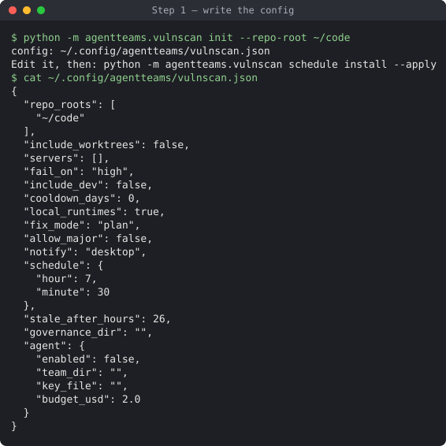

*Demo account. `init` never overwrites an existing config.*

### Step 2: Add your servers (optional)

```bash
python -m agentteams.vulnscan server-kit
```

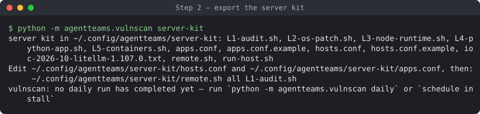

*Demo account, before its first daily run: the last line is the warning every command prints until
a daily run completes.*

Edit `~/.config/agentteams/server-kit/hosts.conf`, one line per host (the examples arrive commented
out, so no example host is ever live):

```text
web1 | deploy@web1.example.com | Ubuntu; nginx + Python app
```

Then list the host names under `"servers"` in `~/.config/agentteams/vulnscan.json`. The name
(`web1`) is what grants and escalations use. It must match `^[A-Za-z0-9][A-Za-z0-9._-]{0,63}$`, and
`all` is reserved (it means every host). Test one audit by hand:
`~/.config/agentteams/server-kit/remote.sh web1 L1-audit.sh`. `remote.sh` streams only
`L1-audit.sh` to `L5-containers.sh`.

To patch a host, a person runs `run-host.sh <host> --apply`; the daily job never does. It stops
before any change when the first audit does not finish cleanly: exit 2 for a config problem, 3 for
an incomplete audit (also when it printed no `RESULT` line), 1 for an unreachable host, and 4 on
compromise indicators. Otherwise it exits with the worst step result: 0 clean, 1 action needed, 3 a
step failed, 4 the post-change audit found compromise indicators.

The daily job and the executor run the scripts packaged with agentteams, reading your `hosts.conf`
and `apps.conf` from this directory. The exported copies are for running by hand; editing them
changes nothing the daily job runs. `ioc-*.txt` files you add here are embedded in each audit as
data, next to the packaged ones.

### Step 3: Run once, then schedule it

```bash
python -m agentteams.vulnscan daily
```

A config value of the wrong type or range stops it with exit 2 and a message naming the key. Only
one daily run works at a time: a second one, started while the first holds
`~/.local/state/agentteams/vulnscan/daily.lock`, exits 3 and writes nothing. The run writes
`~/.local/state/agentteams/vulnscan/<date>/summary.md`:

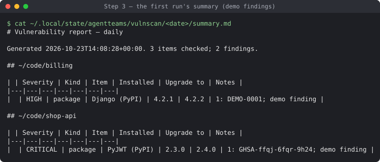

*Demo findings, written through the real report code. One advisory id is real
(GHSA-ffqj-6fqr-9h24, PyJWT); `DEMO-0001` is not.*

`daily` exits with:

| Exit | Meaning |
|---|---|
| 0 | clean |
| 1 | findings at or above the config's `fail_on` |
| 2 | no config, or an unusable one |
| 3 | partially unscanned (a feed or host failed, or the summary or heartbeat could not be written), or another daily run holds the lock |
| 4 | compromise indicators or a malicious package |
| 143 | SIGTERM during the agent phase (Part B) |

Install the daily job. Without `--apply` it only shows what it would do:

```bash
python -m agentteams.vulnscan schedule install            # dry run
python -m agentteams.vulnscan schedule install --apply
```

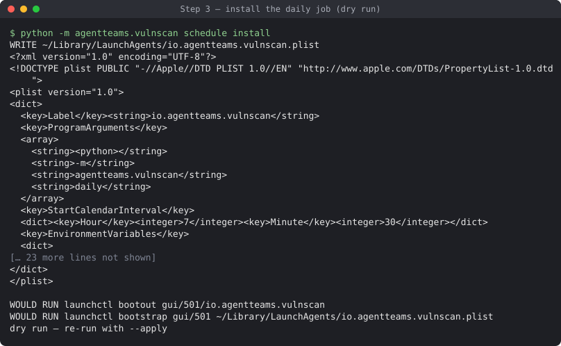

*macOS shown (launchd). Linux gets a systemd user timer, or a crontab line without systemd.
`<python>` stands for the interpreter running vulnscan.*

The job runs `python -P -m agentteams.vulnscan daily`. Its `PATH` is not your shell's: it holds only the
directories where `git`, `gh`, `docker`, `ssh`, `npm`, `node` and `openssl` resolve when you install it,
plus the system directories, and never a directory inside a git repository under your home directory (a
project virtualenv's `bin`, where an agent could plant a fake `git` for the unattended job to run).
`install` names any tool it had to leave out. The job file also bakes in `HOME`, the
`XDG_CONFIG_HOME`/`XDG_STATE_HOME` directories and
the vulnscan and server-kit location overrides
([the list](api-reference/vulnscan.md#command-reference)); no other `AGENTTEAMS_*` variable, so an
API key in your shell never lands in the plain-text plist, unit or crontab. Nor does it get your
shell's `SSH_AUTH_SOCK`: a launchd agent uses the login session's ssh-agent; under systemd or cron,
set a stable agent socket with `IdentityAgent` in `~/.ssh/config`.
`python -m agentteams.vulnscan schedule status` confirms it. From now on, every command except
`daily` and `schedule` prints a warning (`daily.stale_warning`) when the last daily run is older than
`stale_after_hours` (26), when its heartbeat is unreadable, or when it exited 3 (*"only partially
scanned"*) or 4 (*"found MALICIOUS packages or compromise indicators"*).

---

## Part B — Agent mode

### Step 4: Generate a goose team with the remediation agent

Pick a directory for your ops team, for example `~/ops-team`, and put a brief there, `brief.json`.
`project_goal` (at least 10 characters) is the only required field; `capabilities` must include
`vulnerability_remediation`:

```json
{
  "project_goal": "Remediate known vulnerabilities in my repositories and servers",
  "capabilities": ["vulnerability_remediation"]
}
```

Unknown fields are refused (`agentteams/schemas/project-description.schema.json`).

The capability gives the *ops team* the remediation agent. It does not decide which projects are scanned.
Each scanned project states that in its own brief's `vulnerability_scanning` block (`level`: `off`,
`scan` or `remediate`), and you enrol it with `python -m agentteams.vulnscan enroll`. See
[Per-project settings](vulnerability-remediation-guide.md#per-project-settings).

Then render a goose team from inside that directory:

```bash
cd ~/ops-team
agentteams --description brief.json --framework goose --project .
```

The capability is opt-in; agentteams never infers it from the brief's prose. The team gets a
`vuln-remediation` sub-recipe, wired into the orchestrator:

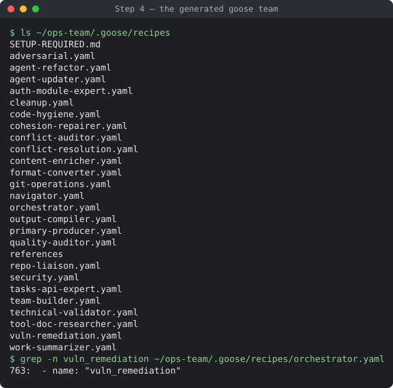

*Demo team from `examples/software-project/brief.json` plus the capability. Offline, the
security-intelligence freshness gate refuses to render (correctly), so the demo stubbed that one gate
as the test suite does. Do not do this: a real run fetches live intelligence.*

A feed that fails prints `Warning: security intelligence: <feed> (<host>): …` and generation goes
on, unless the CISA KEV snapshot is then stale: generation stops with
`[SEC-GATE/INTEL-FRESHNESS] blocked` ([Troubleshooting](#troubleshooting)).

You need two paths later:

- **`team_dir`**: the project root (`~/ops-team`). The container runs
  `.goose/recipes/vuln-remediation.yaml` from it: its prompt is the run's task. (The orchestrator recipe
  opens with a role-check prompt, so a one-shot `goose run` of it answers that and stops.)
- **The governance directory**: the team directory holding `references/security-decisions.log.csv`,
  for a goose team `~/ops-team/.goose/recipes`. The executor checks it for HALTs before every action.

### Step 5: Provision your operator key

Grants and resolutions are signed with your Ed25519 key. Run these in your own interactive
terminal, never in an agent session. Replace `<key-id>` with a short name, such as `op1`. The helper
is a shell script around `openssl`; it runs no agentteams code.

```bash
<agentteams checkout>/references/authorized-verify-keys/provision-operator-signing-key.sh \
    --team-dir ~/ops-team/.goose/recipes <key-id>
```

It writes the private key to `~/.config/agentteams/keys/decision-signing-<key-id>.pem` (mode 600;
every sandbox agentteams emits denies reads of that directory) and the public key into the team.
vulnscan reads public keys from a different place, so install the public key there too. It must be
yours and not group- or world-writable:

```bash
mkdir -p ~/.config/agentteams/verify-keys
openssl pkey -in ~/.config/agentteams/keys/decision-signing-<key-id>.pem -pubout \
    -out ~/.config/agentteams/verify-keys/<key-id>.pub.pem
chmod 644 ~/.config/agentteams/verify-keys/<key-id>.pub.pem
```

The script ends by printing the per-command form for `grant sign` and `agentteams --sign-decision`,
and "Do NOT export AGENTTEAMS_DECISION_ED25519_KEYFILE".

!!! danger "Name the private key per command; never export it"
    Signing reads the key file named by `AGENTTEAMS_DECISION_ED25519_KEYFILE`. Set it on the signing
    command itself, as every signing command on this page does
    (`AGENTTEAMS_DECISION_ED25519_KEYFILE=<path> <command>`), so no later process in that shell (an
    agent session, a goose or claude run) inherits it. Never `export` it, never put it in a shell
    profile, and never copy the private key elsewhere.

### Step 6: Configure agent mode

Add the `agent` block to `~/.config/agentteams/vulnscan.json`, with `enabled` off for now:

```json
"agent": {
  "enabled": false,
  "team_dir": "~/ops-team",
  "key_file": "~/.config/agentteams-secrets/openrouter.env",
  "upstream": "https://openrouter.ai",
  "model": "z-ai/glm-5.3",
  "budget_usd": 2.0,
  "max_minutes": 45
}
```

- `key_file` holds one line, `OPENROUTER_API_KEY=...`. Only the gateway container mounts it. Keep it
  in its own mode-700 directory outside `~/.config/agentteams` and outside the team directory, such as
  `~/.config/agentteams-secrets/openrouter.env` (the path `03-configure.sh` writes, mode 600).
- `upstream` defaults to a local route proxy at `http://host.docker.internal:8791`. Without one, set
  `https://openrouter.ai` as above.
- The gateway relays only this `model` and refuses calls once the reported spend reaches
  `budget_usd`, once `max_tokens_total` tokens (default 10 000 000) have been used, or after 20
  successful replies that carry no usage or cost (`max_unmetered_calls`; error replies such as rate
  limits are counted separately). If your route proxy does not pass usage through, either make it
  do so or set `"allow_unmetered": true` knowingly (see
  [what leaves your machine](api-reference/vulnscan.md#what-leaves-your-machine)).
- `team_dir` is required. It must be an existing directory you own that is not group- or
  world-writable, and not your home directory, an ancestor of it, or anything at, inside or above
  `~/.config/agentteams`, `~/.local/state/agentteams` (vulnscan's state) or another credential
  directory. It must not contain `key_file` (keep the OpenRouter key file outside the team
  directory, as above). A team directory at, inside or above `~/.config/agentteams/keys` (where
  Step 5 put your signing key) is always refused. A signing key kept anywhere else is checked only
  when `AGENTTEAMS_DECISION_ED25519_KEYFILE` is set for the command, and Step 5 sets it only on
  signing commands, so keep the key where Step 5 put it. `team_dir` is mounted into the container,
  so the run, the self-test and `agent-chat` refuse anything else.
- Every `agent.*` value is checked whenever the config loads; a wrong one makes any command that
  reads the config exit 2 with `config <path> is unusable: …` naming the key. The rules are in the
  [configuration reference](api-reference/vulnscan.md#configuration-vulnscanjson).

### Step 7: Build the agent image and prove its isolation

Pick a goose version from the [goose releases page](https://github.com/block/goose/releases).
Recipe validation and goose's flags were verified live with **goose 1.37.0**. The image downloads
`goose-<arch>.tar.bz2` from `releases/download/v<X.Y.Z>/`, where `<arch>` is
`x86_64-unknown-linux-gnu` on an Intel/AMD Docker host and `aarch64-unknown-linux-gnu` on Apple
silicon or another arm64 host. Download the same file yourself and hash it:

```bash
curl -fsSLO https://github.com/block/goose/releases/download/v<X.Y.Z>/goose-aarch64-unknown-linux-gnu.tar.bz2
shasum -a 256 goose-aarch64-unknown-linux-gnu.tar.bz2      # Linux: sha256sum
```

Compare it with the checksum the release page publishes, if it publishes one. Then pin the base
image by digest:

```bash
docker buildx imagetools inspect python:3.12-slim          # the "Digest:" line
# or: docker pull python:3.12-slim && docker inspect --format '{{index .RepoDigests 0}}' python:3.12-slim
```

```bash
python -m agentteams.vulnscan agent-image build --source <agentteams checkout> \
    --goose-version <X.Y.Z> --goose-sha256 <sha256> \
    --python-image python:3.12-slim@sha256:<digest>
python -m agentteams.vulnscan agent-selftest
```

A sha256 mismatch fails the build. The self-test needs `agent.key_file` and `agent.team_dir` from
Step 6: it mounts `team_dir` exactly as a run does, and refuses (exit 1) when it is unset or fails
its checks. It starts the gateway and runs the container with the agent's exact flags, then prints `{"passed": ..., "checks": {...}}`. Every check must be `true`; the
reference [lists what each one proves](api-reference/vulnscan.md#selftestcfg). Agent mode refuses to
run until a passing self-test exists **for the current image and the current container flags**:
after every image rebuild, and after an agentteams upgrade that changes how the containers are
started, re-run `agent-selftest` (the run's refusal says which).

A passing self-test, as printed on a real first setup (macOS, Docker Desktop, goose 1.37.0; also saved
to `<state>/agent-selftest.json`):

```text
$ python -P -m agentteams.vulnscan agent-selftest
{
  "passed": true,
  "checks": {
    "no_credential_paths": true,
    "no_token_env": true,
    "internet_blocked": true,
    "gateway_reachable": true,
    "readonly_rootfs": true,
    "readonly_run_dir": true,
    "readonly_results": true,
    "spool_writable": true,
    "goose_dirs_writable": true,
    "no_capabilities": true,
    "no_new_privs": true,
    "non_root": true
  },
  "image": "sha256:cb71cf61b47e3f66ed71a687045c3c66844afdf0c997ed5243f4982a317b163f",
  "flags_sha256": "2f589ad2606b1e8a3a8639eca809317b17caab9c84a8d4290253fba8c273a647",
  "at": "2026-10-23T16:09:39.102160+00:00",
  "stderr": ""
}
```

The `image` and `flags_sha256` values are yours to compare against later runs: a different image or
different container flags need a new self-test.

A refused precondition prints `{"passed": false, "checks": {"<what>": false}, "error": "<why>"}`
instead, exits 1 and records nothing. Without Docker, or without the image, `<what>` is
`docker_reachable`. `agent-image build` checks Docker before it runs `pip wheel`.

### Step 8: Sign a narrow first grant

The first grant lets the agents stage fixes in **one** repository for **one** day, and do nothing
else. They cannot push or open pull requests yet.

```bash
AGENTTEAMS_DECISION_ED25519_KEYFILE=~/.config/agentteams/keys/decision-signing-<key-id>.pem \
python -P -m agentteams.vulnscan grant sign --key-id <key-id> --days 1 --max-uses 5 \
    --op stage-fix --repo-root ~/code/shop-api \
    --governance-dir ~/ops-team/.goose/recipes
```

`-P` (Python 3.11+) keeps the current directory off the import path, so a file in whatever directory
you sign from cannot stand in for the installed `agentteams`. Without it the install-location check
prints a warning (criterion e) but still signs. Use it for every signing and resolving command.

Sign from a directory that does not contain your `agentteams` install: an install inside the current
directory is refused. A `pipx` install lives under `~/.local/pipx`, so **do not sign from your home
directory**; an empty directory works (`cd "$(mktemp -d)"`), as does any project-free folder outside
`~/.local`.

What you see, in order:

1. any warnings from the integrity and install-location checks. Signing **refuses** to run from an
   `agentteams` an agent could edit: the package or a venv's `sys.prefix` inside a git work tree,
   the current directory or an agent-writable root. The base interpreter (`sys.executable`, and
   `sys.prefix` outside a venv) is refused in a work tree only when git does not ignore it there, so
   a `pipx` install on Homebrew's Python signs (see
   [Troubleshooting](#troubleshooting) for the refusal);
2. the banner *"About to sign a STANDING vulnerability-remediation grant…"* and every field the
   signature binds;
3. the `review sha256` line, then the prompt `Sign this payload? [y/N]`.

Answer `y`. The grant is verified against your public key and installed:

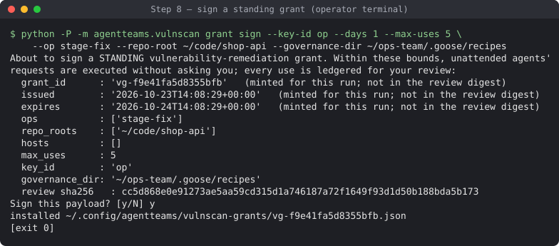

*Demo account and demo key, signed from a clean `pipx`-style install outside every git work tree, in a
terminal. The `grant_id`, `issued` and `expires` lines are minted per run and are not part of the review
digest.*

`grant list` then shows it:

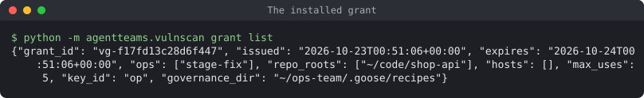

*Demo account (the grant signed above).*

!!! tip "Signing without a terminal"
    Without a terminal, signing prints everything above and stops at `no terminal to confirm on`.
    Check what it printed, then run the same command again with
    `--confirm-review-sha256 <the printed digest>`. The digest covers what you chose (operations,
    roots, hosts, uses, lifetime, key, governance directory), not the grant id and times each run
    mints, so any change to your choices is refused. A digest confirms those choices whenever it is
    used again; it is not a one-time token. Paste only a digest you read off a run you started:
    anyone who hands you a ready-made command is asking you to skip the review.

### Step 9: Run once, supervised

```bash
python -m agentteams.vulnscan agent-run
```

`agent-run` works on the latest scan. While it runs, the executor serves the agents' requests every
15 seconds: escalations first, then the agent's report, then granted operations. It exits 0 when the
run completed, 3 when it did not run, failed or timed out, and 143 on SIGTERM.

At the end it prints the run's status, also written to `<run>/agent/status.json`. A real first
supervised run (GLM 5.3 through OpenRouter, a private test repository with two vulnerable pins):

```text
{
  "started": "2026-10-23T16:21:33.637079+00:00",
  "model": "z-ai/glm-5.3",
  "run_id": "2026-10-23-beca2f",
  "exit": 0,
  "timed_out": false,
  "spend": {
    "budget_usd": 2.0, "max_tokens": 10000000, "spent_usd": 0.057209, "calls": 43,
    "refused": 0, "unmetered": 0, "max_unmetered_calls": 20, "upstream_errors": 0,
    "allow_unmetered": false, "prompt_tokens": 339252, "completion_tokens": 2700,
    "updated": "2026-10-23T16:22:20.578648+00:00"
  },
  "run_state": "completed",
  "state": "completed",
  "finished": "2026-10-23T16:22:28.832302+00:00"
}
```

About a minute and six cents: `unmetered: 0` shows the route reports usage on every reply, so the budget
cap is exact.

`run_state` is `completed`, `agent-error`, `timed-out` or `not-run`. A refused run, a launcher
failure or a SIGTERM has `reason` in place of `exit`, `timed_out` and `spend` (a held run lock also
adds `"status_written": false`, and nothing is written); `stale_requests`, `spend_problem`, `report_problem` and
`cleanup_error` appear only when they apply. A run whose agent exits 0 without a single model call
(no gateway spend recorded) is `agent-error`, not `completed`, and its `reason` quotes goose's error line
from `<run>/agent/transcript.log`. The sample above predates two later fields: `report` (the
`request_id` and `submitted` time of the report this run submitted, or `null`) and, when an earlier
run on the same date was set aside, `archived_previous` (its records move to `<run>/agent/runs/<run id>/`
and its report to `<run>/agent-report/<run id>.report.md`). A run that exits 0 without submitting a
report of its own is also `agent-error`, with `reason` quoting goose's last error line.

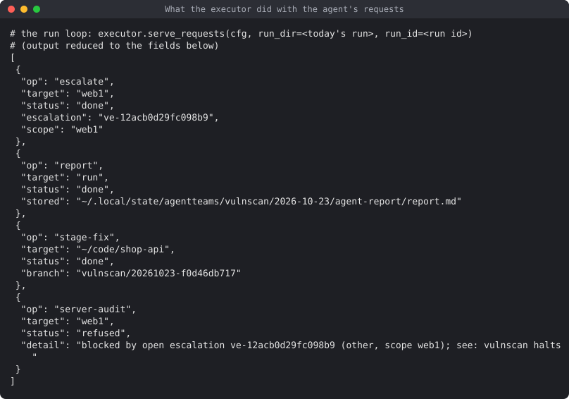

*Demo: the agent's requests went through the real MCP server class and were served by the real
executor with the run's directory, as `agent-run` does. The escalation on `web1` blocks the
`server-audit` request (the grant does not cover `server-audit` either; the escalation check runs
first). `stage-fix` staged a local branch; nothing was pushed.*

Then read the review. It is built from the ledger, not from the agent's account of itself:

```bash
python -m agentteams.vulnscan review
```

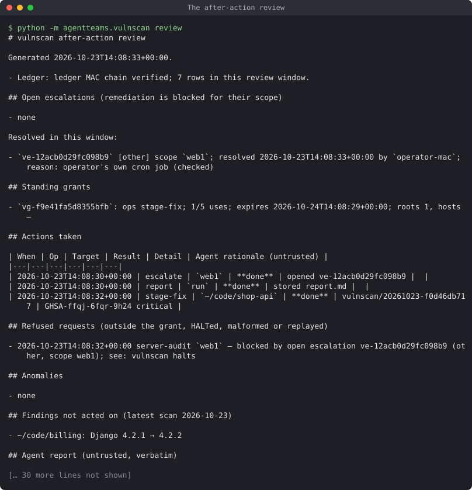

*Demo account; the output is cut where marked (the agent's stored report follows).*

The real first supervised run, actions section (home directory shown as `~`). That run used
`scripts/vulnscan-operator/05-first-run.sh`, which grants `stage-fix` plus `open-pr` on a throwaway
sandbox repository, so it differs from Step 8's stage-fix-only grant and its review shows an `open-pr`:

```text
## Standing grants

- `vg-bea77869f82518a5`: ops open-pr, stage-fix; 2/5 uses; expires 2026-10-24T15:53:54+00:00; roots 1, hosts —

## Actions taken

| When | Op | Target | Result | Detail | Agent rationale (untrusted) |
|---|---|---|---|---|---|
| 2026-10-23T16:21:53+00:00 | stage-fix | `~/vulnscan-sandbox-root/vulnscan-sandbox` | **done** | vulnscan/20261023-88a4e171fe | CRITICAL runtime finding: PyJWT 2.3.0 → 2.15.0 (26 advisories, …); plus MODERATE requests 2.32.4 → 2.33.0 … |
| 2026-10-23T16:22:13+00:00 | open-pr | `~/vulnscan-sandbox-root/vulnscan-sandbox` | **done** | https://github.com/<owner>/vulnscan-sandbox/pull/1 | Stage-fix … completed (branch vulnscan/20261023-88a4e171fe, changed requirements.txt). … |
| 2026-10-23T16:22:28+00:00 | report | `run` | **done** | stored report.md |  |
```

The pull request changed only the two pins (`PyJWT==2.15.0`, `requests==2.33.0`). The same run also
showed a refusal: the agent asked for `server-audit` on a local-runtime finding's target, and the
executor refused it because no grant covers it. (Local findings now use the target `this-machine`, and
the task limits server operations to configured server names.)

Read it end to end, and look at the staged change before going on: `stage-fix` commits it in an
executor-owned worktree under `~/.local/state/agentteams/vulnscan/worktrees/`, on the branch the
review names (`git -C <that worktree> show`). Then record that you reviewed it:

```bash
python -m agentteams.vulnscan review --ack --note "first supervised run"
```

### Step 10: Widen the grant, then switch it on

Only after a run you are satisfied with, sign the grant you want for unattended runs. Name each
repository root explicitly rather than a parent of everything you have cloned: a root covers every
repository inside it, and you do not want the agents proposing changes to third-party clones, your
ops team or the agentteams checkout. The executor also refuses `stage-fix` and `open-pr` in the
repository of the agentteams installation it runs from, of `agent.team_dir`, of every grant's
governance directory and of the publish ops repository (worktrees included), whatever the grant says.

```bash
AGENTTEAMS_DECISION_ED25519_KEYFILE=~/.config/agentteams/keys/decision-signing-<key-id>.pem \
python -P -m agentteams.vulnscan grant sign --key-id <key-id> --days 14 --max-uses 50 \
    --op stage-fix --op open-pr --repo-root ~/code/shop-api --repo-root ~/code/billing \
    --governance-dir ~/ops-team/.goose/recipes
```

Add `--op server-audit --op server-dryrun --host web1` to let the agents audit and dry-run servers.
`merge` and `server-apply` are refused: no grant can cover them. At most two grants may be valid at
once (a third makes all of them invalid), so revoke the first one. `grant list` prints each valid
grant as JSON; take the first grant's `grant_id` from it:

```bash
python -m agentteams.vulnscan grant list
python -m agentteams.vulnscan grant revoke --grant-id <grant_id of the first grant>
```

`open-pr` pushes a new `vulnscan/*` branch to the repository's `origin` and opens the pull request
on that same repository. Before pushing anything, it checks that `origin` is one of
`https://HOST/OWNER/REPO`, `git@HOST:OWNER/REPO` or `ssh://git@HOST[:PORT]/OWNER/REPO` (an optional
`.git` suffix is allowed; an `ssh://` URL with another user is not); otherwise the request fails. gh must be signed in
to that host. Once the pull request exists, the executor removes its worktree and keeps the branch;
a retry after a failed `gh pr create` reuses the pushed branch instead of pushing again.

Finally set `"enabled": true` in the `agent` block. From then on, every daily run ends with an agent
run.

### Using Claude Code instead of goose

The remediation agent can run on Claude Code (`agent.framework: "claude"`). Everything else in this
walkthrough stays the same: the grants, the executor, the review and the isolation. Differences:

- **Models.** Claude Code runs Anthropic models only: `agent.model` must be a Claude model id, such as
  `anthropic/claude-sonnet-4.5` through OpenRouter (the default upstream, `agent.upstream_messages`
  `https://openrouter.ai/api/v1`, using your OpenRouter `key_file`) or `claude-sonnet-4-5` with
  `"upstream_messages": "https://api.anthropic.com/v1"` and an Anthropic key in
  `~/.config/agentteams-secrets/anthropic.env` (`ANTHROPIC_API_KEY=...`, mode 600). Anthropic's API
  reports no cost, so that route also needs a price table, `agent.prices` (a JSON file of USD per million
  tokens per model; see the [API reference](api-reference/vulnscan.md)).
- **The team.** Generate a Claude team with the remediation capability (`--framework claude`); its agent
  definition is `.claude/agents/vuln-remediation.md`, passed to Claude Code by its path. Sign grants with
  `--governance-dir <team>/.claude/agents`.
- **The image and the self-test.** `FRAMEWORK=claude bash scripts/vulnscan-agent-image.sh` installs the
  pinned Claude Code release (its digest checked against Anthropic's GPG-signed release manifest; `gpg`
  must be installed to verify any other version). The self-test then also runs Claude Code once against a
  local stub and fails unless the only tools it reports are the vulnscan ones and planted `.mcp.json`,
  hook, `CLAUDE.md` and `AGENTS.md` files have no effect.
- **The acceptance run.** `FRAMEWORK=claude MODEL=<claude model> bash
  scripts/vulnscan-operator/09-accept-framework.sh` does all of this in order, signs a one-day stage-fix
  grant, runs one supervised agent run and prints the outcome, the spend and any request the gateway
  refused (report those: each names what to add to the gateway's allowlist). Keep `agent.enabled` false
  until that run is clean.

---

## Part C — Operating the loop

### When something blocks

A notification says *"Escalation ve-… (other) opened"* or *"A @security HALT blocked
remediation"*. Ask what blocks:

```bash
python -m agentteams.vulnscan halts
```

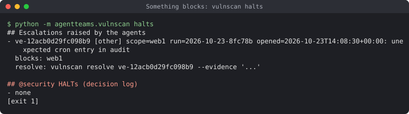

*Demo account. `[exit 1]`: something blocks.*

- **An escalation of kind `other`:** check the evidence, then resolve it. You confirm at the
  terminal:

  ```bash
  python -P -m agentteams.vulnscan resolve ve-<id> --evidence "operator's own cron job (checked)"
  ```

  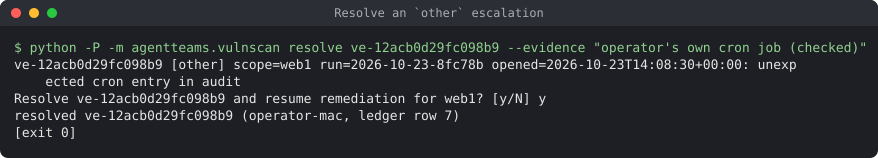

  *Demo account. `operator-mac` is how the resolution is recorded: a MAC'd ledger row (a serious kind
  needs your signature instead).*

- **A serious escalation** (`malicious`, `ioc`, `injection`, `integrity`, `escalation-flood`): treat
  it as an incident first. To resume, resolve it with your signature:

  ```bash
  AGENTTEAMS_DECISION_ED25519_KEYFILE=~/.config/agentteams/keys/decision-signing-<key-id>.pem \
  python -P -m agentteams.vulnscan resolve ve-<id> --evidence "<what you checked>" --key-id <key-id>
  ```

- **A `@security` HALT:** `halts` prints a `HALT-RETRACTED` spec. Fill in the evidence, save it, and
  sign it with
  `AGENTTEAMS_DECISION_ED25519_KEYFILE=<key file> agentteams --sign-decision <spec.json> --output <governance dir>`.
  Nothing else clears a HALT.

### Talking to the agents

Leave a note for the next run. It is folded into the agents' task; it cannot widen the grant, and
the agent's instructions say a note never suppresses an escalation.

```bash
python -m agentteams.vulnscan say "skip billing this week: it is being migrated" --days 7
python -m agentteams.vulnscan say --list
```

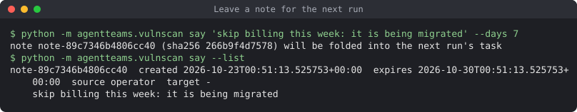

*Demo account.*

- **From a pull request:** comment `/vulnscan note <text>` on one of the agents' pull requests, then
  import it with `say --from-gh <comment URL>`. Only your own comments are accepted, and you see the
  full text before it is stored. `review --gh-replies` lists the replies on the agents' pull
  requests as data.
- **Ask a past run why:** `agent-chat [--run <date>]` resumes that run's goose session in the
  container. The spool is read-only there, so it can explain but not act. It has its own spend, time
  and token caps (`agent.debrief_*` in the
  [configuration reference](api-reference/vulnscan.md#configuration-vulnscanjson)). The config
  load refuses a bad cap first; if one still reaches `agent-chat`, it exits 2 with
  `debrief refused: agent.debrief_budget_usd must be …` (or the key at fault) before starting
  anything.

### Reports, and publishing them (optional)

The agent submits a report at the end of each run; the executor stores it, fenced, under
`<run>/agent-report/report.md` and shows it in `review`. Without a publish grant it stays local:

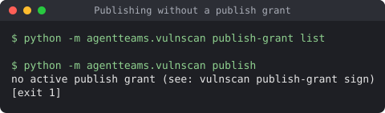

*Demo account. `[exit 1]`: no publish grant.*

To have the executor push each run's report, review and summary to a **private** repository you
own, create that repository, clone it, and sign a publish grant. `<owner>` must be your own GitHub
login: the repository's owner and the signed-in `gh` user must both have the pinned owner id, so an
organisation's repository is refused. Run the two lookups first and check that each prints a value:

```bash
gh repo view <owner>/ops-reports --json id --jq .id     # a node id, R_…
gh api users/<owner> --jq .id                           # a number
```

Then sign:

```bash
AGENTTEAMS_DECISION_ED25519_KEYFILE=~/.config/agentteams/keys/decision-signing-<key-id>.pem \
python -P -m agentteams.vulnscan publish-grant sign --ops-repo ~/ops-reports \
    --node-id "$(gh repo view <owner>/ops-reports --json id --jq .id)" \
    --owner-id "$(gh api users/<owner> --jq .id)" \
    --governance-dir ~/ops-team/.goose/recipes --key-id <key-id> --days 30
```

A failed lookup expands to an empty value, and signing refuses it before anything else (exit 2):
`refused: --owner-id is empty — run the gh lookup first; it must be your numeric GitHub user id`
(likewise `--node-id`). An `--owner-id` that is not a number is refused too.

Before it signs, and again before every push, vulnscan checks that the repository is private, owned
by you, has GitHub Actions and Pages off, is the exact remote you pinned, and has no other
collaborator, no pending invitation and no deploy key. Any failure to check refuses. GitHub Apps and
tokens with access to the repository are not visible to these checks. Files go to `reports/<date>/<run id>/` on the `reports` branch, never
force-pushed. Publishing runs at the end of each daily run while agent mode is on; `publish
[--run <date>]` publishes by hand. Agent text in the files is fenced, and home paths, this machine's
hostname and private IP addresses are scrubbed.

*A real publish needs GitHub, so its capture comes from the operator's supervised run. `publish`
prints the result (`publish.publish`) and exits 0 only on `done`:*

```text
{"status": "done", "commit": "<sha>", "path": "reports/<date>/<run id>", "fenced_injection_hits": 0}
{"status": "failed", "detail": "<why>", "local_commit": "<sha>"}
{"status": "refused", "detail": "<why>"}
```

### Your routine

| When | Do |
|---|---|
| A notification arrives | `halts` if it names an escalation or a HALT, else `review` |
| A few times a week | `review`, then `review --ack` |
| Before a grant expires | revoke the old one, then sign a new one (at most two are valid) |
| A new disclosure wave | nothing extra: the next daily run reads live advisories |

---

## Part D — Acceptance checks on your machine

The test suite covers the code with fakes for Docker, ssh, GitHub and the model. These checks cover
what only your environment can show. Run each once before you turn agent mode on, and again after
you change machines, Docker, the model route or your GitHub token.

| # | Check | Command | Passes when |
|---|---|---|---|
| 1 | Feeds reachable | `python -m agentteams.vulnscan runtimes; echo $?` | exit 0 or 1; exit 3 names the unreachable feed (OSV.dev, nodejs.org, www.php.net, endoflife.date) |
| 2 | Scheduled environment | macOS: `launchctl kickstart gui/$(id -u)/io.agentteams.vulnscan`; Linux: `systemctl --user start agentteams-vulnscan.service` | a new `<date>/summary.md` and a fresh `heartbeat.json` appear, and the run reached your servers and GitHub (the job does not inherit your shell's environment) |
| 3 | One server audit | `~/.config/agentteams/server-kit/remote.sh <host> L1-audit.sh` | a log under `~/.local/state/agentteams/server-kit/logs/`, no password prompt |
| 4 | Docker isolation | `agent-image build …` then `agent-selftest` ([Step 7](#step-7-build-the-agent-image-and-prove-its-isolation)) | exit 0 and every check `true` |
| 5 | Model route and metering | a supervised `agent-run` ([Step 9](#step-9-run-once-supervised)), then read `<run>/gateway/spend.json` | `calls` > 0, `prompt_tokens` > 0 and `unmetered` = 0. Unmetered replies mean the route does not pass usage through; the run stops at `max_unmetered_calls` |
| 6 | GitHub token for pull requests | `gh auth status`; then, under a narrow grant covering a test repository, `python -m agentteams.vulnscan act stage-fix <repo path>` followed by `python -m agentteams.vulnscan act open-pr <repo path>`. `<repo path>` is the absolute path of a repository inside a granted repo root, e.g. `~/code/shop-api` (the shell expands `~`) | a pull request opens and the executor's worktree under `~/.local/state/agentteams/vulnscan/worktrees/` is gone. The staged state goes with it, so a second `act open-pr` fails with `no staged fix`. If `gh pr create` failed after the push, retrying `act open-pr` finds or creates the pull request without pushing again; it refuses (`not claiming` / `not overwriting`) when the branch holds other content |
| 7 | GitHub token for publishing | `gh api repos/<owner>/ops-reports/collaborators --jq '.[].login'` and `gh api repos/<owner>/ops-reports/keys --jq length` | the collaborators list holds only you (the owner is allowed), and `keys` prints `0`. An error means the token cannot read collaborators or deploy keys (it needs Administration read), and every publish will refuse |
| 8 | Server kit syntax (contributors) | `shellcheck agentteams/data/server_kit/*.sh` in the source checkout | no errors |
| 9 | Clean-up after a stop | start `agent-run`, stop it with `kill -TERM <pid>`, then `docker ps -a --filter name=vulnscan` | no vulnscan container is left (a terminated run removes the gateway and the agent before it exits) |

Live checks of the scan itself, the generated goose recipes and goose's flags run from the source
checkout with `FEATURE_AUDIT_LIVE=1 python -m pytest tests/test_vulnscan_live.py`; they use a
throwaway home and never read your config.

---

## Troubleshooting

Search the message for the quoted text.

| You see | Cause | Fix |
|---|---|---|
| `not authorized: ... no valid grant covers it` | no grant names that operation and target, or its uses are spent | `grant list`; sign a grant that covers it |
| `blocked by open escalation ve-...` | an open escalation covers the target | `halts`, then `resolve` |
| `HALT in force: ...` | a `@security` HALT on `vulnscan-remediation` | sign a `HALT-RETRACTED` row (see `halts`) |
| `decision log ... is missing or a symlink` | the grant's governance directory has no decision log | sign a grant naming the team directory that has `references/security-decisions.log.csv` |
| `set agent.key_file in vulnscan.json first` | `agent-selftest` before Step 6 | do Step 6, then re-run |
| `set agent.team_dir in vulnscan.json first` | `agent-selftest` without `team_dir` (it no longer falls back to a directory inside the state directory) | set `team_dir` (Step 6), then re-run |
| `config ... is unusable: ...` (exit 2) | `vulnscan.json` is not valid JSON or a JSON object, or the named key has a wrong type or range. Every `agent.*` key is checked at load, not only `agent.enabled` | fix the key the message names ([rules](api-reference/vulnscan.md#configuration-vulnscanjson)) |
| agent run state `not-run`, reason mentions the self-test | no passing self-test for this image | `agent-selftest` |
| `refusing to sign from an install an agent may be able to edit` | `agentteams`, its venv or its interpreter is inside the current directory, a git work tree or an agent-writable root; the next lines name which | sign from a verified install outside agent write roots (`pipx install`). `--allow-checkout-signing` overrides this, but then you sign with code an agent may have edited |
| `the agentteams package (...) is inside a git work tree` / `sys.prefix (...) is inside a git work tree` / `sys.executable (...) is inside a git work tree` | an editable checkout, a venv kept in a repository, a `pip install` into Homebrew's Python without a venv, or an interpreter git tracks or does not ignore. An interpreter in a git-ignored path (Homebrew's `Cellar/`) is not refused; only the work tree's own ignore rules count (inherited `GIT_*` variables and a global `core.excludesFile` do not) | `pipx install` from a verified release (works on Homebrew's Python) |
| `the agentteams package (...) is inside the current directory` / `sys.prefix (...) is inside the current directory` | you signed from a directory that contains the install, typically your home directory with a `pipx` install under `~/.local/pipx` | sign from an empty directory: `cd "$(mktemp -d)"`, then re-run the signing command |
| `<project>/.claude/settings.json cannot be read or parsed, so the agent-writable roots it grants are unknown` | a project's settings file exists but is unreadable, not JSON, or its `sandbox`/`filesystem` is not an object or `allowWrite` not a list (a missing file or no sandbox block is fine) | fix the file, then sign again |
| `no terminal to confirm on` (suggesting `--confirm-review-sha256`) | signing ran without a terminal | check the printed fields, then re-run with `--confirm-review-sha256 <digest>` (see Step 8) |
| `--confirm-review-sha256 does not match` | your choices differ from the run that printed the digest | re-run without it and read the new digest |
| `agent.team_dir ... ` (run state `not-run`, or a refused self-test) | `team_dir` is unset, relative, not a directory, your home or an ancestor, at, inside or above `~/.config/agentteams` (which holds `keys/`), the vulnscan state directory or a credential directory, or contains `key_file` (or the signing key, when `AGENTTEAMS_DECISION_ED25519_KEYFILE` is set) | set it to the team's project directory and keep key files outside it (Step 6) |
| `agent.team_dir ... is not owned by you` / `is group- or world-writable` | the team directory's owner or mode | use a directory you own; `chmod go-w` it |
| `the container flags or the self-test changed` / `predates container-flag binding` | agentteams changed how containers start since the last self-test | `agent-selftest` |
| `run token cap reached` / `replies carried no usable usage/cost` | the gateway's backstops (Step 6) | raise `max_tokens_total`, or fix usage reporting upstream |
| `is the same repository as` (a refused `stage-fix` / `open-pr`) | the target is the agentteams checkout, the team, a governance directory or the ops repository | leave it out of the grant |
| `no operator verify key ...` | the public key is not in `~/.config/agentteams/verify-keys/` | repeat the `openssl pkey` command in Step 5 |
| `verify key ... is not owned by you or is group/world-writable` | the public key's mode (your umask) | `chmod 644` it |
| `verify key ... could not be opened safely (symlink?)` / `verify key ... is not a regular file` | the public key file is a symlink or not a file | put the PEM file itself there (Step 5) |
| `is a symlink — refused` / `is not a directory — refused` (`refusing all grants`, `refusing all publish grants`, `verify-keys directory ...`) | a grants directory or `~/.config/agentteams/verify-keys` is a symlink or not a directory | replace it with a real directory holding the files |
| `is not owned by you or is group/world-writable — refused` (a directory, as above) | the directory's owner or mode | `chmod 700` a grants directory, `chmod go-w` the verify-keys directory; it must be yours |
| `origin is not a GitHub repository URL` | `open-pr` on a repository whose `origin` URL is not `HOST/OWNER/REPO` | give it a GitHub `origin`, or leave it out of `open-pr` grants |
| `gh pr create failed` | gh is not signed in to `origin`'s host, or `origin` is not on GitHub | `gh auth status`; leave non-GitHub repositories out of `open-pr` grants |
| `holds the run lock` | an agent run or `agent-chat` is in progress | wait for it to finish |
| `another daily run holds ... daily.lock` (exit 3) | a daily run is already in progress | wait for it to finish |
| `origin/HEAD is not set` (`fix_mode: apply-worktree`) | the repository has no default branch recorded | `git remote set-head origin --auto` in that repository |
| `the repository's git config defines a filter driver, which git would run — fix it by hand` (`fix --apply`; `stage-fix`: `<repo>: …`, ledgered `failed`, before any fetch) | the repository's own git config defines a `filter.*` driver | apply that fix by hand |
| `git refuses to read this repository (<git stderr>) — fix it by hand` (`fix --apply`; `stage-fix`: `<repo>: …`, ledgered `refused`, before any fetch) | git will not open the repository, e.g. `safe.directory` rejects it because another user owns it | fix what git reports (e.g. the directory's owner), or apply that fix by hand |
| `hash-pinned (--hash) requirements are never edited` / `hash-held` | the requirements file pins `--hash` values | regenerate it yourself (`pip-compile --generate-hashes`) |
| `invalid host name` (exit 2) | a `hosts.conf` name does not match `[A-Za-z0-9][A-Za-z0-9._-]{0,63}`, or is `all` | rename the host there and in `servers` |
| `L1 audit of <host> did not complete (exit N) — stopping before any change` (`run-host.sh`, exit 3) | the audit printed no `RESULT` line (no passwordless sudo, the shell died) | read the audit log; fix access, then re-run |
| `option ... needs a value` (exit 2 from the `L3`/`L4`/`L5` script; through `run-host.sh`, `STEP FAILED (exit 2)` and exit 3) | an `L3`/`L4`/`L5` option, often from an `apps.conf` line, has no value | complete the option |
| `apps.conf flags may not contain --apply, --restart-services or --reboot (found …)` (`run-host.sh`, exit 3) | an `apps.conf` entry's flags column carries one of those; the entry is skipped as a failed step | remove it from the flags column; pass it to `run-host.sh` instead |
| `refusing ...: binary content (NUL bytes)` (exit 2) | an `ioc-*.txt` file is not plain text | remove the file or save it as text |
| `docker is not reachable or the agent image ... is not built — start Docker (or run agent-image build) first` (`agent-selftest: …`, exit 1, `docker_reachable: false`; a refused run's reason ends `…first, then re-run agent-selftest`; a docker client that hangs gives up after 60 s and counts as not reachable) | the Docker daemon is down, or the image for this agentteams version is missing | start Docker, or run `agent-image build`; then `agent-selftest` |
| `agent image build failed: docker is not reachable — start Docker (or install it) first` | `agent-image build` found no Docker daemon; nothing was built, `pip wheel` did not run | start or install Docker, then build |
| a run ends early, or `agent-error`'s `reason` quotes a goose error | goose stopped inside the container | read goose's own logs for that run in `<run>/agent/goose-data/state/goose/logs` |
| `agent-selftest failed: ...` (exit 1) | a `docker` command failed part-way through the self-test | read the error; check `docker info`, then re-run |
| `refused: --node-id is empty` / `refused: --owner-id is empty` / `... is required` / `--owner-id must be your numeric GitHub user id` (`publish-grant sign`, exit 2) | a `gh` lookup printed nothing (the `$(…)` expanded to empty), a flag was left out, or the owner id is not a number | run the two lookups by hand and check each prints a value ([Reports](#reports-and-publishing-them-optional)) |
| `Warning: security intelligence: <feed> (<host>): truncated or malformed HTTP response (...)` / `response is not valid JSON, possibly truncated (...)` / `response is not a JSON object (got list)` (Step 4) | a feed's response was cut off or is not a JSON object | usually transient: re-run. If the CISA KEV snapshot is stale, generation stops with `[SEC-GATE/INTEL-FRESHNESS] blocked`; re-run once www.cisa.gov answers |
| `not owned by you or group/world-writable — refused` (a grant file) | the grant file's mode or owner | `chmod 600` the file |
| `not a regular file (symlink or special) — refused` (a grant file) | the grant file is a symlink | replace the symlink with the file itself |
| `cannot tell which repositories are protected` | a `*.json` file in a grants directory cannot be read | make the file readable, or remove it |
| `ledger integrity failure` / `incomplete final row (interrupted write?)` | the ledger was edited, truncated or deleted; or a crash or full disk cut its last append | the recovery the message names; see below |

**A ledger integrity failure** refuses every action until it is resolved. Treat it as an incident:
something changed a file only you and the executor should write. An incomplete final row
usually means a crash or a full disk instead: the message says the rows before it are intact. It
needs the same recovery, because nothing can be appended after it. Do not delete anything in
`~/.config/agentteams/keys/`; your signing key lives there. To start over, revoke every grant first,
then move `~/.local/state/agentteams/vulnscan/ledger.jsonl` and
`~/.config/agentteams/keys/vulnscan-ledger.hwm` aside (keep them for investigation). A new ledger
forgets every open escalation and every grant's use count, which is why the grants must go first.
Then sign new, narrow grants.
