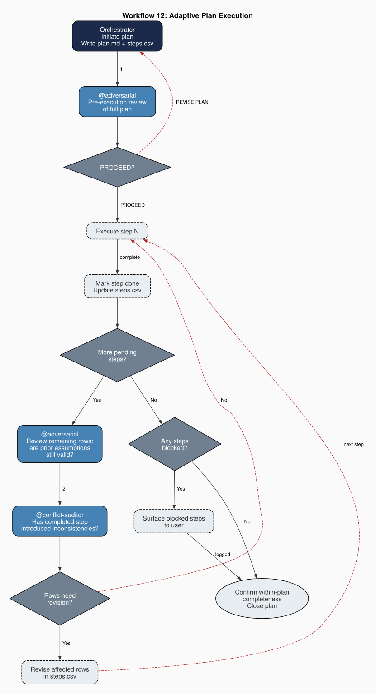

# Anatomy of a team

A generated team divides work across four tiers of agents. This page is for anyone deciding whether
that structure fits their project: it explains why each tier exists and which failure it guards
against. For the mechanics, such as which agents are selected and how files are
rendered, see [How it works](../how-it-works.md).

## Four tiers, four kinds of work

The tiers separate four kinds of work that a single agent would otherwise mix together: routing,
auditing, producing and scoping.

| Tier | Does | Does not | Failure it prevents |
|---|---|---|---|
| **Orchestrator** | Routes every request, enforces the constitution, and opens and closes every multi-agent session | Produce deliverables | One agent deciding what to do, doing it and judging the result |
| **Governance agents** | Own a cross-cutting concern (navigation, security, code hygiene, consistency, cleanup, documentation, git) and audit the team's work against it | Produce deliverables | Unchecked changes, unsafe actions, and slow drift between documents and code |
| **Domain agents** | Do the production work on deliverables: drafting them, checking their quality and accuracy, converting and compiling them | Decide scope | Production work that wanders beyond what was asked |
| **Workstream experts** | Hold deep knowledge of one component, and write the component brief for work on it | Produce deliverables | Shallow, general-purpose work on parts of the project that need specialist knowledge |

[How it works](../how-it-works.md#4-tier-agent-taxonomy) summarizes the separation this way: the
orchestrator routes without producing, domain agents produce without scoping, workstream experts scope
without producing, and governance agents audit without producing.

## Seeing it work: adaptive plan execution

The tiers matter most when work spans several steps. The constitution of every generated team requires
multi-step work to follow the pattern below.

In words:

1. The orchestrator writes the plan and a step-by-step list before any step runs.
2. The adversarial agent reviews the whole plan. A plan resting on a bad assumption is revised, not
   executed.
3. After each step, two checks run before the next step starts:
   - the adversarial agent re-checks the remaining steps for assumptions the finished step has made
     stale;
   - the conflict auditor checks whether the finished step introduced inconsistencies.
4. Steps that the checks flag are revised. Steps that cannot proceed go to you.
5. The plan closes only after a completeness check.

No single agent both makes a change and approves it, and you see blocked work instead of having an
agent guess past it.

## Where the team lives

A team is a set of ordinary files in your repository, read by your AI tool. Each tool has its own
folder, for example `.claude/agents/` for Claude Code or `.github/agents/` for VS Code Copilot. Because
they are files, you can review, version and edit them like any other code. [How it
works](../how-it-works.md#framework-adapters) lists every supported tool and where its files go.

## Go deeper

- [How it works](../how-it-works.md): the generation pipeline and the full agent roster
- [Working with your generated team](../working-with-your-generated-team-guide.md)
- [Constitutional design](constitutional-design.md)
- The blog series in [Further reading](further-reading.md), with posts on the orchestrator, the
  functional (governance) agents, the domain agents and the workstream experts
